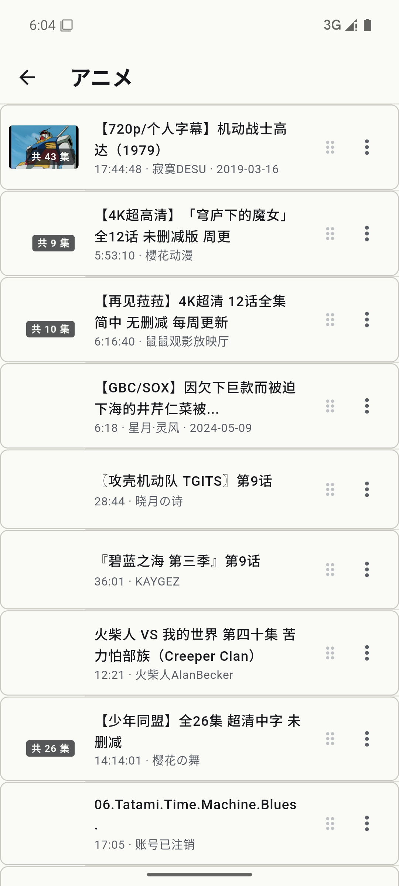
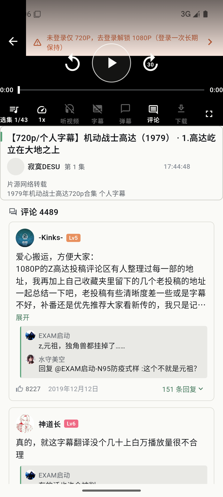
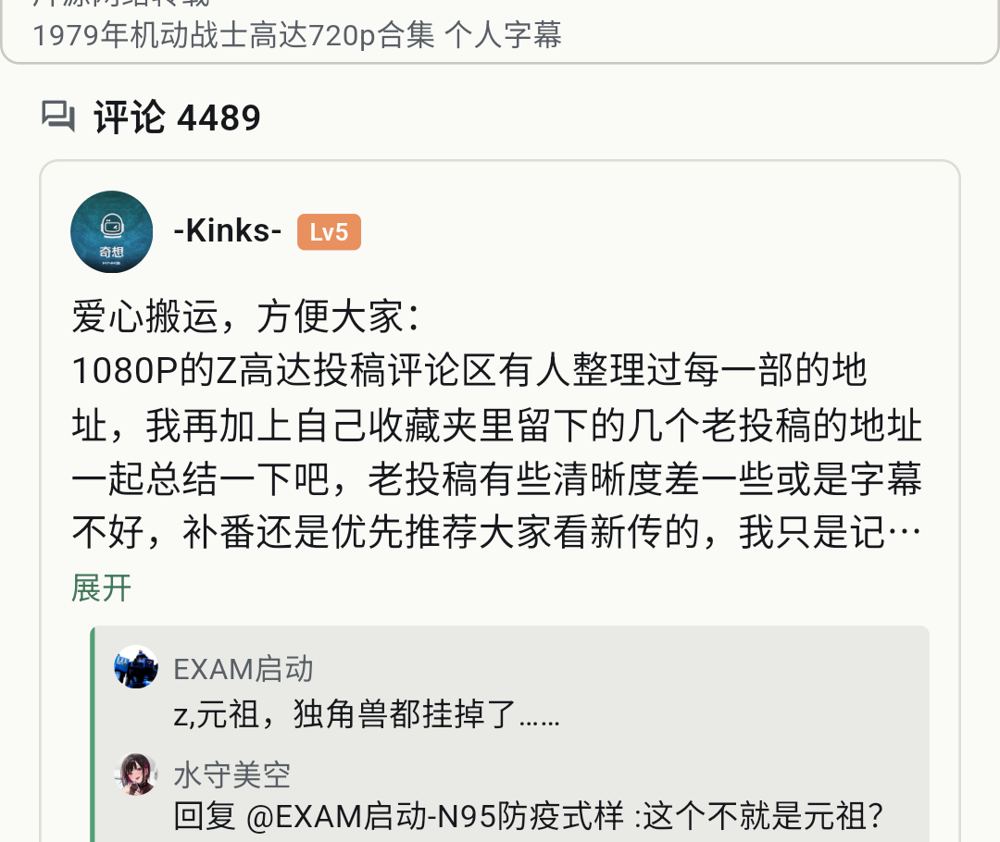
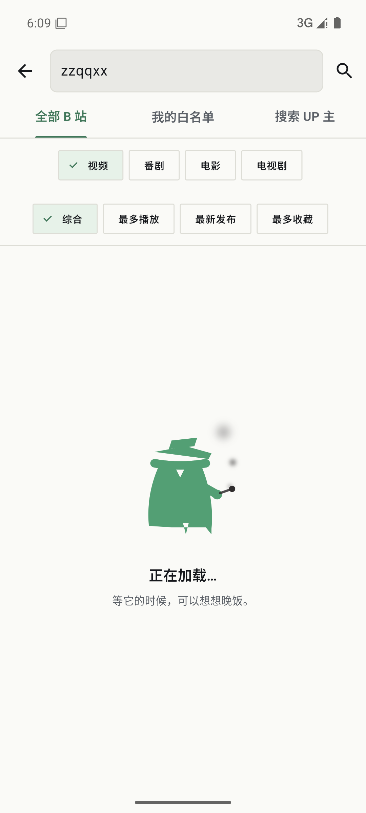
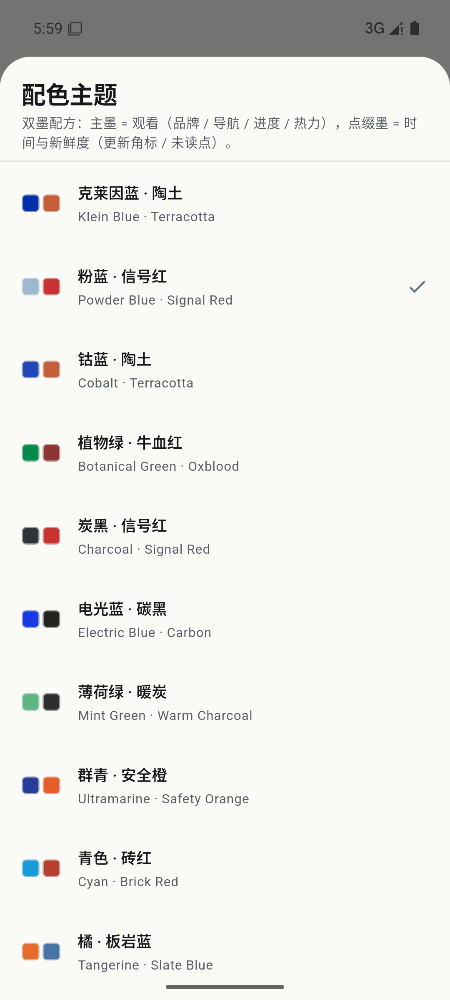
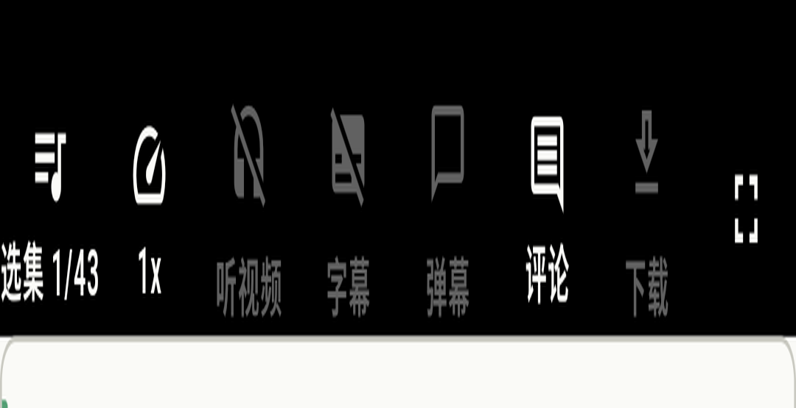
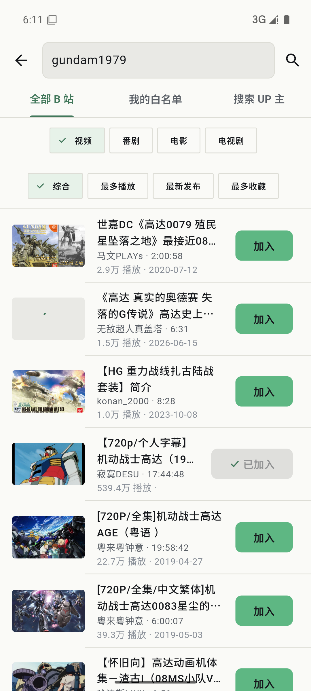

# amoTV

**amoTV —— 防短视频成瘾的内容白名单系统**：在电脑上自由浏览 B 站并标记你想看的视频，手机 App 只能点播这些白名单视频——刷手机时只有你事先选好的内容，没有信息流、没有推荐；唯一加内容的途径是在 App 内**手动粘贴 B 站分享链接**导入（有意识导入已知想看的视频）。

```
[PC]  浏览器自由浏览 → 一键"加入白名单"（油猴脚本直连 Gist）
[App] 手机上只能播放白名单里的视频 → 刷不到新内容 → 防沉迷的硬约束
```

---

## 目录

- [开发理念](#开发理念)
- [功能特性](#功能特性)
- [界面截图](#界面截图)
- [技术栈](#技术栈)
- [架构与数据流](#架构与数据流)
- [核心实现方法](#核心实现方法)
- [目录结构](#目录结构)
- [使用方法](#使用方法)
- [构建与测试](#构建与测试)
- [数据模型 v3](#数据模型-v3)
- [UP 主白名单与信箱（v2.13.0+）](#up-主白名单与信箱v2130)
- [安全与合规声明](#安全与合规声明)
- [已知限制](#已知限制)
- [许可证](#许可证)

---

## 开发理念

本项目围绕三条原则设计，先决策、后娱乐，把"防沉迷"做成系统约束而不是意志力博弈：

- **先决策，后娱乐（核心哲学）**：内容消费前必须先经过一个"决策环节"——在电脑上挑选、标记想看的内容；手机端只负责执行娱乐（播放白名单），不承担决策。你在电脑上有意识地选择，在手机上无意识地观看。
- **手机端仅白名单 + 主动导入**：App 只能看白名单，加内容的途径只有两条——**手动粘贴 B 站分享链接**或**主动搜索后逐条确认加入白名单**（搜索结果不会自动进列表，必须手动确认才入库）。没有推荐流、热榜、信息流入口，也不依赖 B 站收藏体系，**"随手刷到一个新视频"在物理上不可能发生**——这是防沉迷的硬约束，不是靠自觉。
- **数据独立于 B 站**：白名单是自持的 JSON（存在 GitHub Gist），不依赖 B 站的收藏体系。B 站接口怎么变，最多影响"播放"这一环，**伤不到"白名单数据"**——换播放方案即可，数据永远在你自己手里。

---

## 功能特性

### PC 端（Python CLI + 油猴脚本）

| 模块 | 说明 |
|------|------|
| `whitelist.py` CLI | 白名单管理：`add`（加视频）/ `remove`（删）/ `list`（列表）/ `serve`（本地 HTTP 服务，App 拉取）/ `push`（同步 Gist）/ `collection`（合集管理） |
| 油猴脚本 | B 站视频页双击按钮 → 配置 `github_token` + `gist_id`；单击 → 一键加入白名单。**直连 GitHub Gist，零本地服务** |
| `start-whitelist.bat` | 一键启动本地 `serve`（可选，供 App 备用拉取通道） |

### 同步（GitHub Gist）

- 白名单以 `whitelist.json`（数据模型 **v3**）存于 GitHub Gist，支持多 P（分 P 选集）与合集
- PC / App 双端都通过 Gist 读写，实时 API 优先（规避 CDN 缓存）

### App 端（Flutter Android）

- 白名单列表展示（封面 / 标题 / UP 主 / 时长；**v2.16.16+ 显示发布时间**：新导入视频副信息行 `时长 · UP主 · 2023-05-01`，旧数据无发布时间则不显示）
- **充电专属视频标注（v2.55.0+）**：视频卡片封面左上角加「充电专属」角标（与「已缓存」竖排成一列，不压右下角「共 N 集」、不遮时长行），播放页标题下加「充电专属视频 · 需给 UP 主充电后观看完整内容」。标记来源是 `view` 接口的 `data.is_upower_exclusive`（**实测**布尔字段，普通视频为 false），**不靠标题里有没有「充电」猜**。**局限**：列表类接口（合集 / 搜索 / UP 主页视频列表）都不给这个字段（实测搜索结果里的 `is_charge_video` 对已知充电视频仍是 0），所以**封面角标只对白名单里「已知」的视频显示**——新导入的会带，老白名单里的不会自己冒出来；**播放页标签每次进页按接口实时校正**（UP 取消充电专属也会跟着撤掉）。首页合集卡**有意不加**（它画的是合集封面，标「充电专属」会误称整个合集）。另实测：未充电时 `playurl` **不报错**，给的是**试看片段**（无 dash 流，只有 mp4 单流），所以没有错误码可映射，改为信息块常驻说明——在「莫名停住」之前就能看到原因
- **合集管理**：Tab 分类、新建 / 重命名 / 删除 / 移动视频到合集；每个合集可设**封面与简介**（v2.38.0+；**v2.50.0+ 封面支持「从相册选图」用本机图片**）——编辑入口：首页一级合集卡**左滑「封面」**、合集内页 AppBar「编辑封面与简介」（改的是**当前这个合集**，任意层级都能就地改），也可从「个人」页 → 管理合集面板进入。封面优先级 **本机相册图 > Gist `cover` URL > 合集内首个视频封面 > 占位图标**；本机图**只存本机**（图片在 App 私有目录、路径映射在本机偏好里），**不进 Gist、不跨设备**（Gist 的 `cover` URL 仍照旧可同步），改名 / 移动 / 删除合集时会跟着搬迁或清理，不留错位封面与孤儿文件；相册选图走系统文件选择器，**不加任何权限、不引新依赖**。封面 URL 写成协议相对的 `//host/xx.jpg` 会自动补成 `https:`
- **多 P 选集**：播放页切换分 P
- **集数记忆（v2.57.0+）**：多 P 视频**记住你上次看到第几 P**（本地按 bvid 存一个下标，`last_episode:map` 单 key JSON，上限 200 条按最久未看裁剪）。以前只有从「历史记录」点进去才回到那集，从合集 / UP 主页 / 搜索 / 信箱 / 收藏夹点进去永远从第 1 集开始。优先级 **入口明确指定的集 > 上次看的集 > 第 1 集**：历史条目与评论里的 `?p=N` 链接仍是显式指定，**显式的 `0` 也算明确第 1 集**、不会被记忆里的第 5 集盖掉；链接只带 `?t=`（说的是第 1 集的第 N 秒）时按第 1 集落位。记忆的集号**越界（视频改版、分 P 变少）自动夹到最后一集**，不崩。写入时机三处：流真正就绪（`_onPrepared`）、手动切集、退出播放页/换源前。番剧整季的选集列表给「上次看到」那行加一个小标，**只标记、不自动滚动**（行高随标题行数变化，硬滚容易停错位置）
- **非全屏观看布局（v2.17.0+；v2.17.17 横屏置顶模式）**：非全屏不再整屏黑底——视频画面**顶部置顶**（按宽高比铺满可用宽并封顶：竖屏超高视频如 9:16 封顶屏高 60%；横屏 16:9 视频封顶屏高 55%），下方依次是**视频信息行**（标题 / UP 主入口 / 时长）与**内嵌评论区**（同一屏可滚动）；弹幕 / 字幕 / 手势 / 控制层都绑定在视频画面区内（不覆盖下方内容）。设备竖放为**竖屏置顶+评论**布局；**v2.17.17+ 设备横放（横屏置顶模式）**——布局自适应为横屏「顶部置顶 + 下方评论」（信息行横屏自动紧凑：标题 1 行 / 简介少行，剩余高度留给评论区哪怕矮也可滚），**退出全屏不再强制转回竖屏**：全屏（横屏）点退出/返回后设备当前横放即**停在横屏置顶+评论**，旋转设备可在横/竖两态间自由切换，离开播放页恢复系统方向。**全屏（横屏）仍为整屏播放布局**（无评论区）。控制层「评论」按钮：**非全屏（竖屏/横屏置顶）点击 → 滚动定位到评论区**；**全屏点击 → 打开独立评论页**（原行为，返回后仍全屏续播）。**全屏中点返回/系统返回 = 先退出全屏**（回当前方向置顶+评论），再点返回才离开播放页
- **播放页 UP 主入口（v2.17.2+，播放页大重构阶段 C 收尾）**：竖屏信息行 UP 主区仿 B 站升级——普通视频运行时调 `fetchVideoMeta(bvid)` 取 view 接口 `owner` 补齐 **mid / 头像 / 真名**（按 bvid 会话内缓存、随换源复位重拉），显示**圆形头像 + UP 主名**（头像带 UA/Referer 防盗链头，加载失败 → 首字圆形占位），点击**进 UP 主主页**（`UpownerPage`，mid 进入、头像名预填；进页前自动暂停当前视频、返回 `didPopNext` 续播——防从 UP 主页再点开视频时双音轨）；真名拉取成功后替换 up_name 展示。**番剧 / 电影（带 epId）取舍为弱化**：pgc 内容挂靠官方/搬运号，无 UP 主页点播价值且易误导——**不拉 owner、显示剧集标签**（导入的 up_name，空则「剧集」）、**不可点**；旧版导入的无 epId 番剧数据无法区分，走普通视频路径（行为按 view owner 实测，属已知边界）。拉取失败/进行中：名字照常显示，点击提示「无法获取 UP 主信息」不进页
- **视频简介（v2.17.3+）**：白名单条目可带 `desc`（简介，普通视频导入与油猴 v2.3.3+ 写入；多 P 视频简介视频级、不分 P；含换行原样）——竖屏信息行标题/UP 主行下方**小字灰色显示简介**（`ExpandableText`：超 3 行折叠省略 +「展开」点击看全文、「收起」复原，展开态封顶高度内可滚动防撑爆布局）；数据优先条目自带 desc，**旧数据（无 desc）搭 view 拉取运行时补拉**（与 UP 主元数据同一次请求、零额外开销）；desc 为空（无简介 / 番剧逐集导入季级取舍 / 拉取失败）→ **简介区不显示不占位**
- **UP 主主页合集 / 列表区（v2.17.4+）**：UP 主详情页顶部新增「合集」区（仿 B 站 UP 主页，**仅在 UP 主有合集/列表时显示**）——横向 chips：「全部视频」+ 各合集（season，名带「合集·」前缀）与列表（series，名带「 · 列表」后缀）；点合集 → 下方视频列表切换为该合集视频（`fetchSeasonArchives` / `fetchSeriesArchives` 独立分页滚动加载，此时搜索框与排序隐藏——搜索/排序只作用于「全部视频」；点「全部视频」切回）。合集视频行复用现有交互：点击播放（合集接口视频**无 cid** → 播放时 view 接口补齐，实机验证取流日志带真实 cid）、长按加入白名单。**取舍**：series `creator='auto'`（直播回放等系统自动生成）**过滤不显示**（与 B 站网页端 UP 主页一致，非 UP 主动整理内容不进该区）；合集/系列三个接口**匿名可用、无需 WBI**
- **UP 主页加载容错（v2.17.8 修复）**：修复两处高频问题——① **粉丝数读不到**：UP 主详情接口 `acc/info` 实测**不含 `fans` 字段**（成功响应也没有），粉丝数改走 `x/relation/stat?vmid=`（`data.follower`，B 站网页 UP 主页同源，新增 `fetchUpownerFollower` 匿名可用）→ 粉丝数与资料**独立拉取**：资料接口被风控时粉丝数照常显示，全部失败才显示「—」；② **进 UP 主页常「网络请求失败」**：`acc/info` / `arc/search` 等 space wbi 接口对匿名/高频请求有**间歇风控**（-352/-412，实测等待后重试即恢复）——页面进入时 3 个请求并发且零重试，被拦即整页错误。现新增**自动重试**（退避 1s→2s 最多 3 次，资料/粉丝/视频列表各自独立；重试不并发、页面销毁即放弃），仍失败才落既有整页错误 + 「重试」；**信息成功结果按 mid 会话级缓存**，重进同一位 UP 主页直接显示不再请求（少请求少触发风控）；资料接口被拦时名字/头像回退 initial 或视频列表作者名兜底、不阻塞。另修正 `arc/search` 总数解析（实测在 `data.page.count`，旧读 `list.count` 恒 null 导致末尾多打一次空页）
- **DASH 1080P 播放**：video + audio 双流合并播放；流 URL 过期自动续播。**v2.17.14+ 播放错误自愈**：流 URL 过期（403/404/410/429/5xx）与**瞬时网络错误**（2001/2002 网络 IO 兜底桶、断连、解析失败）在原生统一归为可自动恢复 → Dart 自动重取流续播（保留位置），续播失败退避 1s→2s→4s 重试有限次，仍失败才提示（手动重试兜底）——网络抖动弹「播放失败」打断观看成为极少情况；数据源超时同步调大（connect 8s→15s、read 8s→20s）减少弱网误判。**v2.17.15+ 主动预取平滑换源（根治必现中断）**：实测 B 站流 URL `deadline` 有效期固定 **2h**（普通视频播放中不会到期，间歇 2001 主因是网络——v2.17.14 已兜底）；但超长视频 / 长时间暂停续播会用尽 URL 剩余有效期 → **播放中每 10s 解析 deadline，判定「剩余有效期不足以播完剩余内容 + 60s」→ 到期前主动重取 playurl 换新 URL**（URL 尚有效时 setDataSource+seek 平滑切换，几乎无感；与被动续播互斥防双换源；deadline 缺失回退被动）
- **倍速九档**：0.5x – 3x，长按 2x 快捷
- **听视频模式（v2.55.0 起是真·音频-only）**：只加载**音频轨**——原生侧只建一条音频源，**不构造视频源、不建 `MergingMediaSource`**，**视频轨一个字节都不请求**（1080P 视频轨 1.5~4 Mbps → 音频 128~192 kbps）；**有本地缓存音频时优先播本地文件、零流量**（占位层会写明）；**拿不到独立音频轨时不会偷偷播视频**（那正是要消灭的老行为）：明确提示「这个视频拿不到独立音频轨，听视频不可用」并保持视频播放，听视频中途音频轨失效也会提示 + 回落视频 + 保留播放位置。进出听视频都保持播放位置，切回画面优先复用已取到的地址（不重取 playurl）。关屏可听
- **播放时保持亮屏（v2.60.0+）**：有画面在播时手机**不会自己息屏**（与 B 站官方 App 一致）。用的是窗口标志 **`FLAG_KEEP_SCREEN_ON`**——**不需要任何权限、不申请 WakeLock**，标志跟着窗口可见性走，离开播放页就自动失效，不存在"忘了释放"的泄漏。**只有三种条件同时成立才亮**：① 设置里「播放时保持亮屏」开着（默认开）；② 真的有画面在播（`playing` 且不在缓冲）；③ App 在前台（`resumed`）。**以下一律立刻恢复正常息屏**：暂停 / 缓冲 / 播完 / 播放失败 / **进「听视频」模式**（那个模式就是要你熄屏听，亮着屏纯属耗电，是刻意这么做的）/ 离开播放页 / 退到后台 / 设置里把开关关掉。设置位置在「个人」页 →「网络与播放」分区（免流兼容下面），**默认开启**，关掉后立刻生效（播放中也会马上放行息屏）。同一状态不重复下发（通道层去重，500ms 的状态复核不会反复戳系统）。**点播页和直播页都接了**。真机局限见「已知限制」
- **字幕**：播放页「字幕」入口可选主 / 副字幕轨道，**大号 + 小号双语同步显示**（时间轴同步）；支持 B 站 CC 人工字幕与**登录后的 AI 字幕**（多语言，如英 / 中 / 日）；无字幕视频有提示
- **字幕翻译**：副字幕可选「翻译（中文）」——主字幕内容经 **OpenAI 兼容翻译服务**（可配置 base_url / api_key / model，key 仅存本机）批量翻译成中文显示，带翻译进度提示；**本地缓存**（同一视频同一轨道只翻译一次，切集 / 重进命中缓存直接显示）
- **实时转写（Sherpa 流式）**：播放页「🎙 实时转写（流式）」边播边出字幕——**主字幕 = 实时原文句子、副字幕 = 逐句译文**（OpenAI 兼容翻译服务，未配置则无副字幕），**8 语模型**（中/英/日/俄/泰/越/印尼/阿拉伯）本地推理；**模型 247MB 首次下载**（GitHub releases，国内可能较慢，支持**手动放置模型文件**到指定目录跳过下载），转写中面板实时预览 + 可随时停止，完成即作为字幕显示
- **弹幕（v2.16.3+）**：播放页底部「弹幕」开关，开启即拉取当前视频弹幕并随时间叠加显示——**滚动 / 顶部 / 底部三种模式**按 B 站原始时间轴发射，保留字号档与颜色；XML 弹幕接口匿名可得，接口失败 / 视频无弹幕**静默不阻塞播放**（轻提示一次）；弹幕层仅在开关开启且有数据时构建（关闭零开销），暂停冻结、seek / 切集自动重置游标，切集自动换集弹幕、开关状态保留。**v2.16.6+ 弹幕增强**：长按「弹幕」按钮打开设置面板——**真碰撞分层**（滚动按水平轨道逐轨追尾判定，同轨不叠字；顶部 / 底部纵向行堆叠）、**屏蔽关键词**（substring 匹配）+ **屏蔽类型**（滚动 / 顶部 / 底部开关）、**透明度滑杆**（20%~100% 含阴影整体变淡）；移动按帧间 dt 浮点推进（掉帧钳制平滑）、单帧发射预算保帧率稳定，设置本地持久化。**v2.16.11+ 滚动连续性修复**：推进的每一帧都落屏（CustomPaint 挂每帧 repaint 信号 + RepaintBoundary 隔离——修复前只在发射帧重绘，弹幕按 500ms 轮询节奏"跳"动导致卡顿/不连续）；切后台/暂停恢复重置时间基准不跳变；发射改按真实时间信用预算（40 条/s），掉帧/seek 积压不扎堆补发。**v2.16.13+ 显示区域 + 设置记忆**：设置面板新增**「显示区域」滑杆**（10%~100% 步进 10，说明"弹幕只在屏幕上方 N% 高度内滚动"）——弹幕带等比压缩到屏幕上方该比例内（100% 与旧版布局一致；调 30% 弹幕不再飘到画面中下部妨碍观看，轨道数按区域高度自动缩减），区域 / 屏蔽 / 透明度任一改动即时清屏重排；**弹幕开关状态持久化**（点按即存，进播放页自动恢复上次开关——上次开着本次自动开，区域 / 透明度 / 屏蔽词全部记忆，重启 App 保持）。**v2.16.19+ 顶/底与滚动纵坐标可重叠（小区域不再过度挤压）**：显示区域内**不再为顶/底弹幕单独分区避让**——滚动轨道**占满整条可用带**（轨道数换算不再扣除顶部 3 行 / 底部 2 行：100% 屏 28 条、区域 30% 由 3 条回到 8 条）、顶部弹幕从带顶向下堆叠 / 底部弹幕从带底向上堆叠，与滚动轨道**纵坐标可重叠**；各自**内部**仍互不叠（滚动按轨道追尾碰撞、顶行/底行分别堆叠，行满丢弃），所有弹幕 y 不越显示区域。**v2.16.24+ 修复开关重开补发开头弹幕**：发射游标在弹幕层挂载 / 开关重开 / 切集 / seek / 设置变更时统一按**当前播放位置对齐**（跳过严格已播过的弹幕，不补发开头；seek 后退按新位置重算、越过时间窗重放）——此前「播到中段关弹幕再开」会从视频开头把整段弹幕重新涌出、时间轴错乱。**关于「相同弹幕乘几（×N）」的说明**：这不是本 App 的功能也不是 bug——B 站弹幕接口对重复文案**逐条下发**（实测同文案最多上千条且集中在同秒/邻近秒），App 按 B 站原始时间轴**逐条原样渲染**（全库无合并/计数显示代码、接口文本也不含 × 字符），同文案会成串飞过 → 观感像 ×N；官方播放器那种「同屏相似弹幕合并成一条 + ×N 角标」是它自己的客户端展示，App 暂未实现（需要去重折叠 + 角标绘制的新功能，未做）
- **播放页功能条压扁 + 精简（v2.62.0+）**：竖屏底栏从「两行各 40dp」压成**进度条行 40 + 按钮行 32 = 72dp**（v2.39.0 是 80），按钮单元的图标与文字改成**单行横排**（竖向只由图标列 22dp 撑，标签不再另起一行）。可见项从 **9 格精简到 5 格**：倍速 / 清晰度 / 弹幕 / 评论 / 更多；选集 / 听视频 / 字幕 / 下载缓存 / 分享收进「更多」底部弹层，**动作与原底栏逐条一致**（调用同一批方法，不是另写一套，状态文案也照旧「听视频中」「字幕中」「已缓存」）。全屏键从按钮行挪到**进度条行右端**（与 B 站同位：时间 / 轨道 / 全屏压在同一行，零新增高度）；全屏态横向空间充足，按钮行放 **8 格**（听视频 / 字幕 / 下载回来），高度仍是 32，不做两套视觉。单格宽度 45.7dp → **82.2dp**，标签走 `FittedBox` 等比缩放，**不省略号、不溢出**
- **快捷分享（v2.62.0+）**：播放页「更多」里的「分享」调起**系统分享面板**（`Intent.ACTION_SEND` + `text/plain` + `createChooser` + `FLAG_ACTIVITY_NEW_TASK`），内容是「视频标题 + 站内链接」两行——多 P 带 `?p=N`（1 起，对方点开落到同一集），播放超过 **10 秒**带 `?t=秒`（片头几秒的定位对谁都没意义，所以不带）；单 P 不带 `?p`、0 秒不带 `?t`。**不需要任何权限**（清单里只在 `<queries>` 加了一条 ACTION_SEND 的可见性声明，供 `queryIntentActivities` 在 API 30+ 判断"有没有 App 能收"，**没有任何 `uses-permission`**），也**不联网**——分享只是把一段文本递给别的 App，所以未登录 / 离线 / 取流失败时照样能用。失败分三态且都有中文可读提示、绝不抛到界面：系统里没有能接收的 App（原生回 `false`）/ 原生异常（`PlatformException`）/ 通道不存在（`MissingPluginException`，非 Android 或旧包）。成功不弹提示（系统面板本身就是反馈）
- **小窗播放（系统画中画，v2.63.0+）**：播放页「更多」里多一项「小窗播放」，点一下画面缩成**系统小窗**继续播——切到别的 App、回桌面都留着。小窗里**只剩视频画面**：顶栏 / 底栏 / 功能条 / 信息块 / 评论区 / 弹幕 / 字幕 / 手势层**全部不在树里**（不是盖一层透明的，是整棵树换成「黑底 + 按视频比例的 Texture」，连 `Scaffold` 都不构建）；小窗只有一两百 dp，那些控件既看不清又挡画面，系统小窗上的触摸本来也不该被播放页吃掉。**退出小窗原样恢复，位置连续、不重新取流**——播放器一刻没停，`setDataSource` 不会重调，所以不存在"退出后从头开始 / 黑一下"。**点系统小窗上的 ✕ 关闭** → 自动暂停、存进度 + 写历史（与退出播放页同一口径，位置取原生 `getPosition`）、关掉亮屏。**不需要任何权限**：清单里只给 `MainActivity` 加了 `android:supportsPictureInPicture="true"`（清单开关，不是权限），**没有任何 `uses-permission`**，也不申请 WakeLock。**设备不支持就不显示入口**：`SDK_INT < 26` 或 ROM 没有 `FEATURE_PICTURE_IN_PICTURE` 时这一项**根本不构建**（点了没反应的按钮不如没有）；**「听视频」（纯音频）时也不显示**——源里没有视频轨，小窗只会是纯黑。**小窗里不保持亮屏**：小窗的存在意义就是用户切去看别的 App，这时拦着系统息屏纯耗电；点回全屏会按原判据重新判定（设置开着 + 确实在播 + 在前台才亮）。小窗里不显示弹幕 / 字幕（同一棵树不在），退出后按你原来的开关恢复、状态位一个都没改；**退出时评论区会重新挂载、重新拉一次首屏评论**——这是"UI 必须真的不在树里"的代价
- **应用内浮动小窗（v2.65.0+）**：播放页「更多」里新增「应用内小窗」，点一下画面缩成**浮在本页上层**的小窗（默认屏宽 40%、贴右、纵向落在操作条下方），下面的信息块与评论区照常能看能滚。**它和上一项的「小窗播放」（系统画中画）是两件事**：系统 PiP 的窗口大小、位置、装饰**全由系统管**——不能拖角缩放，也没法在窗口上加自定义按钮（Android 平台限制），好处是切到别的 App 还留着；应用内小窗没有这些限制，代价是只活在本页。**能拖**：按住窗口拖动，怎么甩都会被**夹回可视区**（左右到页面边、上到操作条下沿、下到底部手势条之上），不许有半个窗口在屏幕外。**能缩**：拖**右下角把手**（40dp 触摸区）改大小，**保持视频宽高比**——画面比例异常（0 / NaN / ∞）回退 16:9，超宽或超窄夹到 0.5~2.33（与系统小窗同一组上下限）；**最小 120dp、最大屏宽 85%**，放大到出界时是**整体推回可视区**而不是缩回去（左上角尽量不动，缩放过程中窗口不跳）。**能锁**：右上角锁图标一键锁定，锁定后**拖动与缩放全部失效**（把手整块不构建，结构上就缩不了），再点解锁恢复；**锁定只拦拖动/缩放，不拦还原**——双击窗口、窗口上的还原图标、操作条「回到大屏」照常可用（锁是防误触，不是把人锁死在小窗里）。**三处还原**：窗口右上角图标、48dp 操作条上的「回到大屏」、**双击窗口**。**还原只改一个 `bool`**：播放器、解码、纹理全都不动，所以**位置连续、不重新取流**（`setDataSource` 不会重调），进度上报与历史写入也照旧。**窗口大小 / 位置 / 锁定状态会记住**：存的是**比例**不是 dp（宽度比页面宽、位置比可移动空间，天然落在 0~1），换机型 / 转屏 / 分屏都能落回合理位置；key 是 `player:float_window`（单 key JSON），**坏值逐字段回退**——一个字段坏了只回退它、其余照用，整份 JSON 坏了才回默认，窗口不消失、不崩。**小窗态继续亮屏**（与系统 PiP 相反）：PiP 里用户已经切去别的 App，拦着息屏纯耗电；应用内小窗里用户还在看这一页，屏幕当然不能黑，所以亮屏判定仍只认 `_inPip`、这一批没动它。小窗里**不渲染字幕 / 弹幕 / 热度曲线**（巴掌大的窗口里任何信息层都是噪点），但**开关状态位一个都不改**，还原后按你原来的开关恢复。「听视频」与「仅缓存音频」态**不给这个入口**（源里没有视频轨，窗口只会是黑屏）；纹理还没准备好就点入口会提示「画面还没准备好，稍后再试」
- **诊断日志与一键导出（v2.67.0+）**：报障不用再连 USB 抓 logcat——「个人」页设置区底部（「检查更新」下方）多了「诊断日志」小节，点「导出日志」就把最近的运行日志打成 **zip 走系统分享发出去**。落盘对象是整个 App 的 `debugPrint`：`main()` 里接管（**556 处调用点一个字都不用改**，旧实现照常回调，logcat / IDE 控制台行为不变）。文件在 `<应用支持目录>/logs/diag-YYYYMMDD.log`：**单文件 512KB 轮转、保留 4 份、目录总量封顶 5MB**（超了按修改时间删最旧，正在写的那个永不删），攒批 **64 条或 2 秒**写一次盘，单行超 **8000 字符**截断，同一 `(tag, 前 80 字)` **1 秒**内只留一条并补一行「重复 N 次」。崩溃**四个入口全接**：`runZonedGuarded`（Dart 异步未处理异常）/ `FlutterError.onError` / `PlatformDispatcher.onError` / `ErrorWidget.builder`（把默认红屏换成一句「这块内容加载出错（已记录到诊断日志）」），错误路径走 `recordError` → **`flushSync()` 同步落盘**；**原生崩溃也接**——`NativeCrashRecorder` 挂 JVM 默认 handler，播放器 / WebView / Keystore 抛的异常写 `native-crash-<毫秒>.txt`（碎片最多 10 个），下次启动合入 diag 日志后删掉，然后把异常照常交给原 handler（留证据，不吞崩溃）。**落盘前就脱敏**（不是导出时才脱）：SESSDATA / bili_jct / csrf / access_key / access_token / refresh_token / bili_ticket / deadline / sign / X-Amz-Signature / Authorization / GitHub PAT / 手机号 / 搜索词全换成 `<已脱敏>`，URL 只留 host + path。导出包 = 全部日志 + `meta.txt`（版本 / 机型 / Android 版本 / 时间范围 / 条数 / 脱敏说明），存 `<support>/logs/export/`、**只留最近 3 个包**。**不需要任何权限**：清单只加两条 `<queries>`（SEND + `*/*`，供 API 30+ 的 `queryIntentActivities` 判断有没有接收方），**没有任何 `uses-permission`**
- **推荐页（v2.68.0+）**：底部导航第 2 个页签从「UP 主」换成「推荐」——拿本机播放历史算兴趣，再去 B 站按标签捞**没看过**的视频。**兴趣怎么算**：每条历史视频一个权重 `pow(0.5, 距今天数/14) × 完播率`，完播率 = `(进度/总时长).clamp(0.2, 1.0)`（点开就退也算一次选择，但绝不该和看完平权）；同一 bvid 多分 P 只算一次；视频权重**全额**记到它挂的每个标签上（标签不是互斥归属，均分只会把强兴趣压平），除以最大值归一化后取前 5 个标签。**标签哪来**：`x/tag/archive/tags?bvid=`（实测匿名可用、**不需要 WBI 签名**），一次取最近看的 20 个 bvid。这 20 次请求是整条链路最贵的部分，而标签几乎不变，所以**按 bvid 落本机缓存**（`recommend:tag_cache` 单 key JSON，800 条上限按最久未写入淘汰）——命中就一个请求都不发。**热力球怎么编码权重**：半径 `18 + 20 × 权重`，**填充色深浅也编码权重**（160dp 高的画布放不下更大的球，光靠尺寸撑不开差距）；位置是**确定性**黄金角螺旋布局（同一组权重永远落在同一处），扫描 900 个按面积均匀铺开的候选点，先试原尺寸、放不下依次缩到 85% / 70%，缩到底仍放不下才允许重叠。**推荐池怎么拼**：5 个标签 × 2 路搜索（`order=click` 最多播放 / `order=pubdate` 最新发布）→ 按 bvid 合并去重 → **剔掉整份历史里出现过的 bvid**（不按白名单过滤，白名单外的视频一样能看）→ 打分排序取前 60。**限流**：请求**串行** + 相邻 1500ms 间隔；撞 -412/-352 就把间隔翻成 3000ms 并**跳过该标签剩余的那一路**，不跟风控硬顶。结果内存缓存 **30 分钟**（`force` 才重算）+ 在途请求单飞；**空历史 / 有历史但一个标签都没拿到都不缓存**——这两种状态往往几分钟内就变，缓存住等于让用户干等满 TTL。**交叉区什么时候出现**：同一条视频**同时命中两个标签**才成组，且该组要凑够 **≥2 条**、最多 3 组；长尾标签下常常凑不齐，那一块就整块不出现。**局限（如实）**：搜索接口**没有时间窗参数**，所以「最新」只是排序靠前、不是近 N 天，「最火」是播放量不是涨势——「上涨最快」只是近似说法；推荐结果**不落盘**（带播放量和发布时间快照，存下来过期反而误导），冷启动要重算，但最贵的标签那一段有缓存，重算主要花在 ≤10 次搜索上。详见「核心实现方法 §18」
- **阅读（v2.69.0+）**：底部导航第 3 个页签从「日程」换成「阅读」——一个**书源式阅读器**：导入书源（剪贴板里的单个 JSON / 数组 / 混着说明文字 / legado 原生格式都认）→ 多源并发搜索 → 详情与目录 → 正文阅读 → 书架与进度（读到第几章、页内位置，重新进来自动定位）。**规则支持** CSS / XPath（`css:` / `@css:` / `xpath:` / `@XPath:`，裸 `//…` 也按 XPath）/ `class.`·`id.`·`tag.` 简写 / `regex:` 正则 / 取值后缀 `@text`·`@html`·`@href`·`@src`·`@attr:NAME` / `##正则##替换` 清洗 / `A || B` 回退链。**内置示例书源**「标准电子书（示例）」（`standardebooks.org`，公共领域、服务端渲染无 JS），书源管理页右上角溢出菜单「添加示例书源」一键写入，添加后就能把搜索 → 详情 → 目录 → 正文整条链路走通。**明确不支持**：用了 `@js` 规则的书源（`<js>` / `@js:` / 非占位符的 `{{…}}`）——搜索页会跳过，并在结果页顶部单列一行「已跳过 N 个需要 JS 规则的书源：…」，因为 legado 的同步 `java.ajax` 在 WebView 里没法实现（跨域还会被 CORS 拦）；**GBK 书源会乱码**——本版没有 GBK 解码，声明 `gbk` 的源按 UTF-8 强解（不崩），正文里给一句「疑似乱码」的提示。目录 / 正文分页只认 `{{page}}` 模板，不支持点「下一页」。日程整体搬到「个人 → 设置 → 打开日程」，数据与功能一条没少（`ScheduleStore` 与存储格式零改动）。详见「核心实现方法 §19」
- **播放页「热度高潮线」（v2.61.0+，v2.62.0 改算法）**：进度条上方一条细曲线，峰值 = 弹幕最密集的段落（就是 B 站「高能进度条」那回事）。官方 `pbp/data` 接口实测已下线（404），所以**用弹幕自己算**：**5 秒一桶**（v2.61.0 是 10 秒）→ **高斯平滑**（σ = 1.2 桶、半径 3 桶，边缘按实际存在的桶归一化，不拉向 0）→ **P5 / P98 对比度拉伸**（分母下限 `0.20 × 峰值`，防止把噪声放大）→ **伽马 1.6** → clamp 到 0..1。绘制从逐点 `lineTo` 折线改成 **Catmull-Rom 转三次贝塞尔**（曲线严格穿过每个采样点、连接点切线连续，所以没有折角；控制点 y 夹在带内，陡变不过冲）。效果：同一份数据下「峰值 − 中位数」从 0.54 提到 **1.00**，相邻抖动降到原来的 **30%**。整层 `IgnorePointer`，拖动 / 点按 / 缩略图预览的命中一点不受影响，进度条行高仍是 40；曲线只在**弹幕到手 / 时长就绪 / 切集 / 开关切换**时重算，播放中 tick 不进来。没有弹幕 / 数据未就绪 / 不足 2 个桶**一律不画**，**密度完全均匀的视频现在也不画**（以前会画一条满高的平线——没有高潮就不假装有）；切分 P 按新 cid 重算。开关在弹幕设置面板（长按底栏「弹幕」），**默认开**
- **评论区（v2.16.15+；v2.17.0+ 竖屏内嵌 + 组件抽取）**：**竖屏（非全屏）评论区内嵌在播放页视频下方**（同一屏可滚动；换集 / 换源自动刷新）；点控制层「评论」→ **竖屏滚动定位到评论区 / 全屏（横屏）打开独立评论页**。评论功能（**只读**，视频 / 番剧通用；独立页与内嵌共用同一实现 `widgets/comment_list.dart`）：评论列表按热度排序、**上拉翻页**（回传 cursor.next，到底「没有更多了」）、**置顶评论**顶部展示；每条含头像 / 用户名 / 等级角标 / 正文（`<br />` 转行）/ **图片评论**（按原图宽高比显示，动图带角标）/ 点赞 / 时间；**楼中楼**：内嵌至多 3 条预览，点「N 条回复」展开完整楼中楼（分页加载「加载更多回复」）；主评论接口**匿名可得**（无需 WBI），错误分类：评论区已关闭（12002）/ 风控（-412）/ 限流（-352）/ 网络均有友好提示与重试。**v2.16.19+ 评论图片全屏查看 + 保存**：点缩略图 → 黑底全屏查看页（多图左右滑动 + 页码、双指缩放 1~4x / 双击 1x↔2.5x、顶部关闭）→ 底部「保存到相册」——Dart 下载图片字节（带 UA/Referer）→ 原生 MediaStore 通道写入系统相册 `Pictures/BiliWhiteList`（Android 10+ 免权限；8/9 自动弹存储授权一次搞定），成功 / 失败 SnackBar 提示。**v2.16.19+ 评论正文链接识别与站内跳转**：正文链接渲染为可点击文本（主色 + 下划线）——**B 站视频链接 / 裸 BV / b23.tv 短链** → 点击解析 bvid → **站内预览播放**（fetchVideoMeta → 播放页，**不加入白名单**）；**UP 空间**（space.bilibili.com/<uid>）→ UP 主页；**番剧 / 电影**（bangumi/play/ep|ss）→ 提示「搜索页切换番剧/电影导入观看」（App 无通用番剧播放入口，取舍）；**其他 http(s) 链接** → 系统浏览器打开（url_launcher）；正文链接混排、URL 尾随中英文标点裁剪、无链接评论保持旧选择复制能力（有链接的评论长按整段复制兜底）。**v2.17.1+ 评论视频链接跳转（可返回续播，防双音轨）**：评论区（播放页内嵌 / 全屏独立页）点视频链接 → **push 新播放页**播放该视频——旧播放页（上一个视频）在 push 前**自动暂停并保存进度**（无双音轨）；在新播放页按返回 → 旧播放页从离开处**恢复续播**（两页进度/历史独立）。**全屏独立评论页打开时旧页不暂停**（边看边评，仅点链接跳转那一刻才停；评论页内点链接先关闭评论页再叠新播放页，保证旧页拿到暂停与返回恢复的通知）。push PlayerPage 的路由统一带 `RouteSettings(name: 'player')`，main.dart 挂全局 `RouteObserver`，播放页以 `RouteAware` 订阅（恢复续播走 `didPopNext`；暂停因本版本 `didPushNext()` 无参、无法按路由名判定，改在 push 调用点显式执行——见 player_page.dart 注释的机制取舍）。**v2.16.23+ 的 `playVideo` 换源语义保留**（内部换源场景，不再由评论触发）。UP 主页 push / 外链浏览器维持原跳转（旧视频继续播为「边浏览边听」可接受行为，不产生双音轨）。**v2.17.3+ 评论正文过长折叠（展开/收起）**：正文超 5 行折叠省略 +「展开」，点击展开全文 +「收起」复原——纯文本 / 链接混排都支持（折叠在文本层截断，展开恢复完整链接可点；无链接短评保持原选择/复制），折叠态长按整段复制兜底（见「核心实现方法」的 `ExpandableText` 说明）。**v2.17.6+ 评论视频链接带进度跳转（?p/?t）**：B 站评论无专用「跳转进度」标签，惯例贴**带 `?p=`（分P号 1起）/ `?t=`（秒）的完整分享链接**（web 播放器同款参数）——App 点击链接会**先跳对应分 P、再定位到指定进度**（`?t=` 支持纯数字秒含小数与 `Xs`/`XmYs`，如 `?p=2&t=129.0` / `?t=2m5s`）：**异 bvid → 叠新播放页**并带初始分 P/进度（覆盖该页记忆进度）；**同 bvid → 本页内跳**（同集直接 seek、其他分 P 原地切集定位，不叠页不打断，返回键仍回上一个视频）；无参数链接完全维持 v2.17.1 行为。见 CHANGELOG v2.17.6
- **播放页 B 站式快捷手势（v2.16.7+）**：**双击**画面播放 / 暂停；滑动按**主导方向**判定（**v2.16.9+**，参考 B 站）：**水平主导 → 全屏横屏左右滑 seek**（滑动中浮层实时显示进度 `12:34 / 56:78`，松手定位）；**垂直主导 → 按起点左半屏上下滑调亮度、右半屏调音量**——**横屏竖屏都可用**（稍斜的上下滑不再被误判成 seek，调节即时生效，应用内亮度仅当前播放页、退出恢复系统亮度；带图标 + 百分比浮层）。**v2.16.12+ 调节手感修复**：完整上下滑一屏 ≈ 基准 **±30%**（灵敏度 0.3；旧版 ±100% 且基准被逐帧改写 → 动一点点就跳 0/100），小幅滑动平滑小幅变化（1/10 屏 ≈ ±3%）；调节基准在手指落下时读取一次并固定（读取成功前不调节；亮度读取失败兜底 50%，杜绝 -1 异常基准），不跳变、可平滑回退。斜向滑动按主方向归类、锁定后本次手势不再切换；竖屏水平主导忽略（无 seek 防误触）。**v2.16.14+ 顶部/底部豁免带 → v2.16.17+ 四边豁免 + 按下点判定（与系统手势解冲突）**：豁免以**触摸按下点**判定（onPanDown 的真实坐标；onPanStart 是竞技场胜出点、边缘滑动实测可内移 ~100px，不用于判豁免）——按下点落在屏幕**顶部**（固定 24px，状态栏/刘海区）、**底部**（`max(屏高×8%, 48px)`，横屏屏高 ~400px 时 48px 兜底；竖屏 ≈8% 屏高）或**左/右边缘**豁免带（横屏取与底部同宽——横屏全屏旋转后**物理底边 = 逻辑左/右边缘**，加宽覆盖物理底边导航区；竖屏 16px 窄带防误触）内 → 本次滑动**整体忽略**（不 seek / 不调亮度音量 / 不出 hud）——横屏全屏从**物理屏幕底部**滑动**唤醒 Android 三键/手势导航不再误触发 seek**，把边缘一段让给系统手势；中部 seek / 调节不受影响。豁免只作用于 Pan 滑动：tap / 双击 / 长按（豁免带内单击显隐等）与 Stack 上层的控制层按钮 / 进度条照常。单击显隐控制层 / 双击暂停 / 长按 2x / 进度条拖动 / 控制层按钮等既有操作互不干扰
- **登录（自动，v2.16.18+）**：WebView 内嵌 B 站官方登录页（短信验证码）——**启动自动处理登录态**：已登录静默恢复，将过期自动用 `refresh_token` **静默续期**（**v2.16.21+ 分档提前续期**：有 refresh_token 距过期 < 15 天即续期——登录一次长期不掉线；无则 7 天），未登录 / 彻底过期自动进入登录页引导（提示条说明"登录一次、之后每次进入自动恢复"）；**v2.16.21+ 关闭登录页 = 明确匿名**——首页与播放页给「未登录仅 720P，去登录解锁 1080P」提示入口，不默认静默降级；登录态下播放自动请求 1080P（qn=80）；**首页不再有常驻登录按钮**，重新登录入口在底部导航「个人」页的设置区（「B 站账号」）
- **GitHub token 配置**：App 内填写，安全存储
- **离线缓存**：播放页一键下载到本地（单集 / 全部集），**断网可播放**已缓存视频（播放优先走本地文件）；缓存管理（查看 / 删除 / 清空 / 总大小），列表页显示「已缓存」标记
- **本地导入**：粘贴 B 站分享链接 / 文本（支持完整链接、b23.tv 短链、裸 BV 号）一键导入白名单，与电脑端油猴脚本等效
- **B 站收藏夹导入（v2.17.5+）**：**收藏夹与白名单互通（导入方向 MVP）**——登录 B 站账号后，首页「导入」对话框新增「从 B 站收藏夹批量导入」入口：拉取自己创建的收藏夹列表（默认夹/自建夹，封面+名称+数量）→ 选一个收藏夹 → 确认后**一键批量导入**夹内全部视频（逐条：bvid 查重跳过已在白名单的 → view 补全元数据 → 写 Gist；失效稿件 62002 自动跳过不中断；进度对话框「导入中 i/N」→ 汇总「已导入 X，跳过 Y，失败 Z」）。未登录点入口会先引导登录（收藏夹是个人账号数据，接口需 SESSDATA）。**取舍**：仅导入方向（白名单→收藏夹反向与自动同步未做）、单夹选择；详见 CHANGELOG v2.17.5
- **我的收藏夹直看（v2.17.7+，浏览方向 MVP；v2.17.11+ 夹内搜索）**：首页合集区顶部新增**固定的「收藏夹」卡**（第一层，图标+「我的 B 站收藏」副标，不随合集列表滚动、空名单也显示）→ 点开 = **我的 B 站收藏夹列表**（第二层，`fetchMyFavorites`：封面/名称/N 个视频，下拉刷新）→ 点某收藏夹 = **夹内视频列表**（第三层，`fetchFavoriteVideos` 上拉加载更多；**夹内搜索框（v2.17.11）**——输入关键词自动翻页拉全夹后本地按**标题 / UP 主**过滤（忽略大小写、跨页条目可搜到；夹内 >500 条提示拉全量稍慢仍继续），清空恢复整夹浏览，无匹配提示「未找到匹配的视频」）→ **点视频直接播放**（夹内条目无 cid → 播放时 view 接口补齐，走「白名单外可播」模式：**不写 Gist、不自动入库**，进度/历史等常规能力照常）。收藏夹属个人账号数据：**需登录**——首页点卡未登录会先提示并引导登录，总览/视频页遇登录失效（-101）也有「去登录」引导；失效稿件（62002）点播时提示并跳过。**取舍**：夹内非视频条目（type≠2：音频/专栏/合集/剧集等）不展示（B 站合集收藏浏览留后续）；夹内视频仅观看、无加入白名单长按（批量加入走 v2.17.5 收藏夹导入、单条走导入/搜索）；夹内搜索依赖拉全夹（取舍见 CHANGELOG v2.17.11）；详见 CHANGELOG v2.17.7
- **观看统计（v2.17.9+；v2.17.10 重做；v2.17.16 热力改相对制）**：播放页**按真实观看计时**——仅「正在播放且位置连续前进（0<Δ≤5s）」累计观看秒数（缓冲/暂停/快进快退/拖动 seek/断点跳转不计；**听视频纯音频模式计入**），内存累加约每 10s 批量落盘，按**本地日期**存 shared_preferences（保留近 400 天自动裁剪、损坏容错；数据仅本地不入 Gist）。**v2.66.0 起这组数字不再只有本机实测**：热力图与总览叠加了「电脑端（估算）」观看时长，两个来源分开存、画图时才相加（见下一条）。底部导航**「个人」页**（v2.19.0 起「统计」与「设置」合并为「个人」：统计在上、设置在下；首页顶栏观看统计图标仍可直达）：**① 上方 = GitHub 官方 contribution 样式的单张大热力图（v2.17.10 克莱因蓝重做）**——近 53 周连续（今天在最右列、加克莱因蓝描边）、圆角小方块、主色**克莱因蓝 `#002FA7` + 白**（无观看浅近白底 `#EBEEF5`，有观看按**相对制**连续渐变——取 53 周内最长单日观看为基准，最长那天克莱因蓝 `#002FA7`、其余按 `当天/最长` 强度从浅蓝 `#D5E5FF` 连续变浅，无固定时间分档）、月份标签 + 无观看灰格→渐变条图例；窄屏横向滑动（默认锚到最近），宽屏整图放下；**点任意日期格 → 该日观看历史页**（当天看的视频列表，点击续播）；无数据显示空态「开始观看后这里会生成你的观看热力」；**② 下方 = 观看总览 2×2**（今日 / 本周 / 累计 / 最长连续天，副信息「N 天有观看记录 · 平均每天 X 分钟」）；**③ 页底内联设置区**（`ManagePanel`，与「个人」页设置区共用组件）——统计页同一滚动页看完热力/总览后可直达 GitHub 配置 / 合集管理 / 缓存 / 翻译 / B 站账号等全部设置；详见 CHANGELOG v2.17.9 / v2.17.10
- **电脑端观看时长计入热力图（v2.66.0+）**：热力格子和总览里的数不再只是「本机实测」，而是**本机实测 + 电脑端（估算）**——你在电脑网页 / 其他设备上看过的视频，会按 B 站账号历史里那条的播放进度折算成秒数，归到**本机时区的那个自然日**（跨零点按本地 0 点分界，与热力键同口径）。**估算口径**是 `clamp(progress, 0, duration)`：`progress`（上次看到第几秒）与 `duration`（总时长）任一 ≤ 0 就不计（**不编数**），`progress` 超过总时长时按总时长算（脏数据不虚高到超出总长）。**幂等**：每条历史一个键 `bvid|分P下标|view_at`，同一条历史同步多少次都只计一次；键集与天数表**一起落本机 prefs**（单 key `pc_watch_stats:state`，一次原子写，避免"天数写了键还没写"的撕裂），**跨会话（重启 App / 重装）同样幂等**。**排除本机同日**：本机历史里**同一天、同一集**已有记录且来源含本机（`local` / `both`）→ 这条远程整条跳过，避免「本机实测 + 电脑端回读」双计；纯远程来源（上一次同步写进来的 `bilibili`）不算"本机看过"，跨日则照常计入。分 P 下标与历史条目共用同一个纯函数（`remotePageIndexOf`），两边算法不会分叉。**热力图与观看总览用同一个合并值**（今日 / 本周 / 累计 / 最长连续 / 有记录天数 / 平均每日都按总和算，不会出现"热力最深、今日 0"），颜色仍是既有**相对色阶**（基准 = 合并后 53 周内最长单日），没有第二套配色。**只有电脑端数据的那一天也有格子**（以前是空白）。点进某一天的详情页，页顶多一张「当天观看时长」卡，把总数拆成「**本机 42 分钟 · 电脑端（估算）18 分钟**」（电脑端为 0 显示「—」，不摆一个 0）；只有电脑端数据、没有本机历史条目的一天也给一行说明而不是白屏。存储只在本机（天数保留近 400 天、幂等键上限 2000 条按"新→旧"裁剪），**不入 Gist、不跨设备**
- **番剧 / 电影导入（v2.16.2+）**：粘贴番剧链接（`bangumi/play/ep<id>` 单集 / `ss<id>` 整季，或 `b23.tv/ep|ss<id>` 番剧短码）**整季逐集加入白名单**——每集一条、标题含「第 X 话 + 副标题」、标为番剧/官方；导入进度逐集提示、重复集自动跳过
- **会员番剧完整播放（v2.16.4+）**：番剧导入时每集写入 `epId`；播放番剧集时普通接口取流失败（会员集返回 -404）自动回退 pgc 番剧取流接口——免费集仍走普通接口（720P 更清晰）；会员/付费集**登录大会员账号后可完整播放**，未登录时匿名接口只给试看流（前几分钟），App **不播试看**、明确提示「该集为大会员内容…请登录大会员账号完整观看」并引导去登录（不误导）；旧版导入的番剧数据无 epId，保持原「该集可能为大会员/付费内容或已下架」提示
- **搜索番剧 / 电影（v2.16.5+）**：「全部 B 站」搜索页新增**搜索范围切换**（视频 / 番剧 / 电影 / 电视剧）：番剧/电影走 media 搜索接口（`search_type=media_bangumi / media_ft`，匿名 + WBI 签名即可），结果展示封面/标题/角标（独家、大会员等）/风格标签/「全 N 话」或上映日期，右侧「导入」**整季逐集加入白名单**——与首页粘贴链接导入共用同一实现（拉整季 → 逐集查重写入 → 进度逐集提示），导入后按钮变「已导入」；media 结果同样支持上拉翻页（排序 chip 仅视频范围显示）；电视剧（`media_tv`）入口同样可搜，但匿名搜索会被 B 站降级过滤（-1200，番剧/电影不受影响）
- **搜索专栏（v2.61.0+）**：搜索范围 chips 多一档「专栏」（`search_type=article`，匿名 + WBI 签名即可）。结果卡片是封面 / 标题 /「作者 · N 阅读 · 日期」/ 一行摘要，点进去是 App 里**已有的专栏阅读页**（正文 + 图片 + 评论区），不是另写的页面；支持上拉翻页（按 cv 号去重，到底「没有更多了」）。专栏接口**实测支持排序**，所以「综合 / 最多播放 / 最新发布 / 最多收藏」照常显示。**这一栏没有「加入白名单」按钮**——白名单存的是 bvid 与 UP 主 mid，专栏两样都不是。**空态与失败态分开**：被风控拦下（`code=0` 但 `data` 里只有 `v_voucher`）走「搜索失败 + 重试」，不会冒充「没有找到相关专栏」
- **关注 UP 体系（v2.17.12+ / v2.17.13 自动同步）**：App 内统一「**关注 = 加入白名单 UP 主**」语义——**UP 详情页顶部新增「关注 / 已关注」按钮**（未关注点「关注」= 加入白名单；已关注点「已关注」→ 确认后取消关注 = 从白名单移除；播放页 UP 入口、评论里 UP 链接、搜索 UP 结果等**一切进 UP 详情页的途径**都可用），搜索 UP 结果按钮文案统一为「关注 / 已关注」。**UP 主管理页（v2.68.0+ 迁到「个人 → 设置 → UP 主管理」全屏页）新增「导入我关注的 UP」**：登录 B 站后拉取**自己账号的关注列表**（`x/relation/followings`，需 SESSDATA；分页「加载更多」，最多导入前 200 位并提示总数）→ 勾选 / 全选 → 批量加入白名单——**一次拉 Gist → mid 查重合并 → 一次写回**（非逐条 add），已在白名单的关注项直接标「已关注」不可选，汇总「已添加 X，跳过 Y」；未登录会先提示并引导登录。**v2.17.13+ 每次进 App 自动同步关注**：启动 ~4s 后（登录成功也触发）静默拉取 B 站关注（前 200 / 10 分钟节流）→ 把**不在白名单的新关注自动批量加入**（增量、**只增不删**：B 站取关不移出白名单；手动从白名单移除过的 UP 记入跳过名单、不会被自动加回；全程不弹窗）。**取舍**：仅「B 站关注列表 → 白名单」一个方向（v2.17.13 起该方向自动增量）；**不做反向同步**——App 内关注 / 取关只写白名单 Gist、**不回写 B 站关注关系**（`x/relation/modify` 需 csrf 且是官方账号操作，第三方客户端不代写，避免误操作），详见 CHANGELOG v2.17.12 / v2.17.13
- **搜索 / UP 主管理**：搜索页支持「全部 B 站 / 我的白名单 / 搜索 UP 主」三类入口；**v2.17.16+ 搜索历史**——进入搜索页输入框为空时（全部 B 站 / UP 主 Tab）显示「搜索历史」面板（本地保存、去重置顶、上限 20），点历史词直接填入并搜索、行尾 X 单删 / 顶部清空一键清空，键盘搜索键/搜索按钮/点历史词都会记录（防抖自动搜索不记录）；结果可**一键加入白名单**但不会自动入库。首页为**底部导航 5 页签**（合集 / 推荐 / 阅读 / 历史 / 个人），第 2 个页签「推荐」按兴趣标签推热门/新片（v2.68.0+，详见上方「推荐页」与「核心实现方法 §18」），第 3 个页签「阅读」是书源式阅读器（v2.69.0+ 取代原「日程」页签；日程整体搬到「个人 → 设置 → 打开日程」，功能一条没少，详见「核心实现方法 §19」）；**UP 主管理（查看 / 进入 / 移除 / 导入我关注的 UP）v2.68.0 起迁到「个人 → 设置 → UP 主管理」**（全屏页，原页签位置被「推荐」取代）；UP 主详情页支持在该 UP 主投稿内搜索视频，**v2.17.4+ 另有「合集」区**（见上：展示该 UP 主合集/列表，点合集查看其视频，可播放/加入白名单）
- **历史记录**：播放页自动记录看过的视频（标题 / 封面 / UP 主 / 进度 / 时间，上限 200 条本地保存）；底部导航「历史」页（或首页顶栏历史图标）进入历史页，按时间倒序展示，点击条目**续播**上次进度与分 P（多 P 视频精确定位到看过的哪一集）；支持单条删除与一键清空
- **B 站观看历史双向同步（v2.57.0+）**：**读**——历史页右上角同步按钮，把账号观看历史并入本机历史（`x/web-interface/history/cursor`，游标最多翻 3 页 × 30 条）。**不按白名单过滤**：非白名单的普通投稿照收，历史卡上标一行「未在白名单」，**照样能点开播**（播放页本来就只认 bvid + cid，不写白名单）；只跳过在本 App 播放器里没有对应物的条目——**番剧（pgc）/ 直播 / 专栏、空 bvid、无观看时间、非白名单且认不出 cid**（同步完提示里会说跳过了几条）。合并规则：按 `(bvid, pageIndex)` 去重、**本机独有的记录一条不丢**、进度按 `watchedAt` 更近的一方取（时间与进度必须同一侧，否则会出现「3 分钟前看到第 40 分钟」的错位）、元信息优先本机那份（来自白名单，字段最全）；两边都有的条目标「来自 B 站 · 本机也看过」，只从账号同步来的标「来自 B 站」。**写**——本机观看进度写进账号历史（`x/v2/history/report`，`aid` + `cid` + `progress` 秒 + `platform=android`），**默认开启**（可在设置「写操作」区随时关掉）。节流约 **60s** 一次，暂停 / 退出 / 切换分 P 时各补一次（`force` 绕过节流）；失败一律静默，退避 60s→120s→240s，**连续 3 次失败本次会话停手**，**-101（未登录）/ -412（风控）第一次就停手**。**开关关着时连取 aid 的那次 view 都不发，未登录时也不发**（凭据由 secure storage 本地读取判定，不是网络请求）。**v2.59.0+ 读方向改为自动**：**进历史页自动同步一次**（`kHistoryAutoSyncInterval` = **10 分钟节流**；「上次成功」与「上次尝试」两个时间都计入——失败后同样安静 10 分钟，否则"失败 → reload → 又该同步 → 再失败"会变成死循环刷接口），**下拉刷新强制同步**（绕过节流，用户明确要求刷新），右上角按钮保留（等价于"现在就同步一次"）。自动那次**安静**：成功不弹提示，失败**只在页内留一行轻提示、不弹 SnackBar**（用户没点任何东西时弹错只会变成每次进页面都被骂一顿）；**未登录一个请求都不发**（凭据本地判定），页内给一行「登录后可同步 B 站历史」。**跨端进度**：合并时如果**远程的进度比本机新**（判据是 `watchedAt`，时间完全相同再比进度大小；**不看"谁离结尾更近"**——本机可能往回拖过），就把那条写进本机进度记忆（`PlaybackProgress`），**本机更新的进度绝不会被旧数据按回去**；写失败静默（历史表本身已合并成功，不该因为一次落盘失败让整次同步看起来失败）。于是 PC 上看到 10:00，手机上从任何入口点开都接着 10:00。播放页另有一条**独立补查**（不依赖历史页有没有同步过）：从白名单 / 合集 / 搜索 / UP 主页**直接点开**视频时，如果本机**没有**这一集的进度记录且**已登录**，发一次 `x/player/wbi/v2` 读 `last_play_time`（**毫秒**）当初始位置——本机**有**记录就一个请求都不发（本机就是最新的事实）；补查只等 **1.2 秒**（宁可从头播，也不让画面在开播后突然跳到别处）；过小（≤5s）、太接近结尾（距结尾 <5s）、`last_play_cid` 与当前集不一致都当"没有进度"；未登录 / 网络失败 / 风控一律静默、不打断播放。**番剧集不补查**（走历史同步那条；`x/player/wbi/v2` 的番剧参数本版没接）
- **稍后再看（v2.58.0+，读 / 加入 / 移除）**：App 里直接看 B 站账号的「稍后再看」——**以账号那份为准，App 不存本地副本**（本地再存一份必然两边打架：你在网页端加/删之后 App 那份立刻是错的，而「谁赢了」没有便宜又正确的收敛办法。所以**打开页面重新拉一次就是同步**，没有定时轮询、没有后台对账）。**入口（v2.59.0+）在合集页顶部**，与「收藏夹」卡**并排**成两张同宽同高的卡（同一个 `_AccountEntryCard` 组件；副标显示「N 个视频」，拿不到时显示「B 站账号里的稍后再看」——**不写 0**，0 的意思是"已经清空了"）。原本挂在「个人」页页头行内的按钮已移除（页头只剩一列文字，没有留空 Row 与多余间距）。列表每行：**封面 / 标题 / UP 主 / 时长 / 上次看到几分几秒（有总时长就带分母）/ 加入时间 / 共几集**；点一下直接播，**落到条目自己那一集**（`page.page` 是 1 基 → 0 起下标；条目没 cid 时播放页按 bvid 自己补元数据）。**加入**在**合集页视频卡「更多」菜单**的「加入稍后再看」（只传 bvid，不先取 aid——少一次请求、少一次撞风控；**不改白名单、不写 Gist**）。**移除**是每行右侧删除按钮 + 二次确认（长按同效），**成功后当场把那一行从内存摘掉、不重拉全量**（省一次请求，也不会在服务端还没反应过来时把刚删的又显示出来）；失败则保留该行并给可读原因，绝不假装成功。**上限 100 条**（B 站自己的限制）。**跟随「写操作」总开关**：开关关着时卡片菜单项与删除按钮**都不出现**（不是置灰——留一个按不动的按钮只会让人怀疑坏了），页面只能看，顶部一行说明原因。错误文案分层：未登录 / 登录失效、网络、风控、请求过频，以及两个专属码——**列表已满（90001，文案是「先移除一些」而不是「稍后再试」：它是持久状态，重试一万次也不会好）**、**稿件已删除（90003）**。**播放页也有切换式按钮（v2.59.0+）**：在写操作那排（点赞 / 投币 / 收藏）之后，已在列表显示「已加入」、再点就移出；**受「写操作」总开关控制**，**未登录时整颗不出现**（切换式按钮画反方向就是"点一下把用户没加过的加进去"，比少一颗按钮糟）。**严格非乐观**：等服务端 `code=0` 才改按钮与缓存（加入受 100 条上限影响，先改界面再回滚只会闪一下假状态），失败给可读原因（列表满了 / 稿件被删 / 风控 / 未登录 / 网络）。**同一会话只 GET 一次 `toview`**（一次即全量，之后所有播放页与切集查会话缓存；加入/移出就地改缓存、不重拉）。**收藏夹卡因此一并收窄**：代表视觉 64→40、去掉右箭头——360dp 屏每张卡只有约 164dp，64 视觉 + 12 间隙 + 20 箭头之后标题只剩 48dp，「稍后再看」四个字必然省略号，那是"挤变形"而不是"平行"；收窄后两张卡并排（各约 60dp 高）比原来一张 84dp 的卡**还省 24dp**，合集列表可见高度不减，两张卡仍严格同级（同组件、同宽、同高）
- **多选批量管理**：长按卡片进入多选模式，勾选多条后**批量移动到合集** / **批量删除**
- **拖动排序**：主页长按合集卡片拖动重排合集顺序（「未分类」固定最后不可拖）；合集页按住视频尾部拖拽把手拖动重排视频顺序——排序结果**同步到 Gist**
- **「免流兼容（实验）」开关（v2.51.0+，v2.52.0 起换机制，默认关）**：设置页「网络与播放」分区。打开后**整条取流链路换成官方 App 形态** —— 播放改走官方 App 的 gRPC 取流接口 `PlayView`（`POST /bilibili.app.playurl.v1.PlayURL/PlayView`，匿名可用、HTTP/1.1 即可），它下发的直链 CDN 签名是 **`platform=android`**，取流要求「App 特征 UA + **不带** `Referer`」（网页接口那条 `platform=pc` 直链要求恰好相反，所以**只换 UA 必然 403** —— 旧版 v2.51.x 就是这样）。API / 图片 / 弹幕 / 登录页一律不动。**代价：App 形态鉴权要 `access_key`（网页登录拿不到），默认匿名档可能只有 480P**（v2.52.0 起清晰度低于 720P 且已登录时会提示一次，每次启动一次）。**取不到流会自动切回普通模式**（v2.51.1+：自动续播三轮全败 → 本会话换回网页接口 + 浏览器 UA 并续播，**不改你的设置**），错误页上另有一颗「关掉免流兼容并重试」一键自救。**机制、副作用与判据见「核心实现方法 §3.1」**。**v2.53.0 起个人页常显一个「取流状态」块**（三态 + 最近一次取流实测信息，见「核心实现方法 §3.2」）
- **播放页「清晰度」选择（v2.53.0+）**：底栏倍速旁「清晰度」入口，标签显示**当前实际下发**的档位。点开列表：**只有这次真能拿到的档位可点**，拿不到的一律列出并标原因（`需登录` / `需大会员` / `当前模式下不可用`）——不会让你点了 1080P 然后黑屏；**切换保持播放位置**（复用换源机制重新取流，不重建播放器）、**选择被记住**（本地 `ui:preferred_quality`，默认仍是 1080P）；选的档位这次拿不到时**回落到能拿到的最高档并明确提示**（例如「1080P 需登录，已回落 480P」）。档位（`qn`）同时打通网页接口与 App 形态（`PlayViewReq.qn`）。仅网页接口会给出 `accept_quality` 全集；网页接口一个档位都没给时退化成「实测档 + 更低的标准档」，App 形态匿名时会补出 1080P/720P 并标「需登录」
- **旋转 / 复位跟随控制层（v2.53.0+）**：播放页的「旋转」「复位」不再常驻——默认隐藏，点画面唤起控制层时才出现；**画面已被缩放或旋转（有变换）时保持在屏幕上**（复位是转完画面后唯一的退路，不能藏）
- **个人页「流量计量」（v2.53.0+，v2.54.0 起运营商数值可自动读）**：**系统口径**（本 App 移动流量 + 本机总移动流量，需「使用情况访问」特殊权限，未开时给一句话 + 「去开启」按钮，从设置页回来自动刷新）+ **运营商口径**——v2.54.0 起多了一条**自动来源**：在 App 内的**中国移动掌厅（实验）**页面登录一次（手机号 + 一次短信验证码，可能要过滑块），之后 App 自己读「通用流量已用」并记快照；**手动录入仍然保留兜底**。两条快照相减得**疑似**免流量，结果一律带口径与不确定性说明（**仅供参考、以运营商账单为准**）。**不是零操作**（会话失效时要重登）、**非官方接口随时可能改**、**App 绝不代填手机号/验证码、不点登录、更不会自动重发验证码**。详见「核心实现方法 §3.2」
- 版本号显示（列表页底部）

### App 视觉体系（v2.18.0+，品牌更名为 amoTV）

- **10 套双墨配色主题（可切换 + 持久化）**：「个人」页 →「配色主题」10 套配方（克莱因蓝·陶土 / 粉蓝·信号红 / 钴蓝·陶土 / 植物绿·牛血红 / 炭黑·信号红 / 电光蓝·碳黑 / 薄荷绿·暖炭 / 群青·安全橙 / 青色·砖红 / 橘·板岩蓝），点击即生效、杀进程重进保持。配色走 token 体系（`app/lib/theme/app_tokens.dart` + `app_palette.dart`），全库硬编码颜色统一收敛到 token；`AppPalette` 内置 **WCAG 对比度护栏**（浅墨配方自动压深到 4.5:1 / 3:1，保证文字与图形可读）。**取消一切阴影**——层级改由 1px 描边 + 底材差表达
- **夜间模式（v2.57.0+，浅色 / 深色 / 跟随系统）**：「个人」页 →「外观」三选一，**默认仍是浅色**（老用户观感一个像素都不变）；选中立即生效、不用重启，选择存本机（`ui:theme_mode`，脏值回浅色）。暗色不是简单反色：底材/中性墨/语义色改由 `AppSurfaces` 按当前亮度解析（`kPaper` 等 getter 的**对外名字与用法完全不变**，浅色取值与 v2.55.0 **逐字节相同**，有单测钉住）。深色是一套「夜纸」三层——页面 `#15171C` / 内容 `#1E2128` / 抬高 `#23262D`，**没有用纯黑**（纯黑上任何描边都像显示器漏光，OLED 拖影也明显），抬高级别靠**提亮**而不是阴影；**描边在暗色下加强**（`#343841` / `#464B55` ≈26%/34% 白，浅色是 ≈18%，否则「框」会消失）；文字用夜纸白而非纯白，按 100/80/60/40% 分级（前三级过 WCAG AA）。双墨配色的 **10 套配方全部保留色相**——暗底上对比度不够时是**提亮**而不是「去色」（克莱因蓝在夜里还是蓝的，不会变成灰白），有断言钉住「蓝仍是最大通道」。覆盖范围：全局底栏 / AppBar、合集卡与视频卡、设置面板、对话框与弹层、SnackBar、播放页信息块、评论区、历史页、信箱卡片、流量/掌厅面板、空态与错误态、日程页（v2.69.0 起日程在「个人 → 设置 → 打开日程」）。**有意不动**：播放器画面区（始终黑，与 B 站一致）、弹幕/字幕描边（要压在任意画面上才可读，所以拆出不随明暗变的 `kMediaScrim` / `kMediaInk`）、数据语义色（日程学科色等）。机制上 token 不是 `InheritedWidget`，换亮度后由 `theme/theme_rebuild.dart` 在帧后把已挂载元素标脏一次（`markEverythingDirty`），停在子页面上切主题也会立刻换色（有"不标脏就不更新"的反证测试）
- **块化设计语言**：`app/lib/widgets/app_block.dart` 提供 6 个变体（视频信息 / 评论 / 回复 / 视频卡 / 合集卡 / 设置），靠「底材差 + 描边重量 + 左侧竖条 + 圆角」四轴表达层级；评论 / 回复 / 视频卡 / 历史卡 / 合集卡 / 播放页信息块全部块化
- **流式交错入场 + 封面飞入转场**：列表逐条浮现（首屏 36ms/条、翻页更快、最长封顶；`EntranceLedger` 记账——滚出滚回不重播）；点卡片时**封面飞入**播放页（原生纹理无法 Hero → 「封面 → 占位层 → 淡出露画面」的假转场，含兜底超时），页面转场为「淡入 + 3% 上滑 + 下层压暗」，播放页走无位移快速淡入
- **风衣男剪影加载动画 + 15 条可编辑加载文案**：整页等待统一为「通用剪影（不指向具体角色、规避版权）+ 主文案 + 逐字淡入副文案」；15 条闲话文案（`loading.line.*` / `footer.loading.*` / `loading.empty.*`）走 `UiCopyStore`，用户可在设置里改写
- **空态细线插画**：空态 / 错误态统一到 `AppStateView` / `AppErrorView` + `DotIllustration`（1px 细线 + 一个点缀色小点 + 一角半调网点，每页一个稳定 seed）
- **「加入白名单」确认动效**：按钮三态（未加入 / 加入中 / 已加入）+ 波纹扩散 + 描边生长对勾

---

## 界面截图

> 截图来自 Android 模拟器（AVD `bili_test` / Android 15，1080×2400），版本 **v2.18.0+73**，数据源为 GitHub Gist 白名单。这一组是 amoTV 新视觉体系（token 化配色 + 块化设计语言 + 剪影加载 + 细线插画）的实机取证。

**图 1：首页 —— 块化合集卡 + 底部导航**（v2.18.0+）—— 导航从「AppBar 图标 + 横滑」改为底部导航 4 页签（合集 / UP 主 / 历史 / **个人**）；合集卡是视觉主角：封面 + 名称 + 「N 天前加入 / 更新」角标（点缀墨）+ 底部 3px 观看进度条 + 「已看 X/Y」。**注**：这张图是 v2.18.0 的形态，现在导航是 5 项（合集 / 推荐 / 阅读 / 历史 / 个人——v2.68.0 起第 2 项由「UP 主」改为「推荐」，v2.69.0 起第 3 项由「日程」改为「阅读」，日程在「个人 → 设置 → 打开日程」）。


**图 2：合集页视频列表**（块化视频卡）—— 多 P 视频带「共 N 集」角标，副信息行「时长 · UP 主 · 发布时间」，行尾拖动把手可重排（同步到 Gist）。



**图 3：播放页（DASH 双流 + 控制层 + 信息块 + 内嵌评论区）**—— 视频画面顶部置顶（按宽高比封顶），下方依次是块化的视频信息块与内嵌评论区；控制层 8 个标签（选集 / 倍速 / 听视频 / 字幕 / 弹幕 / 评论 / 下载 / 全屏）。截图中的黑画面是模拟器 SurfaceView 截图限制，实机播放正常。



**图 4：评论区块化（主评论 + 楼中楼）**—— 评论 / 回复各自成块：底材差 + 1px 描边 + 左侧竖条（回复块缩进 + 下沉底色）表达层级，点赞 / 时间 / 「N 条回复」行尾对齐。



**图 5：整页加载 —— 风衣男剪影 + 闲话文案**—— 等播放器 / 等接口的整页等待统一为「剪影 + 主文案 + 逐字淡入副文案」，15 条副文案可编辑。



**图 6：配色主题选择器（10 套双墨配方）**—— 「个人」页 →「配色主题」，主墨 = 观看（品牌 / 导航 / 进度 / 热力）、点缀墨 = 时间与新鲜度（更新角标 / 未读点）；点击即生效，杀进程重进保持。



**图 7：配色切换示例（薄荷绿 · 暖炭）**—— 同一屏换配方后：主色 / 角标 / 进度条 / 底部导航选中态一起换，底材与描边层级不变。


**图 8：空态细线插画**—— 空态 / 错误态统一为「细线插画 + 标题 + 副文案（+ 行动按钮）」，每页一个稳定 seed（同一页刷新不变样）。


**图 9：播放页底部按钮行**—— 8 个标签的按钮行（自绘细轨进度条在最上）；开启态用「纸白短线」表意（颜色不是唯一信息载体）。



**图 10：搜索结果「加入白名单」与「已加入」态**—— 搜索结果逐条确认才入库（不自动进列表）；「加入白名单」按钮带波纹扩散 + 对勾生长的确认动效，已入库条目按钮变「已加入」。



> 油猴脚本效果：PC 端 B 站视频页标题右侧的"⭐ 加入白名单"按钮（单击加白 / 双击配置）为 Tampermonkey 扩展注入，本机未安装 Tampermonkey，未能生成对应截图，用法见[使用方法](#使用方法)。

---

## 技术栈

| 端 | 技术 |
|----|------|
| PC 脚本 | Python 3（标准库 + requests，仅 `push` 用到） |
| 油猴脚本 | Tampermonkey，`GM_xmlhttpRequest` 直连 Gist API |
| 同步 | GitHub Gist API（`api.github.com`，实时读写） |
| App | Flutter（Dart）2.6.0+11 |
| App 网络 | dio（全局头 / Cookie 注入） |
| App 播放 | 原生 Kotlin 插件：AndroidX Media3（ExoPlayer）`MergingMediaSource` 合并 DASH 双流 |
| App 登录 | webview_flutter（内嵌 B 站官方登录页） |
| App 安全存储 | flutter_secure_storage（SESSDATA / token） |
| App 其他 | crypto（WBI 签名 md5）、package_info_plus（版本号）、path_provider、shared_preferences |

---

## 架构与数据流

```
                    ┌────────────────────────────────────────────┐
                    │              GitHub Gist                   │
                    │      whitelist.json（数据模型 v3）           │
                    └────────────────────────────────────────────┘
                       ▲ GET / PATCH（api.github.com 实时 API）
                       │
        ┌──────────────┴───────────────┐
        │                              │
[电脑] B站视频页                   [手机] App
   │   油猴脚本                        │  刷新 ← GET Gist
   │   "加入白名单"                    │   白名单列表（封面/多P/合集）
   │   PATCH Gist                      │   ↓ 点击播放
   │                                  │   播放页：playurl 实时取流
   └── 管理操作（合集/删除/移动）       │   → DASH(video+audio .m4s) 合并播放
        PATCH Gist → 刷新              │   → 流过期 → onUrlExpired 自动重取续播
```

- **写路径**：PC 油猴脚本（或 App 的管理操作）→ PATCH Gist → 数据持久化
  （油猴 v2.3.1+ 已保留顶层 `upowners`，与 App 写路径一致）
- **读路径**：App 刷新 → GET Gist（实时 API）→ 白名单列表 → 播放页实时调 `playurl` 接口取流
- **播放数据流**：App 拿到 playurl 的 DASH 双流 URL → 原生 ExoPlayer `MergingMediaSource` 合成播放

---

## 核心实现方法

### 1. WBI 签名（B 站接口访问凭证）

B 站部分接口（如 `playurl`）要求 WBI 签名：

- 匿名请求 `nav` 接口拿到 `wbi_img`（`img_url` / `sub_url`），从 URL 文件名提取两个 key
- `mixinKey` = 按 64 项置换表 `_mixinKeyEncTab` 从 `img_key + sub_key` 拼接串中取前 32 位
- 签名过程：参数字典附加 `wts` 时间戳 → 去除参数值非法字符 `!'()*` → 按 key 排序 → urlencode → `md5(编码串 + mixinKey)` → 得到 `w_rid`
- 签名随请求参数一起发送；key 会过期，App 里自动重取

（算法由本项目从 `probe.md` 实测数据逐行实现，未复制任何 GPL 源码；`wbi/wbi_signer.dart` 附实测 golden 值。）

### 2. B 站 API 风控应对

- 请求带完整浏览器头（UA / Referer / Origin 等），模拟真实客户端
- 2026-08 起 B 站对匿名接口有额外限制（实测记录在 `probe.md`）——项目按实测结论调整请求策略
- **限速与指数退避**：请求失败按退避策略重试，避免触发风控封禁

### 3. 播放链路（DASH 双流 + 防盗链 + 续播）

- `playurl` 接口返回 DASH 格式：video（`.m4s`）与 audio（`.m4s`）两条独立流
- App 用原生 Kotlin 插件：AndroidX Media3（ExoPlayer）`MergingMediaSource` 将两路合并成一路播放
- **防盗链**：网页接口下发的直链（CDN 签名 `platform=pc`）要求请求带 `Referer: https://www.bilibili.com` + 浏览器 UA，**两者缺一不可**，否则 403。**「免流兼容（实验）」开关打开时（v2.52.0+）这条反过来**：改走 App gRPC `PlayView` 的 `platform=android` 直链，要求「App 特征 UA + **不带** `Referer`」（带任何 `Referer` 必 403）。原生插件的 `networkFactoryFor` 按直链 URL 里有没有 `platform=android` 自动分流，两类链可在同一次会话里并存（见下面 §3.1）
- **流 URL 带 deadline 签名（实测有效期固定 2h=7200s，2026-09 跨视频/流类型稳定）**：插件检测到流失效（`onUrlExpired` 事件）→ Dart 层重新请求 `playurl` → `seekTo` 当前位置续播，用户无感
- **播放错误自愈（v2.17.14+）**：`onUrlExpired` 语义扩展为「可自动恢复的数据源错误」——除 URL 过期
  （HTTP 403/404/410/429/5xx），**瞬时网络错误**（网络连接失败 2001 = media3
  `ERROR_CODE_IO_NETWORK_CONNECTION_FAILED`，是 HTTP 取流的 **IO 兜底桶**——收 `EOFException`/`SSLException`/
  通用 `IOException`，**不是超时**；读/建连超时 2002 `ERROR_CODE_IO_NETWORK_CONNECTION_TIMEOUT` 才由
  `SocketTimeoutException` 映射而来；域名解析失败
  `UnknownHostException`、连接重置/拒绝 `SocketException` 等）也一并自动重取流续播（不弹错误打断观看）；
  续播失败按 1s→2s→4s 退避**最多 3 次**（每段播放独立预算：新流成功 READY / 手动重试 / 换集 / 重进清零），
  仍失败才显示「播放中断（网络或视频流异常），请重试」+ 重试按钮手动兜底。原生数据源超时同步调大
  （Media3 默认 connect/read 8s → connect 15s / read 20s）：正常传输数据连续、单次读 >20s 无字节才触发，
  弱网不再轻易误判超时；Media3 1.5.x 已无 `HttpDataSource.TimeoutException`（超时由
  `HttpDataSourceException` 包 `SocketTimeoutException` 呈现），按 java.net 原生异常沿 cause 链判定，版本更稳
- **主动预取 + 平滑换源（v2.17.15+）**：被动 onUrlExpired 是「失败才恢复」；对「超长视频（>2h）/ 长时间暂停续播」这类会**用尽** URL 剩余有效期的场景，到期后读流必失败。播放中 Dart 每 10s 解析当前网络流 URL 的 `deadline`（`streamDeadlineMs` 纯函数，秒/毫秒按量级归一）→ 当「URL 剩余有效期不足以播完剩余内容 + 60s 提前量」时（`shouldPrefetchSource`）**到期前主动重取 playurl → setDataSource(新 URL, 当前位置) 平滑换源**，播放几乎无感；普通视频差量 ≫ 提前量 → 判定不通过即零请求。预取（`_prefetching`）与被动续播（`_autoRecovering`）互斥、`_initSession` 代次校验、seek 拖动中不触发、换源节流 ≥90s、失败静默回退被动兜底；本地缓存/无 deadline → 不预取
- **听视频 = 真·音频-only（v2.55.0+）**：`setDataSource(videoUrl, audioOnly: true)` 调用时 **videoUrl 传空串**，原生 `DashExoPlayer.prepare` 的 `audioOnly` 分支**只建一条音频 `ProgressiveMediaSource`**（不构造视频源、不建 `MergingMediaSource`）→ 视频轨零请求；音频地址缺失时原生直接抛错（`IllegalArgumentException`），Dart 侧据此提示「拿不到独立音频轨」并回落视频，绝不静默播视频。本地缓存有 `audioPath` 时直接播 `file://`（零流量）；退出听视频复用已解析的 video/audio URL 重建双流源，`positionMs` 取原生 `getPosition()` 真值（不归零）
- **播放时保持亮屏 = 窗口标志，不是 WakeLock（v2.60.0+）**：原生 `KeepScreenOnPlugin`（通道 `bili_whitelist/keep_screen_on`）在 **UI 线程** `window.addFlags/clearFlags(FLAG_KEEP_SCREEN_ON)`。选它而不是 `PowerManager.WakeLock` 的理由：**不要 `WAKE_LOCK` 权限**、不用成对 release、不持有 CPU 唤醒锁，标志只在本 App 窗口可见时生效（退后台自然不生效）。判据是纯函数 `shouldKeepScreenOn`（`app/lib/services/keep_screen_on.dart`）：设置开 + 在播 + 非缓冲 + 未播完 + 无错误 + 非听视频 + 前台，**七条全成立才亮**，任一条不成立立刻关。点播页与直播页共用同一个 `KeepScreenOn` 单例（**同值不重复下发**，所以挂在 500ms tick 上也不会每跳发一次通道调用）；两页的 `dispose` 都**无条件**下发 false（不看看播放态与设置），防"退出播放页后一直不熄屏"。设置项「个人 → 网络与播放 → 播放时保持亮屏」，**默认开**，关掉立刻生效
- **纹理 id 对齐（v2.16.22 修复 vivo 黑屏有声音）**：`Texture(textureId:)` 必须用 Flutter 引擎在
  `TextureRegistry.createSurfaceTexture()` 分配的纹理 id（`SurfaceTextureEntry.id()`）——旧实现用
  自增序号，引擎纹理表查不到对应纹理 → 视频帧只进 SurfaceTexture 不上屏（音频轨独立，照常出声）
  → vivo 等真机"有声音没画面（黑屏）"。已改为引擎分配 id（与官方 `video_player_android` 同源），
  真机画面恢复

### 3.1 「免流兼容（实验）」开关（v2.51.0+，v2.52.0 起改走 App 取流接口）

运营商的**定向免流是运营商网关侧判定的**，App 自己没有开关。本 App 的取流数据本来就发往 B 站官方 CDN（`*.bilivideo.com`，与 B 站 App 同一批域名）——**如果运营商只按域名 / IP 放行，你可能已经在走免流了**。差别只在**请求特征**：App 默认发的是桌面 Chrome 的 UA + 网页形态直链，而官方 App 是 `BiliDroid` 那套 UA + App 形态直链。若运营商要求「必须是官方 App」，就得把整条取流形态对齐。

- **它是什么**：设置页「网络与播放」分区里的一个**默认关闭**的实验开关。**v2.51.x 只把流请求的 UA 换成官方 App 特征值**；**v2.52.0 起换成整条取流链路** —— 播放改走官方 App 的 gRPC 取流接口 `PlayView`（`POST /bilibili.app.playurl.v1.PlayURL/PlayView`，`content-type: application/grpc` + 5 字节帧在 **HTTP/1.1 上就能发**；**匿名可用**，最小头集合只有 `x-bili-metadata-bin` 一个，不需要 `access_key`、不需要设备指纹）。
- **为什么必须连直链一起换（旧版"开了就黑屏"的原因）**：`PlayView` 下发的直链 CDN 签名是 **`platform=android`**，取流要求「Android 特征 UA + **不带** `Referer`」（带了必 403）；而网页接口 / App REST 接口下发的直链签名是 **`platform=pc`**，要求恰好相反（浏览器 UA + 带 `Referer`，带 App UA 反而 403）。**在 `platform=pc` 直链上换 App UA 是必然 403** —— v2.51.x 只换了 UA 没换直链，所以那版等于**只可能失败**（用户 v2.51.0 实测的"一直转圈、黑屏、取不到流"就是这个原因，不是"CDN 要求与运营商要求互斥"）。v2.52.0 把 UA 与直链配套一起换，**这是第一次让这个 App 的流量"看起来像官方 App 在看视频"**。
- **只动取流链路**：API 请求（`biliHeaders()`）、图片请求、直播弹幕 WS 握手、登录页 WebView **一律不动**（API 改 UA 有 -412 风控风险，图片 / 弹幕改了对免流无帮助）；**v2.53.0 起离线缓存下载与语音转写临时音频也跟着开关走 App 取流**（先试 `PlayView`，拿不到再回落网页接口），两条链的请求头改成**按直链形态分流**（`config.biliStreamHeadersFor`，与原生 `networkFactoryFor` 同一判据：pc 链 = 浏览器 UA + `Referer`，android 链 = App 特征 UA 且**不带** `Referer`）—— 这修掉了 v2.51.x / v2.52.0「pc 链 + App UA」必然 403 的 bug（那两版开着开关时离线下载 / 语音转写会直接失败）。判定集中在 `app/lib/config.dart` 的 `streamUserAgent()`（原生 ExoPlayer 侧由 Dart 经 `BiliDashPlayer.create(userAgent:)` 传入同一个值）与 `player_page` 的取流链路选择；原生侧由 `DashExoPlayer.networkFactoryFor` **按直链 URL 里有没有 `platform=android` 自动分流**（App 链无 `Referer`，网页 / 番剧 / 直播链带 `Referer`），所以两类链可以在同一次会话里并存。**关掉开关时请求与改动前逐字节一致**（浏览器 UA + 网页接口）。
- **⚠️ 副作用：清晰度可能掉到 480P**：App 形态的鉴权用 **`access_key`**（官方 App 登录流程才发，**网页登录拿不到**），所以这条请求默认落在**匿名档** —— 而匿名档两个接口一样，只给到 480P/360P（网页接口那边靠登录 Cookie 能拿 1080P，这边的匿名档拿不到）。v2.52.0 为此做了两件事：① **试着带上你本机的登录 Cookie**（`PlayView` 端点是另一个域，必须显式带；**不带 `Referer` / `Origin` 这条不变**）—— 能不能靠它换到高清只能真机看，拿不到也只是回到匿名档，不会更坏；② **不许静默降级** —— 每次取流会打一行 `[playview] 最高视频轨=32（480P）` 的日志，且**清晰度低于 720P 而你是登录状态**时会**提示一次**（每次启动一次；走「界面提示」总开关管得到的 info 档，你关掉界面提示就不弹）。
- **取不到流会自动回退（v2.51.1+）**：开关开着时，若自动续播（退避 1 秒 / 2 秒 / 4 秒共三轮）**全败**，App 会**自动切回网页接口 + 浏览器 UA 并接着播**（从失败那一刻的位置续播，不从头开始），并明确提示「这个网络下『免流兼容』取不到流，已自动切回普通模式，视频继续播放」。这条回退**只在本次会话生效、不会偷偷改你的设置**（重启 App 后仍按你的开关设置再试一次）—— 免流只在**运营商网络**（蜂窝）上才可能成立，一次失败就永久关掉，换个网络本来能用的用户就找不回来了。**唯一会写设置的是错误页上那颗「关掉免流兼容并重试」按钮**（你亲手点了才关）。取流本身失败（`PlayView` 报错 / 帧损坏 / 空响应等）也**一律静默回落网页接口**，不会因为这条实验路径挂了就播不了。
- **归因提示覆盖三条失败出口（v2.51.1+）**：自动续播耗尽 / 原生流级致命错误 / 403 被原生归为「可自动恢复」这条链路，都会点名「免流兼容（实验）」并给出「关掉免流兼容并重试」。⚠️ v2.51.0 那句 403 提示写在**原生致命错误分支**里，而 403 实际被 `DashExoPlayer.isRecoverableHttpStatus` 判为**可自动恢复**（走 `onUrlExpired` → Dart 侧自动重连），**真机上是死代码**；v2.51.1 才把归因挪到真实会走到的出口。
- **如何判断有没有免流**：**App 侧无法自证**，只能看**运营商侧**的用量 —— 播十分钟视频，看运营商 App 里的「定向流量 / 免流」用量涨不涨、通用流量涨不涨。涨了 = 成了，以后就开着用；没涨 = 说明你的运营商不看这些特征（很可能按合作白名单 / App 包名放行），这条路到头，关掉即可。App 这边能验证的只有「这条流确实是 App 形态」（`app/test/playview_api_test.dart` 与 `stream_compat_test.dart` 用真 loopback HTTP 收请求头钉住）。
- **两点提醒**：① 定向流量一般限定「在官方 App 内使用」，第三方客户端走免流**可能不合运营商条款**；② 这类免流通常有**月度上限**，超了照常扣通用流量。
- **已知不覆盖**：① **番剧仍走网页 `pgc` 接口**（`PlayView` 只认 aid/cid，番剧是另一套 pgc gRPC 服务，本版没为它扩面）；② 官方 App 默认的「**裸 IP + http**」形态（`PlayViewReq.force_host=0`）**未采用** —— 本版用 `force_host=2` 取 https 域名直链（Android 9+ 默认禁明文 HTTP，裸 IP 形态会被系统挡掉）；若实测发现免流只认裸 IP 形态，需要再补一轮；③ **高清需要 `access_key`**（理论上可由 TV 端扫码获取），本版**没做这个入口**；④ 开关只对「下一次创建播放器 / 下一次下载」生效，不热切换正在播放的流；通知栏封面的 UA 刻意不跟开关走（非浏览器 UA 取 `i*.hdslb.com` 封面会 403，且对免流无帮助）；直播页的 403 仍是通用文案。**v2.51.1 起另有三条**：① 直播页没有同步这套自动回退（点播页触发过回退后，直播也会跟着用浏览器 UA，属于部分缓解）；② 自动回退后设置页的开关仍显示「开」、而实际在用网页接口（这是"不偷偷改你设置"的代价）；③ 回退前要经历约 7 秒（1+2+4 秒退避）的转圈，比直接报错久一点。

### 3.2 个人页「取流状态」与「流量计量」（v2.53.0+，v2.54.0 起运营商数值可自动读）

#### 「取流状态」（`lib/widgets/stream_status_view.dart`，跟在「免流兼容（实验）」开关下方）

- **三态可见**：`普通模式（网页接口）` / `App 形态（实验）` / **`App 形态已在本会话回退`**。第三态是刻意加的 —— 取不到流时 App 会**自动回退**（只本会话、不改设置，见 §3.1），不显示出来的话用户看着开关是开的、会一直以为还在走 App 形态。
- **最近一次取流的实测信息**：接口来源 / **实际下发**的清晰度档位 / 有没有带登录 Cookie，**落盘**（`stream:last_*`，重启后仍能看到上次结果，见 `lib/services/stream_status_store.dart`）。判据与 `config.streamCompatInUse()` 对齐，开关关着时发的是网页接口就记 `web`。
- **一句如实说明**：`免流是否生效只能看运营商侧；这里只表示 App 走的是哪条接口。` —— 免流是运营商计费侧判定的，App 无从自证（见 §3.1「如何判断有没有免流」）。

#### 「流量计量」（`lib/widgets/traffic_panel.dart`）

运营商侧的「剩余免流额度 / 通用流量」**没有任何官方接口或授权可读**（三大运营商都是封闭的自家 App 接口），所以拆成三块：**系统口径** + **运营商口径（自动读，实验）** + **运营商口径（手动录，兜底）**。

- **系统口径（能真读）**：原生 `TrafficStatsPlugin.kt`（`NetworkStatsManager`）读**本 App 的移动流量**（按 UID 聚合，`TYPE_MOBILE` 天然排除 Wi-Fi）与**本机总移动流量**（device 口径），都给「本月」（本地月初 00:00 → 现在）。需要系统里的**「使用情况访问」特殊权限**：Manifest 声明 `PACKAGE_USAGE_STATS`（声明本身不构成授权，只是让本 App **出现在**那个设置列表里），**必须用户在系统设置里手动打开**；没开时页面给一句话 + 一个「去开启」按钮（跳 `Settings.ACTION_USAGE_ACCESS_SETTINGS`），从设置页回来（`resumed`）自动重读。没权限时另给一个**免权限的「自开机以来」对照数**（`TrafficStats`；如实标注口径，不冒充「本月」）。
- **运营商口径（自动读，v2.54.0 起，实验）**：`lib/pages/cmcc_page.dart` + `lib/services/cmcc_plan.dart`。在 App 内的**中国移动掌厅**页面（`wx.10086.cn`）登录一次（**手机号 + 一次短信验证码，可能要过滑块，得你自己划**），之后 App 自己读「通用流量已用」并自动记一条 `source = cmcc` 的快照，**直接喂给上面的差值算法**（快照卡上标明这条是「自动读到（掌厅）」还是「手填的」）。**这不是零操作**：登录是你自己做的一次性动作；移动的会话与设备绑定、有效期不固定，**失效时需要你重登一次**。隐私与边界：**不碰服务密码**（这条路径不需要它）、**验证码用完即弃**（不落盘、不记日志）、**手机号只存本机加密存储**（`flutter_secure_storage`，日志与界面里只出现**尾号**）；**App 绝不代填手机号 / 验证码、不点登录按钮、不会自动重发验证码**（那是风控红线）——它对页面能做的只有「加载登录页 / 加载首页 / 点刷新类按钮 / 读可见文字与 `#phone` 的值」，且点击**先过黑名单**（获取验证码 / 发送验证码 / 重发 / 登录 / 退出 …）**再看白名单**（只认刷新类）。**它是怎么读的**：主路（C）在页面里注入脚本**钩住页面自己的网络请求**，把原始响应交给 App **解密（AES-128-CBC/PKCS7）**并解析（字段天然分成通用 / 定向 / 其他 / 总四个桶）；抓不到响应 → 降级（B）**读页面文字**用正则抠数；还认不出 → 再降级（D）**不解析**、把页面原样留给你自己看。每一步失败都给**不同的可读原因**（没抓到 / 解不开 / 字段变了 / 运营商维护 / 需要重登），不静默。
- **运营商口径（手动录，兜底仍在）**：用户从运营商 App 抄「通用流量已用」记**快照**（裸数字 / 带单位 / 全角 / 千分位都能认；非法输入就地提示、不记垃圾快照）；两条快照相减得**两个增量**，再与**本 App 的移动流量增量**相减得「**疑似**免流量」。**自动读不到时这条路随时可用**，两者可以混着记（自动那条另有 5 分钟防抖，不会把手动快照挤出名额）。
- **定向流量**：掌厅**给了就显示**；**没给就明说「掌厅没给定向流量读数」并显示 `—`，不拿 0 冒充**（0 在流量语境里是「没用量」，与「没读到」是两件事）。注意**「疑似免流量」的计算只依赖「通用流量」**，所以定向读不到不影响这个结论。
- **节奏（为账号考虑过）**：打开个人页 / 点刷新即查一次；**页面存活期间**每 **30 分钟**一次；失败隔 **5 分钟**重试，**连续失败 3 次退到 1 小时**；一旦判定「需要重新登录」就**停止轮询**、只提示你（重新收短信只能由你本人操作）；任何自动间隔都**不短于 5 分钟**（硬下限，写错配置也退不回去）。⚠️ **没有常驻的隐藏 WebView 在后台偷偷联网** —— WebView 抓取必须有真实页面存在，所以「后台自动更新」只在**这个页面开着的时候**发生（回前台会补一次）；这是刻意的取舍：看不见的地方持续联网既不省电也不安全。
- **口径与不确定性**：结果一律带 `≈`，并固定写着口径说明（系统统计与运营商账单口径本来就不同：计费延迟、四舍五入、其它 App 也在用通用流量时差值会偏小甚至为负）—— **仅供参考、以运营商账单为准**；任一项读不到就显示「算不出 / 读不到」，**不拿 0 冒充**。**掌厅这条路是「非官方接口」**（页面自己调的接口、没有公开文档与签名依赖），移动**随时可能改**：改了就按 C → B → D 逐级降级并明确报原因，**不会把错误数字当真**。**本机测试无法覆盖真机现场**（页面元素、滑块、接口字段、加密方式都要在真机上试）。

### 4. 登录（WebView 短信 + 自动登录，v2.16.18+）

- WebView 内嵌 B 站**官方登录页**，短信验证码登录（绕开扫码对 B 站 App 的依赖）
- 登录成功后从 Cookie 提取 `SESSDATA` / `bili_jct`，并保存 `refresh_token`
- **登录判定改为「服务端点头」（v2.49.1+ 修复）**：读到 `SESSDATA` **不再等于登录成功**——
  读到后先拿这份 Cookie 打 `x/web-interface/nav`，**只有 `code=0` 且 `data.isLogin=true`
  才判定成功**（才保存 / 才提示「登录成功」/ 才返回上一页）；服务端明确不认（`-101`，或
  `code=0` 但被当匿名处理）、给了别的业务码（风控 `-412` 等）或网络失败 → **一律不保存、
  不返回**，留在登录页说明原因（网络类失败给「重新校验」入口）。为什么：**死会话的 Cookie
  与有效的长得一模一样**，本地无从分辨；旧的"读到就报成功"会造出「提示登录成功 → 一用就
  -101 → 再登 → 又提示成功」的死循环
- **服务端判死会话 → 两处一起清（v2.49.1+）**：任何接口（读 / 写）撞到 `-101` 即认为本地
  这份会话已被服务端作废 → 清掉本地凭据**并**清掉登录页 WebView 里那份残留 Cookie（只清
  一处的话，登录页下次仍会读到死 Cookie 又判"成功"）；下次启动即重新引导登录。清 WebView
  Cookie 失败不会拖住 / 盖掉 `-101` 的上报
- **「粘贴 Cookie 登录」（v2.49.1+，不依赖 WebView 的兜底）**：个人页 →「B 站账号」新增该
  入口——在电脑浏览器登录 B 站后，把整段 Cookie（`SESSDATA=…; bili_jct=…`；容错解析：
  顺序任意 / 换行 / 大小写 / 多余键都认）粘贴进来，App **先用与登录页同一套服务端校验**
  确认，有效才保存、无效一律不存。**登录页 WebView 打不开时，这条路径照样能登进去**
- **「退出登录」（v2.49.1+）**：同一区块，仅在**本机确有会话**（已登录 / 已过期）时出现；
  带确认框，确认后**一次清掉两处**——本机凭据（`bili_sessdata` / `bili_jct` /
  `bili_refresh_token`）与登录页 WebView 的 B 站 Cookie——并**如实回报清干净了没有**
  （哪一处没清掉会明确说出来，不笼统报"已退出"）；退完不自动弹登录页，GitHub 配置 /
  白名单 / 离线缓存不受影响
- **登录页打不开时的自救（v2.49.1+）**：加载看门狗 **10 秒**（WebView 渲染进程崩掉时
  一个回调都没有，只能靠"等不到加载完成"判定）→ 换整页错误态，给 **「重试」** 与
  **「清除网页数据后重试」**（清 Cookie / Web Storage / HTTP 缓存并**重建** WebView，
  治"profile 损坏导致渲染进程反复崩溃"）两个出口；主框架加载失败会带**错误码与主机名**
  （脱敏：只打域名，不打印任何凭据），证书类错误（`net_error -202` /
  `failedSslHandshake`）**单独成档并直接提示「请关掉代理 / VPN」**——检测到无效证书
  **只提示、绝不放行**（那一页要输手机号与验证码）
- **启动自动登录态处理（v2.16.18 / 阈值分档 v2.16.21）**：进 App 自动检查（首页
  `initState`，与按钮无关）——`SESSDATA` 有效（距过期 ≥ 续期阈值）→ **静默恢复**，不弹
  任何界面；距过期 < 阈值 → 用 `refresh_token` **静默续期**（**阈值分档**：有 refresh_token
  → **15 天提前续期**，SESSDATA 约 30 天有效，续期成功即把新会话/新口令入库，登录一次
  长期不掉线，约半月一次调用远低于风控频率；无 refresh_token（登录时未抓到）→ 7 天，
  避免白跑失败请求）；无 `SESSDATA`（首次使用 / 登出）/ 彻底过期且续期失败 → **自动进入
  登录页**引导（顶部提示条：登录后自动保存、下次进入自动恢复，无需重复登录；本次进程只
  引导一次）
- **续期失败分类处理（v2.16.21）**：续期接口按结果区分——**网络失败**（`networkError`）→
  保留现会话**下次启动再试**，彻底不打扰；**refresh_token 失效 / 缺凭据**（`tokenInvalid` /
  `missingCredentials`）→ 会话**已过期**则清凭据并自动引导重登，**未过期**则保留现会话
  （SESSDATA 仍有效、1080P 继续，播放遇 -101 / 管理面板与播放页的临近过期提示在真正失效
  前引导，不打断可用会话）；续期成功响应**兼容 Set-Cookie 与响应体 data.sessdata 两种
  下发**（不同时期接口实现都覆盖）
- **残留过期会话自动清除（v2.16.20 修复）**：会话彻底过期且续期失败时，引导登录前会
  **清除失效 `SESSDATA`**（用户跳过登录页后处于真未登录态，匿名播放正常）；取流注入
  （`_injectAuth`）发现本地已过期的 `SESSDATA` **不再注入**（回退纯匿名 720P 并清除），
  避免残留死 cookie 使播放请求被服务端 -101 拒绝——修复"未登录（实际残留过期会话）
  点视频播放没画面、登录后正常"
- **关闭登录页 = 明确匿名（v2.16.21）**：登录页可关闭（返回/跳过），关闭即匿名——首页
  顶部与播放页给**明确「未登录仅 720P，去登录解锁 1080P」提示条**（点按直达登录页），
  不默认静默降级；登录成功保存后**无需重启**：回首页提示条消失、再播放即注入新会话自动
  1080P（`fetchPlayUrl qn=80`，登录态下发 quality=80）
- **首页登录按钮已移除**（旧版右上角常驻"登录（解锁 1080P）"与登录态不同步，已登录也显示、
  每次进 App 都以为要登录）——重新登录 / 换账号入口在底部导航**「个人」页**的设置区（→
  「B 站账号」区块：显示已连接 / 未登录状态，按钮「登录」或「重新登录」）
- 登录态失效（播放 / 请求遇 -101）沿用既有引导逻辑（播放页「去登录」按钮，登录成功才
  重取流，未登录返回不打断当前画面）；**v2.49.1+ 起 `-101` 还会顺手清掉本地死会话**（见上），
  避免出现「所有需要登录的功能都失效、App 却处处自称已登录」这种既不报错也不引导重登的状态


### 5. 多 P 视频

- `pages` 字段存全部分 P（`cid` / `part` / `duration`）
- App 播放页识别多 P 视频，展示选集 UI，切换分 P 时重取对应 cid 的流
- **集数记忆（v2.57.0+）**：`PlayerPage.initialPageIndex` 改成 `int?` 三态——`null` = 调用方没指定（按本地记忆落位）、`0` = 明确第 1 集、`N` = 明确第 N+1 集。解析顺序在 `_init` 里、**早于建播放器与取流**（取流 cid、缓存命中键、进度恢复 key 全都看 `_currentPageIndex`，晚一步就会先按第 1 集播一帧再跳）。记忆存 `<bvid> → 分 P 下标`（`lib/services/last_episode_store.dart`，单 key JSON + 按 `updatedAt` 裁最旧、上限 200 条），与既有的 `PlaybackProgress`（`<bvid>_<pageIndex>` → 秒）正交：一个记「上次是第几集」，一个记「那一集看到第几秒」。两者同口径，所以「记忆第 3 集 → 续的就是第 3 集自己的进度」有断言钉住
- **链接 `?p=` / `?t=` → 初始集号的唯一换算规则（v2.58.0+ 收口）**：`utils/comment_links.dart` 的 `initialPageIndexOfLink({pageIndex, positionMs})`——**有 `?p=N` → N**（链接说得明确，集数记忆不许覆盖，`?p=1` 的 `0` 也是"显式第 1 集"）；**只有 `?t=` → `0`**（`?t` 指的是"**这个视频**的第 N 秒"，即第 1 集的时间点；若先跳到记忆里的第 5 集再去第 N 秒，播的已经是另一个视频内容了）；**两者都没有 → `null`**（交给上面的集数记忆，没有记忆即第 1 集）。这是**全 App 唯一实现**：评论链接兜底预览（`widgets/comment_list.dart`）与剪贴板 / 分享链接开播（`pages/playlist_page.dart`）**都调它**，两处不再各写一套。收口前两处确实分叉过（一处传 `pageIndex ?? (positionMs != null ? 0 : null)`、一处直传 `pageIndex`），只带 `?t=` 的链接因此在两处落到不同集数——**这种分叉不会报错**，只会在某天表现成「同一个链接点两次，播的不是同一集」。三种情形各有断言（`test/link_page_index_test.dart`）

### 6. 合集（数据模型 v3）

- 顶层 `collections` 数组定义合集（`name` + `created_at`），每条视频用 `collection` 字段引用
- **可选字段**：`cover`（封面 **URL**；空串 / 缺键 = 没设）与 `desc`（简介纯文本）；两者都**只存 URL 与文本、绝不存 base64 或本机路径**（整份 JSON 每次写操作都要 PATCH 一遍，塞图片会把 Gist 撑爆、存本机路径换设备必失效）。**v2.50.0 的「从相册选本机图片」封面完全不进这份 JSON**（图片在 App 私有目录、路径映射在本机偏好里）——字段集与之前完全一致，**本版没有新增任何 JSON 字段**
- **引用一致性**：重命名合集 = 改 `collections` 里的名字 + 同步所有 `videos.collection` 引用；删除合集 = 移除定义 + 该合集下视频 `collection` 置空（回到未分类），**不删视频**
- PC 端 `whitelist.py collection rename/delete` 与 App 端语义完全一致

### 7. Gist CDN 缓存规避

- 公开 Gist 的 raw 链接有 CDN 缓存，刚写入立刻读取可能拿到旧数据
- 管理操作与刷新**优先走 `api.github.com` 实时 API**（GET/PATCH），绕开 CDN

### 8. 离线缓存（流数据下载 + 本地播放）

- 下载走实时取流（**开关关着 = 网页 `playurl`**；**开着「免流兼容（实验）」= 先试 App gRPC `PlayView`，拿不到再回落网页接口**；DASH video+audio 双流，无 DASH 降级 mp4 单流），下载请求头**按直链形态分流**（`config.biliStreamHeadersFor`，见 §3.1）：网页链（`platform=pc`）= 浏览器 UA + `Referer`，App 形态链（`platform=android`）= App 特征 UA 且不带 `Referer`（两者都不带 cookie）—— 与在线播放同一套防盗链策略，且同一次会话里两类链可并存
- 媒体文件存应用文档目录 `video_cache/`，元数据 `cache_index.json`；下载用 `.part` 半成品 + 成功后 rename，失败自动清理并重试一次
- **串行下载队列**：同时只允许一个下载、任务间留间隔（B 站对高频请求风控，串行更稳），多 P「全部集」逐集入队顺序下载
- **播放优先本地**：已缓存的集直接播本地文件（无网络、无流 URL 过期问题），未缓存的走在线取流
- 缓存管理：单集删除 / 一键清空 / 总大小统计（UI 层确认后删除）；列表页封面角标显示「已缓存」标记（多 P 部分缓存显示 `已缓存 n/m`）

### 9. 本地导入（分享链接解析）

- 解析顺序：文本里的**裸 BV 号**（含完整链接内嵌 BV，无需网络）→ `bilibili.com/video/BV..` 完整链接（兜底）→ **b23.tv 短链**（请求跟随 301/302 重定向，从最终 URL 提取 BV；带浏览器 UA + Referer 防反爬）
- 多链接文本只取第一个；解析失败 / 短链重定向失败均给出中文提示
- 导入流程：解析 BV → 调 B 站接口取视频元数据（标题/UP 主/封面）→ 拉取当前 Gist 按 bvid 查重 → 合并写回并刷新（与电脑端油猴脚本同一写路径）
- **番剧 / 电影（v2.16.2+）**：导入入口先试 `parsePgcRef`（本地正则命中 `bangumi/play/ep|ss` 完整链接、裸 `ep|ss<数字>`、`b23.tv/ep|ss<数字>` 番剧短码——**番剧短码就是 ep/ss+数字，无需网络重定向**；随机 b23 短码仍走重定向，落点含 `/bangumi/play/` 才算番剧）→ 命中调 `pgc/view/web/season`（**匿名 + 完整浏览器头即可，无需 WBI**；响应包装层是 `result` 非 `data`，duration 单位**毫秒**）拿整季 → **逐集**构造 `WhitelistVideo`（标题「剧名 + 第 X 话 + 副标题」、`up_name=番剧/官方`、单集 pages）走同一 `WhitelistWriter.addVideo` 写路径（查重自动跳过已存在）；进度对话框逐集提示「导入中 i/N」，失败中断提示已导入数
- **会员/付费集**（`badge` 非空）：照常导入；普通 `playurl` 接口取流返回 **-404**（非稿件失效），播放页映射为友好提示「该集可能为大会员/付费内容或已下架」（完整会员播放需 pgc 取流端点 + 登录态，未实现）

### 10. 搜索（B 站 wbi 搜索 API + 指纹）

- 复用第 1 节的 WBI 签名：请求搜索接口同样带 `wts` + `w_rid` 签名，外加浏览器 UA / Referer 指纹与限流退避（与播放链路同一套风控应对）
- 「全部 B 站」Tab 调搜索接口按关键词查（视频标题 / UP 主），结果归一化为本地 `SearchResult` 模型展示；「我的白名单」Tab 直接对本地白名单数据按标题/UP 主做子串过滤，无需网络
- 一键加入复用第 9 节同一写路径（`WhitelistWriter`：构造 v3 数据 → Gist 实时 API 写回 → 查重合并），与手动导入/电脑端油猴脚本完全一致
- **专栏搜索（v2.61.0+）**：`search_type=article`，与视频搜索同一套 WBI 签名 + buvid 指纹 + 浏览器头（**匿名实测可用**）。`data.result[].id` 就是专栏 cv 号（点卡片直接交给既有 `ArticlePage`），封面只能取 `image_urls[0]`（协议相对 URL 补 `https:`，可能为空 → 占位图），`pub_time` 与 `pubdate` 同值；`numResults` 判「还有下一页」（缺失时按装满 20 条兜底，与视频搜索一致）。**排序四档实测有效**（`totalrank` / `click` / `pubdate` / `stow` 都会真的改变顺序），所以专栏范围照常显示排序 chip，不给假档位。**风控要单独认**：连续快速翻页会返回 `code=0` + `data` 里只有 `v_voucher`（**没有 `result`**）——这是与「真的没结果」（`code=0` + `result: []`）在结构上唯一的分辨点，API 层抛成 `-412` 风控异常 → 页面走失败态 + 重试。没有 cv 号的脏条目直接丢弃（点不进阅读页）

### 11. 字幕（x/player/wbi/v2 + AI 字幕需登录态）

- 轨道列表走 `x/player/wbi/v2`（复用 WBI 签名 + buvid 指纹 + 登录态），解析 `data.subtitle.subtitles[]`；**AI 字幕需登录态**（未登录 / 失效返回 -101，提示重新登录）
- 字幕文件（`subtitle_url`，`//` 开头补 `https:`）下载带 Referer + UA 防盗链头，内容按 `bvid_cid_lan` 内存缓存，同一轨道不重复下载
- 播放页主 / 副字幕各选一条轨道，按播放进度（500ms 轮询）取当前句，**大号主字幕 + 小号副字幕**同步渲染；字幕 JSON 解析容错（BOM / 非法条目跳过）

### 12. 字幕翻译（OpenAI 兼容服务 + 批量 + 缓存）

- 翻译服务配置（base_url / api_key / model）存 **flutter_secure_storage**（key 前缀 `translate_`，与登录态 / GitHub 配置分开，**仅存本机**；任一项留空 = 不启用翻译）
- **批量翻译**：调 `{baseUrl}/v1/chat/completions`（POST + Bearer），每批最多 20 条字幕一次请求，超长自动分批串行（进度 notifier 驱动「翻译中 x/y」）；回复按行逐条对应，行数不足补原文、多出的截断、行首序号剥离
- **本地缓存**：译文按 `(bvid, cid, 主字幕 lan)` 落应用支持目录 JSON（`subtitle_translation_*.json`），同一视频同一轨道只翻译一次，切集 / 重进命中缓存直接显示
- 副字幕「翻译（中文）」与普通副字幕轨道**互斥**（选翻译则轨道置空）；未配置服务时点击提示去管理面板配置；401（key 无效）/ 超时 / 断网给出中文错误提示（字幕层「翻译失败」+ SnackBar 具体原因）

### 13. 实时转写（sherpa-onnx 流式 + 二次分句 + 子句批量翻译）

- **入口**：字幕设置面板「🎙 实时转写（流式）」区块（轨道列表 / 翻译下方）——未开始时显示按钮与说明（首次需下载模型 247MB）；模型下载/音频准备中显示阶段进度；转写中显示「转写中…」+ **实时文本预览（partial）** + 停止；完成后显示「✅ 实时转写完成（N 句）· 已作为字幕」；错误显示红字 + 重试
- **转写链路**：`SherpaModelManager`（GitHub releases 下载 8 语流式 zipformer tar.bz2 247MB，进度 0~1 + 失败重试 + 完整性校验）→ `SherpaAudioPreparer`（离线缓存音频优先，否则临时下载 DASH 音频流，ffmpeg 转 16kHz 单声道 wav）→ `RealtimeTranscriber`（sherpa_onnx 流式识别：按 1s 块喂 OnlineStream → 增量解码 → 实时更新 partial → 检测句尾收句 → **二次分句** + 子句批量翻译）
- **二次分句**：sherpa 端点检测不常触发，一句可能覆盖几十秒/多句话（字幕"一连好几行"）——`lib/utils/sentence_splitter.dart` 把一次端点的完整句子先按句末标点（`。．.!！?？…；;`）拆，过长的子句（>45 字符）再按逗号 / 顿号 / 空格拆；每子句时间戳按**字符数比例**分配（覆盖原句区间、单调不重叠），作为独立字幕入列
- **主字幕 = 原文、副字幕 = 译文**：转写结果作为主字幕数据源（按播放位置取当前子句），副字幕显示该子句译文（`RealtimeTranscriber.sentences[i].translation`）；**一次端点拆出的子句一次批量翻译请求**（OpenAI 兼容服务，按序回填各子句），翻译服务未配置 / 失败则无副字幕；partial 实时文本仅面板预览
- **手动放置模型（下载慢兜底）**：模型解压目录 `<应用支持目录>/sherpa/8lang/<模型名>/`，检测四件套（encoder/decoder/joiner .onnx + tokens.txt，encoder > 10MB）完整即**跳过下载直接使用**——网络下载慢（GitHub 国内仅几 KB/s）时可在 PC 下载 tar.bz2 解压后把模型目录放进该路径；面板在下载阶段提示目录路径
- **状态管理**：转写状态随切集 / 重进 / 退出播放页重置（dispose 停止）；并发控制（一次一个，进行中再次开始拒绝并提示）

### 14. 弹幕（v2.16.3+，x/v1/dm/list.so XML）

- **接口**：`https://api.bilibili.com/x/v1/dm/list.so?oid=<cid>`，匿名可得无防盗链；响应体 HTTP 层固定 `Content-Encoding: deflate`（**raw deflate** 非 zlib 包装），dio 只自动解 gzip，故按 bytes 取回手动解压（gzip / raw / zlib 兜底）；老视频弹幕被关闭（state=2）/ 空弹幕 → 无 `<d>` 节点 → 空列表
- **模型**：`lib/models/danmaku.dart`——单条 `time/mode/fontsize/color/text`（p 属性前 4 段，color 十进制 RGB 转 ARGB；mode 4=底部 5=顶部，其余按滚动）；XML 正则解析脏行容错（p 缺段 / 类型非法 / 空文本跳过）+ 实体反转义 + 按时间升序；`parseDanmakuXml` / 档位换算 `danmakuDisplayFontSize` 有单测（含 deflate 解压 mock dio）
- **渲染层**：`lib/widgets/danmaku_overlay.dart`——CustomPaint + Ticker 每帧推进，**缓存 TextPainter**（发射时排版一次，每帧只 paint）；**每帧落屏（v2.16.11 滚动连续性修复）**：painter 挂每帧递增的 repaint ValueNotifier + 外层 RepaintBoundary 隔离——推进的每一帧都真正绘制（旧版只在发射帧 setState 重绘，两批弹幕之间弹幕位置在变但画面不刷新，按父层 500ms 轮询跳跃 → 卡顿/不连续）；移动按帧间时间差 dt 浮点推进（**v2.16.11 平滑**：普通掉帧钳制 ≤50ms 上限；帧间隙 >100ms 视为长时间无帧——切后台/引擎停摆恢复 → 重置时间基准、本帧不推进，暂停恢复不跳变）；发射为"单帧预算 + 真实时间信用（40 条/s、单帧余额 4）"双限，掉帧/seek 积压不一次性扎堆补发；**真碰撞分层（v2.16.6）**：轨道分配器 `models/danmaku_lanes.dart`——弹幕区按行高切横向轨道（顶部区 3 行独立、底部区 2 行独立），滚动轨道只记最后一条的尾缘 / 速率，新弹幕按追尾时间判定（O(1)，同速跟车保持间距、快车仅在追上时前车已出屏才同轨），打满丢弃计数；顶部 / 底部行停留 3.5s 占行（0.15s 淡入 + 0.4s 淡出），全忙丢弃；**v2.16.19+ 顶/底与滚动不再分区避让**：滚动轨道占满整条显示区域带（不再被顶/底固定行挤占；顶部行从带顶向下堆叠、底部行从带底向上堆叠，与滚动轨道可纵坐标重叠——行 i 的 y 换算为纯函数 `danmakuTopTextY(顶锚, i, 行高)` / `danmakuBottomTextY(底缘, i, 行高, 文本高)`，见文件头与 `_ensureLayout`）；滚动弹幕 ~4s 穿越全屏（右入左出）；绘制透明度（用户滑杆 20%~100%）按文本 saveLayer 乘 alpha（含阴影），默认 100% 零额外开销；播放暂停冻结、seek / 恢复进度 >3s 跳变自动清屏并把发射游标跳到新位置；帧回调用 `RenderBox.hasSize` 安全读渲染尺寸（debug 下 mount 首帧尚未 layout，直接读 context.size 会断言终止 Ticker——v2.16.11 顺带修复）；每 ~2s debugPrint 帧节奏统计（平均/峰帧间隔 + 本周期重绘请求数，logcat 可证"推进帧数 = 重绘请求数 → 每帧落屏"）
- **屏蔽与设置（v2.16.6 → v2.16.13 设置记忆）**：`models/danmaku_settings.dart`（屏蔽词 substring 匹配、屏蔽类型 bool、透明度 clamp、**开关 enabled / 显示区域 displayAreaPercent（10~100 步进 10）**、JSON 序列化容错——缺字段回默认、脏值归一化）+ `services/danmaku_settings_store.dart`（shared_preferences 单 key JSON，损坏/失败静默回默认）；发射前过滤（命中不显示、游标照常越过），设置实例变化 → 渲染层清活跃按当前位置重载（即时生效）；**显示区域（v2.16.13）**：`danmakuScrollLaneCount(带高px, 行高)` 纯函数按缩放后带高换算滚动轨道数——**v2.16.19+ 滚动轨占满整条带**（`floor(带高/行高)` 钳 1..60，**不再扣除顶部 3 / 底部 2 固定行**：屏高 1080、区域 100% → 28 条、区域 30% → 8 条；旧版对应 23 / 3——小显示区域弹幕量被顶/底行过度挤压，本次放开分区重叠修复），弹幕带顶锚/底缘随百分比压缩到屏幕上方 N% 内，底缘额外钳制在区域下界内；周期 debugPrint 日志：发射 / 屏蔽 / 丢弃计数 + 屏上活跃 vs 轨道数 + **布局日志（区域 / 轨道数 / 发射 y 范围 / 限制比**，供 logcat 实测"区域 N% → 轨道 y 上限 ≈ 屏高×N/100"）
- **页面集成**：播放页底部「弹幕」按钮开关（默认关，**v2.16.13 起状态持久化**——点按即存；进页异步读持久化 enabled 初始化，上次开着 → 本次进页自动开并自动拉弹幕）→ 开：`fetchDanmaku(cid)` 拉全量（cid → 页面缓存，切集后同 cid 秒开），成功挂载渲染层；失败 / 无弹幕 → 返回空 + 轻提示「该视频暂无弹幕」，**不阻塞播放**；关：弹幕层销毁（零开销）。**长按「弹幕」= 设置面板**（屏蔽词管理 / 类型开关 / **显示区域滑杆 10%~100%** / 透明度滑杆，改动即时生效 + 自动保存，重启保持）。弹幕层位于画面之上、字幕层之下（字幕可读优先）；切集自动拉新集弹幕、开关状态保留

- **热度高潮线（v2.61.0+，进度条上方的弹幕密度曲线）**：`lib/services/heat_curve.dart`（纯函数，可单测）+ `lib/widgets/heat_curve_bar.dart`（`CustomPaint` 细填充曲线 + 1px 顶边）。**数据源就是本节这份弹幕**——官方「高能进度条」的 `pbp/data` 实测 404（`pbp.bilivideo.com` 连 TLS 都握不上），`x/player/videoshot` 的 `pvdata` 是雪碧图截取时间表（bin，不是热度），所以按弹幕密度自算：**10 秒一桶 → 半径 1 的滑动平均（边缘按实际窗口数取均值，不把片头片尾拉向 0）→ 除以本视频最大值归一化**。绘制层整层 `IgnorePointer`（外层 `GestureDetector` 是 `HitTestBehavior.opaque`，命中全归它），曲线占进度条行上方那条空带（上沿 2px、高 14px；轨道在行正中 y=19..21，两者不重叠），**行高仍是 40**；颜色只走 token `kInkClay`（填充 28% + 顶边 72%），压在播放页恒定的 black54 遮罩上，夜间与浅色画面都读得出。**不画的情形**（曲线置 null）：开关关、当前 cid 弹幕还没到手、时长为 0、弹幕为空、弹幕全被脏时间（负数 / 超时长 / NaN）过滤、桶数 < 2、平滑后全 0。**只在数据变化时算一次**（弹幕到手 / `onPrepared` 拿到时长 / 切集换源 / 开关切换），用 `cid@时长` 做键防重算，tick 每帧不进计算；`_danmakuFetching` 记在途 cid，弹幕层与曲线同时要数据只打一次 `list.so`。**开关**在弹幕设置面板（长按底栏「弹幕」）→「热度曲线」，**默认开**（旧版本没有该字段 → 反序列化兜默认 true，升级后不会被静默关掉）。**代价**：即使弹幕层是关的，进播放页 / 切集 / 换源也会为该视频拉一次弹幕（约 10–100KB），关掉开关后不再拉

### 15. 应用内版本更新（GitHub Releases → 下载 → 一键安装）

- **触发时机**：
  - **启动静默检查**：App 启动 5s 后调 `UpdateService.check(force=false)`，24h 节流；失败 / 已是最新 / 节流命中 → 完全静默；发现新版本且非强制 → 弹 `UpdateDialog`
  - **手动检查**：「个人」页设置区底部 → 「检查更新」按钮，调 `check(force=true)` 跳过节流；三种结果 SnackBar 提示（已是最新 vX.Y.Z / 错误 message / 弹更新弹窗）
- **私有仓库鉴权（v2.16.1+）**：仓库是私有的，Release 元数据与资产下载都需带管理页已配置的 GitHub token（`UpdateService(tokenProvider:)`；无 token 时按公开仓库匿名请求，向后兼容）。下载走两段式：带 token + `Accept: application/octet-stream` 请求资产 API 地址 → 手动跟随 302 到签名 CDN 地址后下载（鉴权头不随跳转转发，否则 S3 双重鉴权报 400）
- **下载流程**：`UpdateService.download(info)` 把 APK 下载到 `<应用支持目录>/updates/app-update-<code>.apk`；**下载前先问 `UpdateService.existingApk(info)`**（文件名带 versionCode + 大小等于 `info.size` + 有 `digest` 时再校验一次 SHA-256）——合格就直接复用，点「立即更新 / 重试安装」不会为一个已经躺在磁盘上的 68MB 文件再下一次（用户主动点「重新下载」才强制重下）
- **完整性把关（v2.46.0）**：流干净结束但**实收字节 ≠ `info.size`**（已知时）→ 不 rename、保留 `.part` 报错（`sha256` 缺失的旧资产也挡得住：半截文件不会被当成完整 APK 送装）；206 续传校验 `Content-Range` 起始偏移 == 本次请求位置，不符即报错（绝不把错位数据静默追加进 `.part`）
- **断点续传 + 网络异常友好提示（v2.16.8+）**：下载先写半成品 `app-update-<code>.apk.part`——存在 `.part` 时按已下载字节数带 `Range: bytes=N-` 续传（服务器 206 追加 / 200 不支持 Range 则全量重写），**下载完成才改名成正式 APK**；跳转手动跟随，保证 Range 命中签名 CDN。**失败 / 取消都保留 `.part`**，下次点「重试 / 立即更新」自动从断点继续；瞬时网络错误（断网 / 连接被重置 / 超时）自动重试 2 次（1s→2s 退避）并附「将自动从断点继续」的友好中文提示——不再出现「未知错误」裸文案（下载一半断网也不会整体重下）。可选 SHA-256 流式校验（`info.sha256 != null` 时启用，校验失败删文件抛「完整性校验失败」）
- **安装跳转**：下载完成自动调 `ApkInstallerChannel.install(path)` → 原生 `ApkInstaller.kt` 通过 `FileProvider`（authority=`${applicationId}.fileprovider`）暴露 `content://` URI 给系统安装器，触发 `Intent.ACTION_VIEW` + `application/vnd.android.package-archive`；min_sdk=26 强制走 FileProvider（避免 API 24+ `FileUriExposedException`）
- **归因分离（v2.46.0）**：**下载失败**与**安装失败**是两套文案、两个动作 —— 安装阶段失败显示「安装失败：<原生原因>」（`INSTALL_FAILED` 的 message 如实透出，`e.message` 为空时给异常类名，不再有裸「未知错误」），并给「重试安装」（只重发安装 Intent，不重下）/「重新下载」（真要重下走这条）；下载阶段失败仍是原有的友好中文 + 「重试」（从断点续传）。历史 bug：两者塞在同一个 `try` 里，安装被系统拦下也显示成「下载失败：未知错误」，归因完全错位
- **「安装未知应用」权限前置检查（v2.46.0）**：安装前调 `ApkInstallerChannel.canInstallUnknownApps()`（原生 `PackageManager.canRequestPackageInstalls`，Android 8+）；未开启时**不调用安装**，直接给引导文案（说明要开哪个开关）+「去开启」（跳 `Settings.ACTION_MANAGE_UNKNOWN_APP_SOURCES` + 本应用包名）。查询本身不可用（老包 / 无原生通道）按「允许」处理，由 `install` 那一步兜底报 `NEED_UNKNOWN_SOURCES` 并给同一套引导
- **日志与超时（v2.46.0）**：检查 / 取下载地址 / 下载 / 校验 / 安装各阶段都有 `[update]` 前缀的 `debugPrint`（阶段名 + HTTP 状态码 + 异常类型与原始 message），logcat 可取证；**URL 一律脱敏成 host + path**（签名 CDN 的令牌在 query 里）、token / Authorization 绝不落日志；下载的 Dio 补 `connectTimeout = 15s`（dio 默认不设，网络黑洞式卡死时进度条能冻很久）
- **强制更新策略**（`UpdateInfo.minSupported_code`）：当前 code 严格小于该阈值时弹窗屏蔽返回（`PopScope(canPop: false)`），只显示「立即更新」按钮；首版不启用（默认 null），保留机制备用
- **多 ABI（v2.16.1+）**：Release 同时发 arm64-v8a / armeabi-v7a / x86_64 三 ABI；`UpdateInfo` 按设备 ABI 选资产（`Abi.current()`），无匹配回退 arm64-v8a
- **Release tag 约定**：tag 必须是 `v主版本号+构建号`（如 `v2.16.1+31`）——App 从 tag 的 `+数字` 解析 versionCode 判新旧；缺构建号会退化为发布日期数字（如 260902），比任何真实 versionCode 都大，导致已装最新版仍反复弹更新
- **Android 权限**：新增 `android.permission.REQUEST_INSTALL_PACKAGES` + `<provider>` + `res/xml/file_paths.xml`，完整见 `app/android/app/src/main/AndroidManifest.xml`；系统里「安装未知应用」开关的状态由 `ApkInstaller.kt` 的 `canInstallUnknownApps` 查询（v2.46.0），关闭时 App 不硬撞系统安装器而是先引导用户去开

### 16. 评论区（v2.16.15+，x/v2/reply/main + x/v2/reply/reply）

- **入口**：播放页底部功能行「评论」按钮 → `CommentPage`（`app/lib/pages/comment_page.dart`，只读全屏页）
- **主评论**：`x/v2/reply/main?type=1&oid=<aid>&mode=3&next=<cursor>`——**匿名可用**（完整头 + buvid 指纹 / 登录态 Cookie，**无 WBI**）；`mode=3` 按热度，翻页**回传上一响应 `data.cursor.next` 原样**（不手写 +1），`is_end=true` 或本页空 → 到底；`data.replies[]`（根评论，每条内嵌至多 3 条楼中楼预览）+ `data.top_replies`（置顶）+ `cursor.all_count`（标题「评论 N」）
- **aid 取法**：普通视频与番剧集统一按 aid 取评论——`resolveAidForVideo`（纯函数，meta 带 aid 直接用）+ `BiliApi.fetchVideoAid`（无 meta 时 `view` 接口取 `data.aid`，与 `PgcEpisode.aid` 一致；番剧 ep 评论即该 aid 的评论，多 P 视频评论不分 P）
- **楼中楼**：`x/v2/reply/reply?type=1&oid=<aid>&root=<rpid>&pn=&ps=20`；`hasMore = pn×ps < page.count`（空页不继续拉）；UI 收起态显示内嵌预览（缩进小字），「N 条回复」展开后分页加载
- **字段与清洗**：回复 `member{uname,avatar,level_info.current_level}` / `content{message,pictures[]}` / `like/ctime/count`；`message` 的 `<br />` 转行 + HTML 实体（&amp;/&lt;/数字实体）解码 + 残留标签剥除；图片 `img_src` http→https、按原图宽高比占位、`play_gif_thumbnail` 标「动图」
- **图片全屏查看 + 保存相册（v2.16.19+）**：缩略图点击 → `lib/pages/image_viewer_page.dart`（黑底 PageView 多图左右滑 + 顶部页码/关闭、InteractiveViewer 双指缩放 1~4x + 双击 1x↔2.5x——**1x 禁平移让横向滑动翻页、放大后优先平移看图**）→ 底部「保存到相册」：Dart 带 UA/Referer 下载图片字节（`lib/services/gallery_saver.dart`，dio）→ 原生 `GalleryController.kt`（MethodChannel `bili_whitelist/gallery`）写系统相册——**API 29+ MediaStore.Images 插 `Pictures/BiliWhiteList`（RELATIVE_PATH + IS_PENDING 两步，免权限）**；**API 26~28**（minSdk=26 覆盖）：老式公开目录 + MediaScanner，需要 `WRITE_EXTERNAL_STORAGE`（Manifest `maxSdkVersion=28` 限定只在 8/9 出现）——未授权时原生自动弹系统授权框、授权结果在 `MainActivity.onRequestPermissionsResult` 转发后补完保存（一次 Dart 调用完成）；保存成功/失败 SnackBar 中文提示
- **正文链接识别与跳转（v2.16.19+）**：正文按链接拆 RichText（`lib/utils/comment_links.dart` 纯函数 `splitCommentLinks`/`classifyUrl`，可单测）——链接段主色+下划线可点、URL 尾随中英文标点裁剪、无链接评论保持 SelectableText（有链接的长按整段复制兜底）。点击分发（`app/lib/widgets/comment_list.dart`，独立页/内嵌共用）：`video`（`bilibili.com/video/BV…`/裸 BV）→ `fetchVideoMeta` → `WhitelistWriter.videoFromMeta` → 有宿主回调（播放页内嵌 / 播放页打开独立页传入）则交宿主处理——**v2.17.1+ 宿主 push 新播放页**（旧页暂停、返回续播，见上「评论视频链接跳转」），无回调则兜底 push `PlayerPage`（路由名 `player`）**预览播放（不入白名单）**；`b23`（含裸 `b23.tv/xx`）→ `resolveShortLink` 重定向解析落点后按落点再分发（视频→预览 / 番剧→提示 / UP→主页 / 其他→浏览器；落点仍是短链防死循环走浏览器）；`up`（`space.bilibili.com/<uid>` / `/space/<uid>`）→ `UpownerPage(mid)`；`bangumi`（ep|ss）→ 提示「搜索页切换番剧/电影导入观看」（**取舍**：App 无通用番剧播放入口、番剧需导入白名单走选集/会员集回退，评论内不做番剧播放）；`other`（通用 http(s)）→ `url_launcher` 系统浏览器（`LaunchMode.externalApplication`）。**v2.17.6+ video 链接带 `?p`/`?t` 定位**（纯函数 `parseVideoLinkPosition` 解析 query：p=分P号 1起、t=秒——纯数字含小数 / `Xs` / `XmYs`；`CommentLink` 新增 `pageIndex`/`positionMs` 字段）→ 分发一路携带：同 bvid **本页内跳**（同集 seek、异分P 经 `_switchToPage(seekMs:)` 原地切集）、异 bvid push 新播放页传 `initialPageIndex`+`initialPositionMs`（首次定位覆盖记忆进度）；无参链接维持旧行为
- **长文折叠组件 `ExpandableText`（v2.17.3+，新 `app/lib/widgets/expandable_text.dart`）**：评论正文与播放页简介共用一份折叠逻辑——**按行数折叠**：LayoutBuilder 拿可用宽 → TextPainter 按 `foldLines` 布局 → `didExceedMaxLines` 超行即折叠（换行/宽字符/字号按真实排版判定，比字符数阈值准），折叠态省略号 +「展开」、点击看全文 +「收起」复原。纯文本形态完整态保持 SelectableText（选择/复制），折叠态用 Text+ellipsis（SelectableText 不支持省略号）；富文本形态（评论链接混排）折叠/展开都走 `Text.rich`（链接识别器同一棵树测量 + 渲染安全复用，链接可点语义不变）。`copyTip` 给不可直接选择的正文（折叠态 / 富文本整段）包长按整段复制兜底；`maxExpandedHeight` 非空时展开态封顶高度、超高内部滚动（播放页简介用：防超长简介把固定信息行撑爆布局）。评论正文阈值 5 行；展开状态存在组件 State 内，滚出视口销毁后重折叠（简单方案，注释说明）
- **播放页信息行简介区（v2.17.3+，`app/lib/pages/player_page.dart`）**：信息行标题/UP 主行下方小字灰简介（`ExpandableText`，阈值 3 行）。数据 = 条目 `desc` 非空用它；为空 → **运行时补拉**：搭 UP 主元数据那次 `fetchVideoMeta`（阶段 C 已有请求）顺风车取 view `data.desc`（纯函数 `viewDescOf` 解析、按 bvid 会话内缓存 `_viewDescCache`、换源复位按 bvid 对账），**零额外请求**。desc 为空（无简介/番剧/拉取失败）→ 不渲染简介区、不占位。展开态封顶高度 `_descMaxExpandedHeight` 按「屏高 − 视频区高 − 信息行固有高」动态取值（夹 80~220，超高内部滚动）
- **防御**：`replies[].oid != aid` 的脏条目丢弃、按 rpid 去重、空态（`replies=null/[]`）按「暂无/到底」处理；错误分类：12002 评论区已关闭 / -412 风控 / -352 限流 / 网络（UI 文案 + 重试）
- **代码**：接口 `app/lib/api/bilibili_api.dart`、模型 `app/lib/models/comment.dart`、页面 `app/lib/pages/comment_page.dart`（v2.16.19+：全屏图 `app/lib/pages/image_viewer_page.dart`、保存通道 Dart 封装 `app/lib/services/gallery_saver.dart` ↔ 原生 `android/.../GalleryController.kt`（`bili_whitelist/gallery`）、链接拆分/分类纯函数 `app/lib/utils/comment_links.dart`（复用 `utils/import_parser.dart` 的 `resolveShortLink` 解析 b23 短链））
- **单测**：`app/test/comment_model_test.dart` + `app/test/comment_api_test.dart` + `app/test/comment_links_test.dart`（v2.16.19+ 链接拆分/分类 24 用例）+ `app/test/image_viewer_page_test.dart`（v2.16.19+ 查看页 widget 冒烟）；真机集成 `app/integration_test/comment_flow_test.dart`（真实网络：加载 / 楼中楼 / 图片 / 翻页 / 番剧 / 空态）

### 17. 诊断日志与崩溃导出（v2.67.0+）

- **为什么接管 `debugPrint` 而不是换 logger**：全 App **556 处 `debugPrint`（164 个文件）**，逐处改成 `logger.xxx` 是一次 556 个调用点的大改、还得多一个依赖。`DiagLog.install()` 把旧 `debugPrint` 存下来，`write` 里**先回调旧实现**（logcat / IDE 控制台、`wrapWidth` 折行语义完全不变）再顺手落一份盘，调用点一个字都不用改，将来新写的 `debugPrint` 也自动收编。两个前置约束：**只能在 `main()` 里装**（`playview_api_test` / `update_service_test` 会临时替换 `debugPrint` 抓日志并断言内容，库加载期劫持会让那些用例全废）；目录解析给了 **2s 超时**（`path_provider` 的通道在某些 ROM 上会永不返回，`main()` 里是 `await` 的，不能卡住首帧）
- **Dart 三入口 + zone 的接线位置**：`app/lib/main.dart` 的 `runZonedGuarded`（回调里 `DiagLog.recordError('zone', …)`）兜 Dart **异步**未处理异常（不经过 Flutter 任何回调，只有 zone 能拦）；`CrashGuard.install()` 里换掉 `FlutterError.onError`（先 `presentError` 保住 debug 红屏/控制台堆栈，再 `recordError('flutter', …)`）、`PlatformDispatcher.onError`（落盘后 `return true`，引擎不再往 zone 抛）、`ErrorWidget.builder`（换成一句人话的极简卡片，**按错误摘要前 120 字去重**——一个 build 抛异常可能每帧重建一次那块子树，不去重一秒能记几十条、把 512KB 滚完并挤掉真正的第一条）。装配顺序是 `CrashGuard.install()` → `await DiagLog.install()` → `unawaited(DiagLog.mergeNativeCrashes())`
- **环形落盘**：`app/lib/services/diag_log.dart` 的常量都在文件头、每条都有代价理由——`maxFileBytes` **512KB**（分享通道对文件大小有上限，纯文本 512KB 已是上万行）、`maxFiles` **4 份**（够覆盖「今天出问题、明天想起来报障」）、`maxDirBytes` **5MB**（跨天多份 + 导出 zip + 原生碎片留余量，超了按 `modified` 删最旧、当前活跃文件永不删）、`flushBatchSize` **64 条** / `flushInterval` **2 秒**（`debugPrint` 是热路径，逐条 `writeAsStringSync` 会掉帧）、`maxLineLength` **8000 字符**（一整个 stack trace 顶进来不至于一口气吃掉一个文件）、去重键 `(tag, 前 80 字)` **1 秒**内只落一条、被压掉的条数补一行「[dedupe] 上一条在 1 秒内重复 N 次，已省略」。崩溃路径例外：`recordError` 最后一定调 **`flushSync()`** 同步 `append`（异常之后进程随时可能被系统杀掉，异步 flush 的 Timer 很可能排不上队）。失败约定是「日志永远不许影响 App」——目录不可写 / 磁盘满 / 文件被删 / 编码异常全部静默吞掉
- **原生崩溃**：`NativeCrashRecorder.install(this)` 在 `MainActivity.onCreate`（不是 `configureFlutterEngine`——越早接上，引擎还没起来时的崩溃也留证据；install 内部幂等，Activity 重建不会叠套），接 `Thread.setDefaultUncaughtExceptionHandler`，写 `<filesDir>/logs/native-crash-<毫秒>.txt`（时间 / 线程 / 机型 / 完整堆栈），碎片最多 **10 个**；`finally` 里**一定把异常交给原 handler**（系统照常弹「应用已停止」/ 杀进程，我们只留证据不吞崩溃），原 handler 为空时 `Process.killProcess` 结束自己（否则异常被静默吞掉，用户看到的是「卡死」）。目录选 `filesDir` 是因为 path_provider 在 Android 上返回的就是它，Dart 侧 `mergeNativeCrashes()` 能直接读走、合入 `diag-*.log` 后删原文件，不必为「搬文件」再开一条通道
- **脱敏（落盘前，不是导出时）**：`app/lib/utils/log_redact.dart` 的 `sanitizeLogText` 在 `_formatBody` 里对**每一条**日志执行，所以文件里从来没有明文凭据。顺序有讲究：先 `maskUrlForLog` 截 URL（只留 `host + path`，整条 query 丢掉——`X-Amz-Signature` / `deadline` / `sign` 这类签名漏一次就收不回来）→ `Authorization` 头（连 scheme 一起吃，`Bearer <已脱敏>`）→ 裸 `Bearer` → 具名凭据 `SESSDATA|bili_jct|csrf|access_key|access_token|refresh_token|bili_ticket|deadline|sign|X-Amz-Signature`（`\b` 前缀避免误伤 `design=` / `xsrf=`，分隔符 `[:=]` 同时覆盖 `键=值` / `键: 值` / JSON 三种形态，引号与分隔符原样回填所以 `"a":"b"` 仍是合法 JSON）→ 搜索词 `keyword|key_word`（值吃到行尾或下一个 `键=` 为止，不把 `page=2` 一起吃掉）→ GitHub PAT 形态 `gh[a-z]*_[A-Za-z0-9_]{20,}` → 手机号（`1[3-9]` + 9 位，前后都不许还有数字，13 位时间戳不误伤）；`null` → `—`。这套规则 v2.46.0 长在 `update_service.dart` 里，v2.67.0 起所有日志都要用才搬到 `utils/`，更新侧保留同名静态方法 delegate，老调用点与老单测零改动
- **导出**：`ManagePanel`（「个人」页设置区，「检查更新」下方）的「诊断日志」小节 → 「导出日志」（`kDiagExportButtonKey`，小字 `kDiagExportHint` 明说「已自动脱敏」）。`DiagLog.exportBundle()` 先 `flushSync()`，把 `diag-*.log` 全部 + `meta.txt`（App 版本 / 系统与机型 / 导出时间 / 文件数 / 非空行数 / 总字节 / 最早与最后写入 / 一句「已自动脱敏」说明）打成 zip，落 `<support>/logs/export/diag-YYYYMMDD-HHmmss.zip`，`_pruneExports` **只留最近 3 个包**；再走 `ShareService.shareFile(mimeType: 'application/zip')` → 原生 `SharePlugin` 用 `FileProvider` 换 `content://` URI + `ACTION_SEND` + `EXTRA_STREAM` + `createChooser`。`file_paths.xml` 已把 `getFilesDir()` 根映射成 `support`，`<filesDir>/logs/` 天然在分享白名单里。成功不弹提示（系统面板本身就是反馈），失败两段各有中文提示（打包空 →「暂时没有可导出的日志」；分享三态 `false` / `PlatformException` / `MissingPluginException` 各有文案，绝不抛到界面）
- **原生化（零新增权限）**：`MainActivity.configureFlutterEngine` 里 `DiagInfoPlugin().register(flutterEngine)`，与 `SharePlugin` / `PipPlugin` 同风格——**不做独立插件包**（那是给 `GeneratedPluginRegistrant` 用的），手动注册即可。`DiagInfoPlugin` 只有 `deviceInfo` 一个方法，读 `Build.MANUFACTURER / MODEL / VERSION.RELEASE / SDK_INT`（通道 `bili_whitelist/diag`）——`meta.txt` 要机型，而 Dart 侧 `Platform.operatingSystemVersion` 在 Android 上没有机型，也不值得为一个字段引 `device_info` 包。清单只加 `<queries>` 两条 SEND（`text/plain` 是 v2.62.0 就有的，本次加 `*/*`：各家文件管理器 / 网盘 / 邮件客户端声明的 MIME 不一样，只声明 zip 会漏接收方），**没有任何 `uses-permission`**
- **局限（如实）**：① **国产 ROM 的分享接收行为只能实测**——同一条 `ACTION_SEND` + `content://` 在不同 ROM 的分享面板 / 网盘 / 微信里表现不一致（有的只认真实后缀、有的要先落到 Downloads），代码侧能保证的只有「递出去」，递出去之后收到什么不在 App 控制内；② **轮转表现要在真机上长跑验证**——512KB × 4 份 / 5MB 目录上限是按「一天日志量」估的，连着播放一整天会不会在半路把有用的那段滚掉，只能真机跑一天看 `logs/` 里剩什么；③ **`exportBundle` 有 2 秒超时**——`path_provider` 通道卡住时按「没有可导出的日志」返回 `null`，界面提示「导出失败：暂时没有可导出的日志」，**这句话在「通道卡住」和「真的没日志」两种情况下是一样的**（不为一个边缘情况多加一条错误码）
- **代码**：`app/lib/services/diag_log.dart`（接管 + 环形落盘 + 打包）、`app/lib/services/crash_guard.dart`（Dart 四入口）、`app/lib/utils/log_redact.dart`（脱敏规则）、`app/lib/services/share_service.dart`（`shareFile`）、`app/lib/widgets/manage_panel.dart`（「诊断日志」小节 + `kDiagExportButtonKey` / `kDiagExportHint`）、`app/lib/main.dart`（装配顺序）；原生 `android/app/src/main/kotlin/com/biliwhitelist/bili_whitelist_app/DiagInfoPlugin.kt`（`bili_whitelist/diag`）、`NativeCrashRecorder.kt`、`MainActivity.kt`（`onCreate` / `configureFlutterEngine`）、`SharePlugin.kt`（`bili_whitelist/share` 的 `shareFile`）
- **单测**：`app/test/diag_log_test.dart`（接管不叠套 / 落盘已脱敏 / 超长截断 / 去重计数 / 512KB 轮转与 4 份、5MB 目录上限 / `recordError` 同步落盘 / `exportBundle` 内容与 3 包上限 / 原生碎片合并）+ `app/test/crash_guard_test.dart`（三入口各落一条、ErrorWidget 同错误重复 build 只记 1 条、install 幂等）+ `app/test/log_redact_test.dart`（各凭据形态、JSON 保形、手机号与时间戳边界）+ `app/test/diag_export_ui_test.dart`（入口存在、点一下真的打包并调 `shareFile` 通道、失败可读）


---

### 18. 推荐页（v2.68.0+）

- **页签替换**：底部导航第 2 项由「UP 主」改为「推荐」，**下标不变仍是 1**。唯一真相集中在 `app/lib/pages/playlist_page.dart` 顶部的一组具名常量（`kTabCollections=0` / `kTabRecommend=1` / `kTabReading=2`（v2.69.0 由 `kTabSchedule` 改名，见 §19）/ `kTabHistory=3` / `kTabPersonal=4`）——`PageView` 顺序、`_tab` 初值、`_reloadTab` 分支、`NavigationBar` 的 destinations **四处必须对齐**（以前散着 `2` / `3` 字面量，插一页要满页找；提常量后插页只改一处 + 两个列表）。`RecommendPage` 与历史页同规格：**不是路由**，是 `PageView` 的一页，不带自己的 `Scaffold` / `AppBar`，顶部标题栏页内自绘；父层持 `GlobalKey<RecommendPageState>`，`_reloadTab(kTabRecommend)` 调 `reload()`——**非 force**，走服务里的 30 分钟 TTL：切页不重复打那 10 个请求；等 TTL 过期重算时，刚看完的视频因为已经进了历史，会被「剔除已看」从池子里摘掉
- **UP 主管理去哪了**：原页签上的「移除 / 进入 / 导入我关注的 UP」整体迁到「个人 → 设置 → UP 主管理」**全屏页**（`_openUpownerManage`），入口由 `ManagePanel` 的新回调 `onOpenUpowners` 透传，**为空则不渲染那一行**（旧调用方与弹层宿主不受影响）。为什么是全屏页而不是弹层：这一页有列表 + 下拉刷新 + 批量导入的勾选流程，弹层里塞列表滚动会跟勾选页打架；全屏路由与原 PageView 里的观感最接近（顶部补一个 AppBar 就够）
- **标签链路**：`app/lib/api/bilibili_api.dart` 的 `fetchVideoTags` 走 `GET /x/tag/archive/tags?bvid=`——实测**不需要 WBI 签名**。失败分类沿用 `fetchVideoMeta` 那套模板：`-412` / `-352` 先刷一次 WBI key 重试一次，仍失败抛 `BiliApiException` 让上层退避；`data` 不是 List（含 null / 空数组）→ 空列表，`tag_name` 非字符串 / 空白跳过、同名去重、单条视频最多 20 个标签（`kMaxVideoTags`）。缓存是 `recommend:tag_cache` **单 key JSON**：键 = bvid、值 = 标签数组，另有保留键 `__order` 记插入顺序（JSON 对象的键顺序不是规范保证的，淘汰规则必须自己记账），超过 **800** 条（`kMaxTagCacheEntries`）按**最久未写入**淘汰。**为什么值得单独缓存**：标签几乎不变，而「每个历史 bvid 打一次 tag 接口」是这条链路最贵的成本（20 个 bvid = 20 次请求），命中就一个请求都不发；读失败当空、写失败静默不打扰用户
- **一次为多少个视频拉标签**：最近 **20 个** bvid（`kMaxTaggedVideos`，网络成本上限），按**观看时间倒序**取而不是按权重排序——拉标签问的是「我最近在看什么」，一次看完的冷门视频权重高但只代表一个点。循环中段抛错时前面已拉到的标签照样落盘（写回放在 `finally`）：否则下次重试从头再拉一遍，既慢又更容易触发风控
- **权重公式**：`decay × completion`。`decay = pow(0.5, ageDays / 14)`——**14 天半衰**，上周看的比上个月看的更能代表"我现在喜欢什么"；`completion = (positionMs / durationMs).clamp(0.2, 1.0)`——点开就退的不该与看完平权，但也不记 0（点开本身是一次选择）；远程历史把 `progress <= 0` 写成 `positionMs: 0` 的，同样落到下界 0.2，而不是拿到满值。**同一 bvid 多分 P 只取最新那条算一次**，非 `BV` 开头的脏数据直接跳过。标签侧：视频权重**全额**记到它挂的每个标签上（不按标签数均分——一个视频同时挂「编程」「教程」时两条兴趣都被它证明了，均分只会把强兴趣压平），除以最大值**归一化到 0..1**、降序取前 5（`kTopTagCount`）；最大值为 0 / 一条标签都没有时返回空表（除零保护，页面据此走「没标签」空态）
- **推荐池**：每个标签两路 `searchVideo(tag, order: 'click' | 'pubdate')`——**串行**执行、相邻请求间隔 **1500ms**（`kRequestGap`，与信箱同值同理由：搜索接口风控严格，串行 + 间隔比并发安全得多）。撞 `-412` / `-352` 就把间隔翻到 **3000ms**（`kDegradedGap`）并**跳过该标签剩余的那一路**，不跟风控硬顶；非风控错误直接把整页折成错误态（标签是原料，拿不到就别拿半个权重表凑一个看起来像推荐的列表）。结果按 bvid 合并成池（同一条视频可命中多个标签，`hitTags` 留给交叉区用），然后用 `{for (final e in entries) e.bvid}` 的集合**剔除已看**——整份历史都参与剔除，不只是那 20 个
- **打分**：`tagWeight × 0.55 + log(playCount + 1) / log(1e8) × 0.25 + recency × 0.20`。播放量跨三个数量级，取对数才让「1 万」和「100 万」落进同一档（`1e8` 是刻度上限）；`recency = 1 - ageDays / 365`，而 `pubDate <= 0`（接口没给时间）记 **0.3**——比一年前高、比新视频低，**不当成最新**。一条视频命中多个标签时取**最大**的标签权重；按分数降序、同分按播放量，取前 **60**（`kFeedLimit`）
- **交叉分组**：同一视频同时命中两个标签 → 按标签对聚合（对内按字典序排，A×B 与 B×A 是同一组，`\u0000` 做键分隔避免 `ab`+`c` 与 `a`+`bc` 撞键），只保留视频数 **≥2** 的组合（1 条不足以叫「交叉」），按条数降序、同数按标签名——**确定性**排序，页面不会每次换顺序；最多 **3 组**（`buildCrossings`）
- **热力球布局**：`layoutBubbles` 是纯函数（同一组半径 + 同一画布 → 同一组圆心与半径，无随机数）。每颗球用**黄金角螺旋**扫 **900** 个候选点（`kRecommendBubbleCandidates`；360 太稀，5 颗球里边缘那颗经常扫完一整圈都找不到落点，直接退化成允许重叠），候选点按 `sqrt` 铺开是为了在外接椭圆里按**面积**均匀取样（线性铺开会把大半候选点挤在外圈）。放不下就把半径**整体**缩到 **85% → 70%**（`kRecommendBubbleScaleSteps`，且永不低于 18），缩到最后一档仍放不下才允许重叠，重叠时取「与已放球最小间距最大」的候选点（比旧实现「退化成最后一个候选点」好，后者会把球甩到画布边缘）。半径公式 `18 + 20 × 权重`（`bubbleRadiusForWeight`），上限从 26 收到 20 是因为 160dp 高的画布放不下直径 88 的球，权重差异改由**填充色深浅**（`inkWash → inkDeco` 插值）做二次编码。**球和文字分两层画**：文字独立画在最上层并用 `IgnorePointer` 穿透（不改球本身的点击热区），字色按自己的填充色在 `onInk` / `inkText` 里取对比度更高者、再垫一圈页面底色的软阴影——布局已尽量不重叠，但极小画布上仍可能退化，球内居中绘制的文字会被上层球吃掉（`sunshine` 只剩 `sun`）
- **日期短格式**：`formatPubdateShort` 纯函数——`pubDate <= 0` 返回空串、整段不显示（不摆占位）；< 1 小时「刚刚」（时钟偏差给出未来时间也走这里，不显示负数）；< 24 小时「N 小时前」；**≤ 7 天**「N 天前」；同年「M月D日」；跨年「YYYY-MM-DD」。不复用 `formatPubdate` 的 `YYYY-MM-DD`：推荐卡副信息里还有播放量，日期固定占 10 个字符必被截断（`2026-09-…` 像排版坏了）；相对格式 4~7 个字符就说完「多久以前」。这个窗口（`kRecommendRelativeDays = 7`）与「新」角标的 30 天窗（`kRecommendFreshDays`）是两件事：角标关心「还算新吗」，副信息关心「多久以前」
- **TTL 与单飞**：结果只在**内存**缓存 **30 分钟**（`kTtl`），`force: true`（下拉刷新 / 「换一批」）绕过；`_inflight` 单飞让连点 / 切页重复触发共享同一个 Future。**内存结果不落盘**：列表里带播放量与发布时间快照，存下来过期了反而误导；而最贵的那一段（每个 bvid 的标签）已经在 `recommend:tag_cache` 里，冷启动重算主要花在 ≤10 次搜索上。`recommend:last_fetch_at` 只记「上次什么时候算过」，供诊断与跨进程节流参考，**不参与内存 TTL 判定**。**空历史**与**有历史但一个标签都没拿到**这两种结果**都不缓存**：300ms 后用户可能就看完一个视频回来了，缓存空结果会让他等满 30 分钟（前者本来就只花一次本地读表）。服务实例由页面持有而不是全局单例——推荐页只有一处，单例反而让 widget 测试之间串数据
- **三态与筛选**：加载 / 失败 / 空态；**空态分两种**——「没历史」引导去看视频，「有历史但池子空」给「换一批」（混成一句「暂无推荐」等于什么都不说）。点热力球按标签筛、点交叉 chip 按标签对筛（两者互斥，选一个清另一个）；筛选后为空时列表本身非空，换成一行「这个筛选下没有」+ 一键取消，不整页空态
- **局限（如实）**：① `searchVideo` 的 `order=click / pubdate` **没有时间窗参数**（接口不支持 `pubtime_begin_s`），所以「最新」只是"排序最靠前"、"最火"是播放量不是涨速——**「上涨最快」只是近似说法**，`recencyScore` 只用来在池子内做二次排序，别把它当时间过滤；② 交叉区依赖一条视频命中多个标签，长尾标签下经常凑不齐 ≥2 条，那一块就整块不出现；③ 推荐结果不落盘，冷启动要重算（标签有缓存，成本主要在搜索）；④ 标签拿不到就整页报错，不拿半个权重表凑一个看起来像推荐的列表
- **代码**：`app/lib/services/recommend_service.dart`（纯函数：`computeBvidWeights` / `computeTagWeights` / `scoreRecommendation` / `buildCrossings` + 服务：网络编排 / 标签缓存 / TTL / 单飞）、`app/lib/pages/recommend_page.dart`（页面 + 热力球布局与绘制 + 交叉区 + 卡片 + 日期短格式）、`app/lib/api/bilibili_api.dart`（`fetchVideoTags`）、`app/lib/pages/playlist_page.dart`（页签常量 / `_reloadTab` / `_openUpownerManage`）、`app/lib/widgets/manage_panel.dart`（`onOpenUpowners`）
- **单测**：`app/test/recommend_service_test.dart`（14 天半衰 + 完播率钳制 + 同 bvid 只算一次 + 非 BV 过滤、标签聚合归一化、打分单调性、交叉分组、两路搜索去重与剔除已看、TTL 内不再发请求、标签缓存命中、风控跳过剩余请求、空历史不请求、中段失败仍写回缓存）+ `app/test/recommend_page_test.dart`（三态与可滚动、三块渲染、气泡筛选、交叉 chip 筛选、卡片副信息两行、点卡片先补元数据再 push、布局不重叠 / 确定性 / 缩半径路径、日期短格式边界）+ `app/test/bilibili_api_tags_test.dart`（不需要 WBI 签名、解析去空去重、20 个上限、`-412` / `-352` 刷 key 重试一次）

---

### 19. 阅读模块（v2.69.0+）

- **页签替换与日程迁移**：底部导航第 3 项由「日程」换成「阅读」，**下标不变仍是 2**。唯一真相仍是 `app/lib/pages/playlist_page.dart` 顶部那组具名常量，其中 `kTabSchedule` 改名为 `kTabReading = 2`；`PageView` 顺序、`_tab` 初值、`_reloadTab` 分支、`NavigationBar.destinations` **四处仍必须逐项对齐**。`ReadingPage` 与推荐页同规格：**不是路由**，是 `PageView` 的一页，不带自己的 `Scaffold` / `AppBar`；父层持 `GlobalKey<ReadingPageState> _readingKey`，`_reloadTab(kTabReading)` 调 `reload()` 重读书源 + 书架 + 进度（只读本地 prefs，切页频繁调用也不发一个请求）。日程整体搬到「个人 → 设置 → 打开日程」：`_openSchedule` push `app/lib/pages/schedule_screen.dart` 的 `ScheduleScreen`，它只补一层 `Scaffold` / `AppBar`（原 `SchedulePage` 按「PageView 的一页」写、自身没有 Scaffold），网格编辑 / 拖动填充 / 导入 xlsx / 本地存储全在原页内部，**`ScheduleStore` 与 `schedule:data_v1` 一个字节没改**
- **书源 schema**（`app/lib/models/book_source.dart`）：顶层 `schemaVersion`（结构版本，默认 1）/ `name`（必填、唯一键、大小写不敏感，同名导入即覆盖）/ `version` / `author` / `baseUrl`（必填）/ `charset` / `enabled` / `headers` / `requestIntervalMs`，加四段规则——`search`：`url` / `method` / `bodyType` / `list` / `name` / `author` / `cover` / `intro` / `detailUrl` / `lastChapter` / `body`；`detail`（可缺省，有些站点搜索结果就给全了）：`url` / `name` / `author` / `cover` / `intro` / `status` / `wordCount` / `category`；`toc`：`url` / `pages` / `list` / `name` / `urlSel` / `volume`（`list` / `name` / `chapters`）/ `reversed` / `maxPages`；`content`：`url` / `title` / `nextPage` / `text` / `remove` / `replace`（`regex` + `with`）/ `maxPages` / `paragraphBreak`。`fromJson` 缺字段一律走默认值、**不抛异常**（书源是用户手抄的，少一个 `enabled` 不该让整份导入失败）；`toJson` 字段一个不少，保证「导入 → 存盘 → 再导出」不丢信息
- **选择器语法**（`app/lib/services/book_rule/selector.dart`，**永不抛异常**，最坏结果是「这一条不支持」，其它规则照跑）：`css:` / `@css:`、`xpath:` / `@XPath:` / `@xpath:`（无前缀但以 `//` 开头也按 XPath）、`class.xxx` / `id.xxx` / `tag.xxx` 简写（翻成 `.xxx` / `#xxx` / `xxx`——`.class.book-item` 不是合法 CSS，只能解析期转换）、`regex:` / `@regex:`（对文本跑正则取 group(1)，无分组取 group(0)）；`@json:` **本版只解析不执行**。取值后缀 `@text`（默认）/ `@html` / `@href` / `@src` / `@attr:NAME`；只写后缀不带查询串（如 `@text`）表示取**节点自身**（legado 章节名最常见的写法）。清洗后缀 `##正则##替换`（替换文本可用 `$1`；只写 `##正则` 表示删掉匹配内容）；`A || B` 是**回退链**（A 取不到才试 B，依次尝试，不是布尔或）。`<js>` / `@js:` / 非占位符 `{{…}}` 在解析阶段就判 `unsupported`，UI 显示**具体原因**而不是让用户看到「搜索无结果」
- **legado 兼容层与 `raw`**：`BookSource.fromLegado` 把 `bookSourceName` / `bookSourceUrl` / `bookSourceCharset` / `enabled` / `header` / `searchUrl` / `ruleSearch.*` / `ruleBookInfo.*` / `ruleToc.*` / `ruleContent.*` 映射到本模型；`ruleBookInfo.status` 在 legado 里没有固定规则键、`bookSourceGroup` 是分组不是作者，这两处**留空而不猜**（猜错比空着更糟）。`raw` 保留整份原始 JSON：legado 的 `##正则##替换`、`&&` 组合、`{{…}}` 模板远超本模型字段粒度，执行时直接吃原始串，少掉一整层有损映射。`app/lib/services/book_rule/legado_compat.dart` 的 `usesJs` 扫**选择器字段 / URL 字段 / `raw`** 三处，命中即判「需要 JS」，UI 直接标不支持且**不发请求**；URL 里的 `{{key}}` / `{{page}}` 等是**占位符白名单**，不算 JS——否则所有普通源都会被误杀
- **WebView 当规则引擎**（`app/lib/services/book_rule/rule_engine.dart`）：不自己解析 HTML——CSS 相对查询、XPath、`innerText`（可见文本）、相对链接转绝对都只有浏览器语义能给，Dart 侧也没有 XPath 库、本项目不引新依赖。`WebViewRuleEngine` 用 **Dio** 抓网页（桌面 Chrome UA：手机 UA 会拿到移动版页面、规则匹配率暴跌；也刻意**不复用** `BiliApi` 的 Dio，免得把 B 站 Referer / Cookie 带给第三方站点），`loadHtmlString` 灌进隐藏 WebView，求值前**自己注入 `<base href>`**（部分 Android WebView 版本不真正更新 `document.baseURI`，相对链接会解成 `about:blank` 下的假地址；`<base>` 插在 `<head>` 最前面，优先于页面自带的），再 `runJavaScriptReturningResult` 取结果。返回值做**多层 JSON 解包**：Android 的 `evaluateJavascript` 会把字符串结果再 JSON 编码一次（脚本自己也 `JSON.stringify` → **两层**），iOS 平台不额外加（**一层**）；所以不写死层数，而是「解出来还是以引号开头的字符串就继续剥」——正文脚本剥完是 HTML 字符串，写死两层会把 `"\n\t<p>…` 当正文渲染成带反斜杠的一坨。**一个实例 = 一个 WebView = 一个页面**，所有求值走 `_serial` 串行排队：两次 `loadHtmlString` 交错会互相顶掉 DOM，A 的完成回调回来时页面已经是 B 的。引擎跟随 App 生命周期（`RuleEngineHolder` 单例懒建，页面只 `reset()` 丢弃本页在等的求值、**不 `dispose()`**），宿主 widget 挂在页面 `Stack` 里的 `Offstage` + `1×1 SizedBox`：WebView 必须进 widget 树才会创建原生视图，但不该占布局、闪一下或吃掉点击。代价是 N 个字段 N 次往返，所以搜索走 `queryFieldMap` 一次把 6 列取完
- **多源搜索**（`app/lib/services/book_search_service.dart`）：自己写 worker 池（不引包），**并发 4**（`kDefaultConcurrency`；200 个源一次全塞进同一个引擎，既被站点当爬虫也把自己卡死）、**单源 20s**（`kDefaultSourceTimeoutSeconds`，超时只判这一个源失败）；每个源独立 try/catch，`search()` **本身永不抛异常**。源内按 `normalizeUrl(detailUrl)` **去重且保序**（置顶 + 正常位同书很常见，顺序是站点给的推荐序）。结果**四态**：`ok` / `noResult` / `error` / `unsupported`——UI 能分清「没这本书」与「这个源坏了 / 规则不支持」。合并视图 `mergeSearchGroups` 按「书名 + 作者」归一化（全角转半角 → 去所有空白 → 小写）成键，右侧标「N 个源」，同一源里两条同名只算一次。搜索页在入参上先滤掉 JS 源，结果页顶部单列一行「已跳过 N 个需要 JS 规则的书源：A、B、C…」（一条结果都没有时另说「另有 N 个源需要 JS 规则，本版暂不支持」）；搜索历史复用 `SearchHistoryStore`（`search_history:keywords`，去重置顶、上限 20）
- **正文清洗**（`app/lib/services/book_content_service.dart`）：顺序是硬约定——① 删 `content.remove` 命中节点（广告 / 推荐位）→ ② 取正文节点 `innerHTML`（没命中取整页 `body`）→ ③ 按 `content.replace` 顺序跑正则（`$1` / `${1}` 分组引用，坏正则跳过）→ ④ 段落还原。①② 必须在**同一次页面载入**里做：先重新 load 再删节点，删掉的又回来了。`paragraphBreak` 三档：`br`（默认，`<br>` 与块级结束都换行）/ `block`（只认块级结束，`<br>` 退化成空格；正文逐段 `<p>` 的站点用它）/ `none`（不补换行）。一章跨多页时按 `content.nextPage` 的 `{{page}}` 模板逐页抓再拼（`maxPages` 硬上限 10；拼出的地址和上一页相同就停，不死循环；后几页失败不抛，标 `partial` 并给提示）
- **存储**（`app/lib/services/book_source_store.dart` / `app/lib/services/bookshelf_store.dart`）：`reader:sources`（书源，上限 200，超出**拒绝整次写入**并提示，不悄悄截断）/ `reader:books`（书架，上限 500）/ `reader:progress`（进度，超 100 条按 `updatedAt` 只留最近的）/ `reader:settings`（字号 12~32、行距 1.2~2.6、主题 `auto` / `paper` / `dark`，脏值夹取回默认）。书架与进度**分两个 key**：进度是高频写（滚动停 1.5 秒写一次，切章、离开页面各补一次），书架是低频写，混在一起等于每滚两屏重写整份书架。书籍唯一键是归一化后的 `detailUrl`（书名会重名、作者可能空）；书架**不存目录**（上万章不该复制进书架 JSON），从书架进阅读页后再补一次目录、再定位到进度章
- **局限（如实）**：① 用了 `@js` 规则的书源**一律不支持**（`<js>` / `@js:` / 非占位符的 `{{…}}`）——legado 的 `java.ajax` 是同步阻塞取数，WebView 里没有等价物，跨域请求还会被 CORS 拦；所以搜索页先过滤、分组标 `unsupported`、**一个请求都不发**（省流量，也不给假的空结果）。公开书源里 CSS / XPath 写法占多数，本版就是按「CSS / XPath 够用」这个前提取舍的；但只要一条规则落到 JS，整条源就不可用。② **GBK 书源会乱码**：全项目零 GBK 处理（`dart:convert` 也没有 GBK），声明 `gbk` 的源按 UTF-8 强解（`allowMalformed: true`，不崩），正文里给「该源声明编码为 gbk，本版按 UTF-8 强行解码，正文疑似乱码」；声明 utf-8 但页面含替换符时也会提示「疑似非 UTF-8 编码」。③ **目录 / 正文分页只支持 `{{page}}` 模板**（内部还认 `{{ page }}` / `@page` / `{{searchPage}}`）：真正的「下一页」按钮要靠 JS 点，本版不支持；模板里没有页码占位符时只取第一页并明说，不假装翻到了。④ **只在 Android 验过**（模拟器端到端：书源 → 搜索 → 详情 → 正文 → 书架 → 第二本）；iOS 的解包层数不同（代码按层数无关写，但没跑过），其它平台未验证。⑤ **示例源添加后不会自动更新**：内置「标准电子书（示例）」（`kExampleBookSources`，`standardebooks.org`，公共领域、无 JS）只在书源管理页溢出菜单点「添加示例书源」时写入，同名即跳过（不会覆盖用户改过的规则）；站点改版后要**删掉再重加**才能拿到新规则
- **代码**：`app/lib/models/book_source.dart`、`app/lib/services/book_rule/{selector,js_builder,rule_engine,legado_compat,engine_holder,example_sources}.dart`、`app/lib/services/{book_source_store,book_search_service,book_detail_service,book_content_service,bookshelf_store}.dart`、`app/lib/utils/book_source_import.dart`、`app/lib/pages/{reading_page,book_source_page,book_search_page,book_detail_page,book_reader_page}.dart`、`app/lib/pages/schedule_screen.dart`（日程包装页）、`app/lib/pages/playlist_page.dart`（`kTabReading` / `_readingKey` / `_openSchedule`）
- **单测**（`app/test/` 下 17 个文件）：`book_rule_selector_test.dart`（前缀 / 简写 / 后缀 / `##正则##替换` / `||` 回退 / JS 判不支持）、`book_rule_js_builder_test.dart`（生成的 JS 文本与引号转义）、`book_rule_engine_test.dart`（`injectBaseHref` 各分支 + 假引擎默认行为）、`book_rule_js_decode_test.dart`（Android 两层 / iOS 一层 / 正文 HTML 不多剥 / 非 JSON 原样返回）、`legado_compat_test.dart`（`usesJs` 判定、URL 归一化）、`book_search_service_test.dart`（并发 / 超时 / 源内去重 / 四态 / 合并）、`book_detail_service_test.dart`、`book_content_service_test.dart`（清洗顺序 / 三种 `paragraphBreak` / 分页）、`bookshelf_store_test.dart`、`book_source_import_test.dart`、`book_source_store_test.dart`（同名覆盖 / 脏数据容错 / 上限）、`book_source_page_test.dart`（剪贴板导入 / 启停 / 二次确认删除）、`book_search_page_test.dart`（分组 / 合并视图、JS 源跳过、进详情页）、`book_reader_page_test.dart`、`reading_nav_test.dart`（5 个目的地、「阅读」在「推荐」与「历史」之间、点阅读落到阅读页、切回重读书源）、`example_book_source_test.dart`（选择器都可执行且不互相串、存取往返、幂等）、`example_book_source_page_test.dart`（溢出菜单一键添加、已存在时不动用户改过的同名源）——共 17 个文件

---

## 目录结构

```
bili-whitelist/
├── README.md                  # 本文档
├── .gitignore                 # 敏感/隐私文件一律不入库
├── whitelist.py               # PC 端白名单管理 CLI（add/remove/list/serve/push/collection）
├── amotv.user.js              # 油猴脚本（v2.3.2，B 站视频页一键加白名单，直连 Gist）
├── start-whitelist.bat        # 一键启动本地 serve（可选）
├── sync_config.example.json   # GitHub 配置示例（token/gist_id 占位，真实配置在 sync_config.json，已 gitignore）
├── whitelist.example.json     # 白名单数据示例（v3 结构，纯假数据；真实 whitelist.json 已 gitignore）
├── probe.py / probe.md        # 技术侦察：B 站接口实测脚本与报告（2026-08）
├── probe_1080p.py / probe_1080p.md
└── app/                       # Flutter Android App
    ├── pubspec.yaml
    ├── lib/                   # Dart 源码
    │   ├── main.dart / config.dart
    │   ├── api/               # bilibili_api.dart（WBI+playurl）、github_api.dart（Gist 同步）、translate_api.dart（字幕翻译）、sherpa_model.dart（8语流式模型下载）/ sherpa_audio.dart（实时转写音频）
    │   ├── cache/             # download_manager.dart（离线缓存下载管理器，串行队列）
    │   ├── models/            # whitelist_video.dart（v3 数据模型 + 合集管理逻辑）、book_source.dart（书源 schema + legado 映射）
    │   ├── pages/             # playlist_page.dart（首页五页签宿主 + 底部导航）、recommend_page.dart（推荐页：热力球 + 交叉区 + 列表）、reading_page.dart（阅读页：书源 / 搜索入口 + 书架）、book_source_page.dart（书源管理）、book_search_page.dart（多源搜索）、book_detail_page.dart（详情 + 目录）、book_reader_page.dart（正文阅读）、schedule_screen.dart（日程全屏包装页，v2.69.0 起从「个人 → 设置」进入）、player_page.dart、search_page.dart、collection_page.dart、upowner_page.dart、watch_stats_page.dart、history_page.dart、inbox_page.dart、login_page.dart、comment_page.dart 等
    │   ├── player/            # bili_dash_player.dart（DASH 播放控制器）
    │   ├── services/          # service_locator.dart、theme_store.dart（配色持久化）、ui_copy_store.dart + loading_copy.dart（可编辑加载文案）、realtime_transcriber.dart（实时转写：sherpa 流式状态机 + 逐句翻译）、diag_log.dart（诊断日志环形落盘 + 导出）、crash_guard.dart（Dart 崩溃四入口）、recommend_service.dart（兴趣权重 / 标签缓存 / 推荐池 / 交叉分组）、book_source_store.dart（书源存储）、book_search_service.dart（多源并发搜索）、book_detail_service.dart（详情 + 目录）、book_content_service.dart（正文清洗）、bookshelf_store.dart（书架 / 进度 / 阅读设置）、book_rule/（规则引擎：selector / js_builder / rule_engine / legado_compat / engine_holder / example_sources）
    │   ├── sync/              # whitelist_source.dart（白名单数据源）
    │   ├── theme/             # app_tokens.dart（颜色/字阶/间距/圆角/动效 token）、app_theme.dart（主题工厂）、app_palette.dart（双墨配方 + WCAG 对比度护栏）、ink_recipes.dart（10 套配方）、app_motion.dart / motion_control.dart（动效节奏与全局开关）
    │   ├── utils/             # import_parser.dart（本地导入解析：完整链接/短链/BV）、log_redact.dart（日志脱敏：URL 只留 host+path、凭据/手机号/搜索词打码）、book_source_import.dart（书源文本解析：单对象/数组/混说明文字/legado）
    │   ├── widgets/           # app_block.dart（块组件 6 变体）、app_state_view.dart（空/加载/错误态统一视图）、dot_illustration.dart（细线插画）、smoke_silhouette.dart + animated_copy_line.dart（剪影加载 + 逐字文案）、staggered_entrance.dart（交错入场）、cover_hero.dart（封面飞入）、comment_list.dart、manage_panel.dart 等
    │   └── wbi/               # wbi_signer.dart（WBI 签名器）
    ├── android/               # 原生层（Kotlin 插件：ExoPlayer DASH 播放）
    ├── test/                  # 单元 / widget 测试（token 与配色护栏、数据模型、合集、同步、块组件、动效、各页交互等）
    ├── integration_test/      # 真机集成测试（comment_flow / landscape_pin_flow 等，需真实网络与模拟器）
    ├── build_release.sh / build_release.bat   # release 构建入口
    └── tools/                 # 辅助工具
```

---

## 使用方法

### 1. 油猴脚本（PC 加白名单）

1. 安装 Tampermonkey 浏览器扩展
2. 新建脚本，粘贴 `amotv.user.js` 内容保存
3. 打开任意 B 站视频页，**双击**脚本按钮 → 弹窗配置 `github_token`（GitHub PAT）与 `gist_id`（你的白名单 Gist）
4. 之后**单击**按钮即可把当前视频加入白名单（直连 Gist，无需本地服务）

### 2. App（手机点播）

1. 构建：`app/build_release.bat`（或 `bash app/build_release.sh`），产物在 `build/app/outputs/flutter-apk/`
2. 安装 APK 到手机
3. 打开 App → 底部导航「个人」页 → 设置区「GitHub 配置」填写 GitHub token 与 gist_id（与油猴脚本同一份配置）
4. **登录（v2.16.18 自动）**：未登录首次打开会自动进入 B 站登录页（短信验证码），登录一次后**每次进入自动恢复**；重新登录在「个人」页 →「B 站账号」
5. 刷新白名单 → 开始点播

### 3. PC CLI（可选）

```bash
python whitelist.py list                                        # 查看白名单
python whitelist.py add BV1xxxx [BV2yyyy ...]                   # 加视频
python whitelist.py add BV1xxxx --p 2 --collection 动画         # 指定分P + 合集
python whitelist.py remove BV1xxxx                              # 删视频
python whitelist.py collection list|add <名>|rename <旧> <新>|delete <名>   # 合集管理
python whitelist.py push                                        # 手动同步 Gist（需 sync_config.json）
python whitelist.py serve --port 8124                           # 本地 HTTP 服务（可选）
```

---

## 构建与测试

```bash
# App（推荐直接跑脚本，自动处理国内镜像 + JDK 环境）
bash app/build_release.sh          # 或双击 app/build_release.bat
# 等价命令：
cd app && flutter build apk --release --split-per-abi

# App 单元测试
cd app && flutter test

# 静态分析
cd app && flutter analyze

# PC 端（标准库为主，直接运行）
python whitelist.py list
```

### 如何发版（自动创建 GitHub Release）

推荐用 `release.sh`（gh CLI 已登录即可，幂等可重复执行）：

```bash
# 在 app/ 目录跑：构建 3 ABI + 创建/更新 GitHub Release + 上传 APK
cd D:/pythoncode/bili-whitelist/app
bash release.sh
```

`release.sh` 会：解析 `pubspec.yaml` 的 `version: 2.16.1+31` → 先跑 `bash build_release.sh` 产出 3 ABI，再从 `../CHANGELOG.md` 提取 `## v2.16.1` 段作 notes；tag=`v2.16.1+31`（**必须带构建号**，App 从 tag 解析 versionCode 判新旧）——tag 不存在则 `gh release create`，已存在则 `gh release upload --clobber` 补资产 + `gh release edit` 更新 notes，重复执行无副作用。

备选（不依赖 gh，用 PAT）：

```bash
# 在 app/ 目录跑，带 PAT（repo 权限）即自动创建 Release（tag=v主版本号+构建号）+ 上传 3 ABI
cd D:/pythoncode/bili-whitelist/app
GH_REPO_TOKEN='<你的 GitHub Token>' bash build_release.sh
```

`build_release.sh` 步骤：

1. 解析 `pubspec.yaml` 的 `version: 2.16.1+31` → 主版本号 `2.16.1`（文件名用）、完整版本 `2.16.1+31`（tag 用）
2. 跑 `flutter build apk --release --split-per-abi` 产出 3 ABI
3. 复制为 `app-<abi>-v2.16.1-release.apk`
4. **如果 `GH_REPO_TOKEN` 已设置**：从 `../CHANGELOG.md` 提取 `## v2.16.1` 段作为 body，调 GitHub Releases API 创建 release（tag=`v2.16.1+31`，**必须带构建号**，App 从 tag 解析 versionCode 判新旧），再循环上传 3 ABI
5. 打印 Release 链接 `https://github.com/Tukist/bili-whitelist/releases/tag/v2.16.1+31`

> 没设 `GH_REPO_TOKEN` 时只到第 3 步停下，APK 留在本地可手动拖到 web。
> `jq` 不可用会自动降级到 `python -c "import json..."`（Windows Git Bash 自带）。

> App 构建需要 Android SDK + JDK（构建脚本已设置国内 pub 镜像 `pub.flutter-io.cn`）。

---

## 数据模型 v3

`whitelist.json`（存于 Gist）结构：

```json
{
  "version": 3,
  "updated_at": "ISO 8601 UTC",
  "collections": [                       // v3 新增：合集定义
    { "name": "动画", "created_at": "ISO 时间" }
  ],
  "videos": [
    {
      "bvid": "BV1xxxx",
      "cid": 123456,
      "title": "视频标题",
      "cover": "https://封面图url",
      "duration": 600,                   // 秒
      "up_name": "UP主",
      "added_at": "ISO 8601 UTC",
      "pubdate": 1682899200,              // v2.16.16 起：发布时间（Unix 秒；旧数据无此键 = 未知，列表项不显示）
      "desc": "视频简介",                  // v2.17.3 起：简介（含 \n 换行原样；多 P 视频简介视频级不分 P；旧数据无此键 = 无简介，播放页不占位）
      "collection": "动画",               // 所属合集名；空串 = 未分类
      "pages": [                          // v2 起：分 P 列表（多 P 视频）
        { "cid": 123456, "part": "P1 标题", "duration": 300 }
      ]
    }
  ]
}
```

- 老版本数据（v1/v2）读取兼容：缺 `pages` 视为单 P，缺 `collection` 视为未分类
- **v2.16.16 起导入路径写入 `pubdate`**（普通视频：view 接口 `data.pubdate`；番剧/电影：`pgc` 接口每集 `pub_time`，两者同为 Unix 秒）；油猴脚本 v2.3.2+ 新条目同样带 `pubdate`，且 parse/build 对已有条目整体透传（含 `pubdate`/`epId` 等扩展字段不丢，遵循历史 upowners 丢失教训）。App 列表项副信息行 `时长 · UP主 · 发布时间`，无 `pubdate` 的旧数据不显示该段（不破坏布局）
- **v2.17.3 起导入路径写入 `desc`（简介）**：普通视频导入写 view 接口 `data.desc`；油猴脚本 v2.3.3+ 新条目同样带 `desc`（页面状态 / view API 两路取值）；播放页信息行显示简介（超 3 行折叠可展开）、旧数据无 desc 时播放页搭 view 拉取运行时补拉（见「核心实现方法」）。**番剧/电影逐集导入简介留空**：pgc 简介是季级字段而导入是逐集写（取舍见 `whitelist_writer.dart` 注释，季级简介留待后续）。desc 为空不写该键（保持数据干净、向后兼容）
- 任何端写回 Gist 时统一规范化：`version=3`、刷新 `updated_at`、`collections` 必出
- 字段含义见 `app/lib/models/whitelist_video.dart` 与 `whitelist.py` 头部注释

---

## UP 主白名单与信箱（v2.13.0+）

> T2 里程碑：除了「把单条视频加进白名单」，现在可以**把整个 UP 主加进白名单**——一次关注，TA 的所有投稿都能自由浏览；同时启动时自动检查新视频，「信箱」里能看到 TA 发布了什么。

### 核心功能

| 功能 | 入口 | 说明 |
|------|------|------|
| **搜索 UP 主** | 搜索页「搜索 UP 主」Tab | 复用 B 站全网用户搜索（`x/web-interface/wbi/search/type`，`search_type=bili_user`），头像/名字/认证描述/粉丝数，结果可一键关注（=加入白名单） |
| **关注 / 取消关注（v2.17.12+）** | UP 详情页 AppBar | 一切进 UP 详情页的途径（搜索 UP / 播放页 UP 入口 / 评论 UP 链接 / 白名单管理页）顶部统一「关注 / 已关注」按钮：关注 = 加入白名单 UP 主，已关注 = 确认后从白名单移除 |
| **UP 主详情页** | 搜索 UP 结果 / 播放页 UP 入口 / 评论 UP 链接点 UP 主 | 头部信息卡（头像 + 名字 + 粉丝 + 简介）+ 视频列表（最新发布 / 最多播放 / 最多收藏 三种排序，分页 20 条/页），点视频直接播放（不写 Gist）；顶部可关注 / 取关 |
| **导入我关注的 UP（v2.17.12+）** | 「个人 → 设置 → UP 主管理」页顶部「导入我关注的 UP」（v2.68.0 起；此前在底部导航「UP 主」页） | 登录 B 站后拉自己账号关注列表（`x/relation/followings`，需 SESSDATA），分页「加载更多」最多前 200 位；勾选/全选 → 批量加入白名单（一次拉 Gist → mid 查重 → 一次写回），已在白名单的关注项标「已关注」自动跳过，汇总「已添加 X，跳过 Y」 |
| **启动自动同步关注（v2.17.13+）** | 无入口（自动） | 每次进入 App（启动 ~4s 后 / 登录成功后）**静默**拉一次 B 站关注（前 200，10 分钟节流），把**不在白名单的新关注自动批量加入**（增量、只加不删）；未登录 / 未配 GitHub 静默跳过；手动移除过的 UP（即便仍在关注）不会再被自动加回 |
| **信箱** | 首页 AppBar 最左侧图标 | 启动 5s 后自动检查所有白名单 UP 主的新视频（带 30min 节流 + 1.5s 间隔），未读数 ≥ 1 时显示小红点；下拉刷新强制重检；顶部「全部标记已读」一键清空。卡片默认按**热度**排（v2.64.0+），AppBar 上可切「热度榜 / 最新」并记住选择，见下方「信箱热度榜」 |

### 设计取舍

- **不冗余存储 UP 主视频**：UP 主视频不写入 `videos[]` 列表（数据模型 v3 的视频列表保持精简），只在用户**显式加单条视频进白名单**时才走 `WhitelistWriter.addByBvid` 写 Gist
- **信箱增量靠 `lastSeenBvid`**：每个 UP 主记录最近一次见过的 bvid，下次检查时拿到首页 5 条最新视频，对比找到未读部分（首页已按 `pubdate` 倒序）
- **本地优先**：未读列表写 SharedPreferences（每 UP 主一份 unseen），`lastSeenBvid` 写 Gist（批量 `updateLastSeenBatch`）；检查期间断网/失败不影响下次重试
- **信箱卡片四向手势**：**右滑 = 加入白名单 / 左滑 = 跳过**（两者都算「处理掉」并写 Gist）、**下滑 = 暂缓**（先看后面的卡片、暂不判断）、**上滑 = 取回**最近一次暂缓的那张（LIFO）。**一次「暂缓」只欠一次取回**——反复上滑不会再让之前处理掉的卡片冒出来（v2.50.0 修掉的「卡片循环」）；没有可取回的卡片时上滑只弹一句「暂无可取回的卡片」，**不再静默**（该提示属「界面提示」，受设置里的总开关约束）
- **风控降级**：任何 UP 主遇 -412/-352 → 间隔从 1.5s 自动升级到 3s，跳过该 UP 主不抛错；最多检查 100 个 UP 主（超出按前 100）
- **信箱按热度排，不打乱手上的卡（v2.64.0+）**：卡片顺序默认按热度（`app/lib/services/inbox_heat.dart` 纯函数本地算），只用 `arc/search` 同一次响应里已有的 `play` / `created`，**不为排序多发一个请求**；回读 / 检查带回来的新条目只从索引 1 起找位置、切换排序也只重排队首之后的尾巴 → 用户正在看（甚至正在拖）的那张永远不换人。详情见下方「信箱热度榜」

### 信箱热度榜（v2.64.0+）

信箱卡片从「按发布时间」改成「按热度」，AppBar 上「热度榜 / 最新」一键切换，选择落盘在 `ui:inbox_sort_mode`（默认热度，重启保持）。

- **打分公式**（`app/lib/services/inbox_heat.dart`，纯函数、时间由参数传入，便于钉死）：
  - `E = view + 20 × danmaku + 50 × comment`（互动折算成"等效播放"）
  - `hours` = 发布至今小时数（时间未知 / 未来时间按 0 算）
  - `E_eff = E ÷ (hours + 2)^1.5`（时间衰减，2 小时缓冲既避免除零，也避免"刚发 1 分钟的 3 播放"被放大成榜首）
  - `score = 100 × log10(1 + E_eff) ÷ log10(1 + 1000000)`，再夹到 0~100（100 万等效播放 = 满分）
  - 效果：衰减很凶（相对刚发布，2 小时前约剩 35%、6 小时前约 12.5%、1 天前约 1/47、3 天前约 1/225），叠上 log 压缩之后「3 小时前 12 万播放」能压过「1 天前 80 万播放」——榜会换血，不会长期被大 UP 的旧爆款占满
- **`null` 与 `0` 必须分开**：`view == null`（接口没给 `play` / 升级前的老缓存）= **未知**，分也是 `null`，角标显示 `#1 · —`；`view == 0` 是**真·零播放**，照常算分 = 0，角标显示 `#1 · 0`（**不显示假的 0**）
- **榜单角标**：只有顶层卡片画，左上角一枚 `#3 · 87`（队列内名次 + 0~100 分），与右上角时长角标同一套配色 token；「正在直播」角标也占着左上角时自动下移，两个不叠
- **不换掉手上的卡**：新条目从索引 1 起找插入位置（前插下限是第二张），已在队列里的卡片不重排；切换排序只重排**队首之后**的尾巴。代价是「新模式晚一张生效」——划走手上这张之后，后面完全按新模式排
- **零额外请求**：播放量来自 `x/space/wbi/arc/search` 的 `vlist[].play`（v2.37.0+ 已解析进 `WhitelistVideo.view`），发布时间来自 `vlist[].created`，本批只是顺路带进 `InboxItem.view`；排序 / 切换 / 名次全在本地算，`InboxService.getItems` / `checkAll` 的返回口径（红点数、可见性过滤、已处理过滤）一个字节没动
- **名次是队列内的相对名次**：只算队首这一张（O(n) 计数），同分并列（都可能是 `#1`）；「最新」模式下角标仍显示**热度名次**（它描述这条视频在榜上的位置，与当前按什么排是两件事）

**已知限制**

- 弹幕数 / 评论数目前**拿不到**（`vlist` 里的互动字段没进模型），所以实际只靠播放量 + 时间衰减；`kInboxHeatDanmakuWeight`（20）/ `kInboxHeatCommentWeight`（50）两个权重口子已留好，上游哪天解析进来传值即生效，公式不用改
- **升级前已在缓存里的老条目没有播放量** → 显示 `—` 并排在有分的条目之后（彼此按发布时间倒序，等于退回老行为）。这类条目**不会因为再次检查而回填**播放量（写盘前的合并里缓存值优先），消费掉之后就没有了；升级后新抓到的条目一律带播放量
- 时间衰减按设备时钟算：时钟偏快会让分整体偏低（不会算出 NaN / 溢出，超大播放量封顶 100）

### 数据模型 v4

`whitelist.json` v4 = v3 + 顶层 `upowners[]` 数组（兼容 v3：缺字段视为 `[]`）：

```json
{
  "version": 4,
  "updated_at": "ISO 8601 UTC",
  "collections": [...],
  "upowners": [                          // v4 新增：白名单 UP 主
    {
      "mid": 12345,                       // B 站用户 ID（主键）
      "name": "UP主昵称 · 认证描述",      // 搜索时拼接 official_verify.desc
      "face": "https://头像url",
      "fans": 9999,                       // 可选，缓存展示
      "added_at": "ISO 8601 UTC",
      "last_seen_bvid": "BV1xxx",          // 信箱增量对照
      "last_seen_at": "ISO 8601 UTC"      // 上次检查时间
    }
  ],
  "videos": [...]                         // 与 v3 完全一致
}
```

- 任何端写回 Gist 时统一规范化：`version=4`、刷新 `updated_at`、`upowners` 必出
- 字段含义见 `app/lib/models/upowner.dart` 与 `app/lib/services/inbox_service.dart`
- ⚠ **v2.16.10 修复**：油猴脚本 v2.3.0 的 parse/build 不认 `upowners`，电脑上加视频的 PATCH 覆盖写回曾把该字段清空（表现为"隔段时间重进 App UP 主没了"，与历史"合集消失"同款）——**请把油猴脚本更新到 v2.3.1**（`parseWhitelist` 透传 + `buildWhitelistJson` 兜底保留 `upowners`）；已被清空的 UP 主需重新添加一次，此后任意端写入不再丢

### 风控与限制

| 场景 | 行为 |
|------|------|
| B 站 -412 风控 | 抛 `BiliApiException`，UI 显示「搜索失败：接口被风控拦截」+ 重试按钮 |
| B 站 -352 限流 | 同上：抛 `BiliApiException`，提示稍后再试 |
| 信箱某 UP 主连续风控 | 自动降级：间隔从 1.5s 升级到 3s，跳过该 UP 主不阻塞后续 |
| 超过 100 个 UP 主 | 只检查前 100 个（按 `WhitelistData.upowners` 顺序） |
| 网络断开/异常 | 静默跳过本次检查，下次启动或用户下拉刷新重试 |

### 代码入口

- 模型：`app/lib/models/upowner.dart`（`Upowner` / `addUpowner` / `removeUpowner` / `UpownerException`）
- 写入：`app/lib/services/upowner_writer.dart`（`UpownerWriter.add` / `removeByMid` / `updateLastSeenBatch`）
- 信箱：`app/lib/services/inbox_service.dart`（`InboxService.checkAll` / `markAllRead` / `getUnseenCount` / `getItems`）
- 热度榜：`app/lib/services/inbox_heat.dart`（`inboxHeatScore` / `inboxSortItems` / `inboxCompareForInsert` / `inboxTopHeatRank`）/ `app/lib/services/inbox_sort_store.dart`（`InboxSortStore`，key `ui:inbox_sort_mode`）
- 页面：`app/lib/pages/upowner_page.dart`（详情页）/ `app/lib/pages/inbox_page.dart`（信箱页）
- 入口：`app/lib/widgets/upowner_tile.dart`（搜索结果列表项）
- B 站接口：`app/lib/api/bilibili_api.dart` 的 `searchUpowner` / `fetchUpownerVideos` / `fetchUpownerInfo`

---

## 安全与合规声明

> ⚠️ **仅供个人学习使用，请勿公开分发或商用。**

- 项目使用 **B 站非官方接口**（WBI 签名、`playurl` 取流等），未获得 B 站官方授权
- **2026 年 B 站已对类似项目采取法律行动**（如 bilibili-API-collect 项目永久关停），请知晓风险、低调使用
- 敏感文件**绝不入库**（`.gitignore` 已强制排除）：
  - `sync_config.json`（GitHub token）
  - `cookie.txt`（B 站完整登录 cookie）
  - `whitelist.json`（真实白名单数据，仓库只提供 `whitelist.example.json` 假数据示例）
  - `*.keystore` / `key.properties`（App 签名密钥）

---

## 已知限制

- **依赖 `api.github.com` 可达性**：国内网络访问 GitHub API 可能不稳定，刷新/同步可能间歇失败（可重试）
- **番剧/电影简介（季级）未显示（v2.17.3 取舍）**：pgc 简介是整季一段（季级），而番剧导入按**逐集**写入白名单条目（一集一条），逐集复制季简介会污染每条数据——当前逐集条目的 `desc` 留空，播放页简介区不显示（不占位）。如需要可后续做「季级简介」（季导入入口存 season 简介并按 seasonId 取，见 `whitelist_writer.dart` 注释）
- **匿名态评论条数受限（未登录）**：B 站对访客的 reply/main 只返回前几条热门（replies≤3 且总数更大时列表底部提示「未登录仅展示热门评论」）——长文折叠在可看到的评论里生效；登录后可看全量并翻页（长评更多）
- **Gist 公开 raw 有 CDN 缓存**：App 已用实时 API 规避，但极端情况仍可能读到旧数据
- **B 站接口可能随时变化**：WBI 签名、playurl 风控策略都在演进，接口变更时需跟随 `probe.md` 的实测方法重新适配
- App 仅支持 Android（iOS 未做）；播放依赖 B 站接口返回的 DASH 流可用性
- **国产 ROM 兼容加固（v2.12.1+）**：`flutter_secure_storage` 9.x 默认走 Jetpack Security（Tink + Keystore）加密，与 vivo OriginOS、小米 MIUI、华为 EMUI 等深度定制 ROM 的 Keystore 实现不完全兼容（写入/读取会抛 `PlatformException`，表现为「登录态保存失败」「GitHub 配置保存失败」）。App 已显式切到插件自研 Keystore 加密（`encryptedSharedPreferences=false` + `resetOnError=true`，见 `app/lib/services/secure_store.dart`）。**如仍有问题请反馈设备型号 + Android 版本 + 系统 ROM 版本号**，但一般 v2.12.1+ 应可直接保存登录态与 GitHub 配置
- **应用内更新依赖管理页已配置的 GitHub token（v2.16.1+）**：版本仓库是私有的，未配置 token 时「检查更新」会提示暂时没有可用更新（404）；v2.14.0~v2.16.0 版本的 App 不带 token 检查，无法发现新版本，需手动装一次 v2.16.1+ 才能用上应用内更新
- **「免流兼容（实验）」（v2.51.0+，v2.52.0 起改走 App gRPC `PlayView` 取流）能否真走免流无法在 App 侧自证**：只能看**运营商侧**的定向流量 / 免流用量涨不涨（播十分钟，看定向 / 通用流量的变化）。v2.52.0 已把整条取流形态换成 App 形态（App 接口签发 `platform=android` 直链 + App 特征 UA + 不带 `Referer`），并修掉了 v2.51.x「只换 UA 不换直链 → 必然 403」那个 bug（那版"开了就黑屏"由此而来）。**代价**：App 形态鉴权要 `access_key`（网页登录拿不到），默认匿名档可能只有 480P —— 本版会试着带上本机登录 Cookie，并在低于 720P 且已登录时每会话提示一次；高清入口（TV 端扫码拿 `access_key`）**未做**。**番剧仍走网页 pgc 接口**，官方 App 的「裸 IP + http」形态（`force_host=0`）因 Android 9+ 禁明文 HTTP **未采用**。取不到流会**自动切回网页接口 + 浏览器 UA 续播**（只本会话、不改设置）并给出提示，错误页另有「关掉免流兼容并重试」一键自救。开关只对「下一次创建播放器 / 下一次下载」生效，不热切换正在播放的流；通知栏封面 UA 与直播 403 文案不受它影响
- **充电专属角标的覆盖范围受限（v2.55.0+）**：B 站列表类接口（合集 / 搜索 / UP 主页视频列表）都不返回 `is_upower_exclusive`（实测搜索结果里同义的 `is_charge_video` 对已知充电视频仍为 0），所以封面角标只对**白名单里已知为充电专属**的视频显示 —— 新导入的会带，老白名单里的不会自动补；播放页标签不受影响（每次进页按 view 实时校正）。首页合集卡**有意不加**标注（它画的是合集封面，会误称整个合集）
- **听视频的真机流量与「无视频轨」表现未实测（v2.55.0+）**：代码路径可证（视频 URL 传空 + 原生只建音频源），但真机上的实际流量降幅、以及播放器在「源里没有视频轨」时的渲染表现仍需真机验证；听视频偏好仍未持久化
- **B 站历史写方向不支持番剧（pgc，v2.57.0+）**：`x/v2/history/report` 只认 `aid` + `cid`，番剧集要另一套 pgc 参数（`ep_id`），本版**直接跳过**（播放页对 `epId != null` 不上报）；读方向同样会跳过 `business != archive` 的番剧条目
- **历史同步的自动触发只发生在历史页（v2.57.0+；v2.59.0+ 起不再必须手动）**：进历史页 / 下拉刷新 / 点右上角按钮会拉，**没有后台定时任务**——切到别的页面、App 在后台都不会同步。写入是自动的（受开关控制）。一次同步的上限仍是最近 **90 条**（3 页 × 30），更早的历史不会进本机表；节流 10 分钟，且**失败也计入节流**（失败后要等 10 分钟才会再自动试一次）
- **`last_play_time` 的单位（毫秒）是推断（v2.59.0+）**：B 站文档只写「上次观看时间?」、没给单位；按社区第三方客户端（wiliwili 直接拿它当 seek 目标、显示时除以 1000，若它是秒级时间戳会变成 1970 年）推断为**毫秒位置**。实现已对荒谬值兜底（≤0、≥1e11 那种毫秒时间戳量级、`last_play_cid` 与当前集不一致、超出视频时长都当"没有进度"），所以万一字段语义变了，表现是**不续播**而不是"跳到错的地方"；真机登录态下仍需核对一次
- **稍后再看的状态不轮询（v2.59.0+）**：播放页那颗按钮的"在不在"是**进页面时拉一次**（会话内一次，之后靠缓存）。你在网页端改了它，App 要下次进播放页或重启才对齐
- **稍后再看的条数副标可能过期（v2.59.0+）**：合集页那张卡读的是会话内缓存（谁真正拉过列表谁写进去），**卡片自己不刷新**；杀进程重进 = 又回到中性文案「B 站账号里的稍后再看」，直到某处再拉一次列表
- **「未在白名单」是同步那一刻的快照（v2.57.0+）**：该标记按**本次同步时**的白名单判断并落盘，不渲染时现查（现查要走一次 Gist/Lan 同步链，为一个列表标记不值当）。后来把视频加进白名单，要等**下一次同步**标记才会消失；本机播放也不会改动这个标记（`addOrUpdate` 显式保留上一条的 `inWhitelist`）
- **夜间模式的播放页信息块观感变化（v2.57.0+）**：深色下信息块从「黑底上的一张白纸」变成暗色块（少一片刺眼白）；如果更偏好白纸，可单独钉住该块，目前未做这个开关
- **「稍后再看」是远程列表、没有离线副本（v2.58.0+）**：它就是账号里那份（上限 100 条），断网时只能看**已经加载出来的**那份——首次进来就断网 = 空态 + 可读的失败原因，没有本地存档可退。**「加入稍后再看」目前接在合集页的视频卡菜单、以及播放页写操作那排（v2.59.0+）**：UP 主页 / 搜索 / 收藏夹的视频卡菜单是另一套实现，还没接。番剧 / 直播条目没有特殊处理（能播的播，播不了的给报错）
- **「稍后再看」的写方向就是改 B 站账号（v2.58.0+）**：加入与移除都作用于账号里那份列表（**不动白名单、不写 Gist**），所以跟随「写操作」总开关；`del` 只认 `aid`，因此**没有「清空」和「删掉所有已看过的」入口**（`viewed=true` 是批量操作，误触代价太大，本版只做单条移除）。重复加入的行为未实测（文档没有「已存在」码），按"只认 `code=0` 为成功"处理——若真机上重复添加回非 0，用户会看到失败提示，界面不会假称加进去了
- **「播放时保持亮屏」压不过 ROM 的省电策略（v2.60.0+）**：`FLAG_KEEP_SCREEN_ON` 是**窗口级**请求，部分国产 ROM 的「省电模式 / 超级省电 / 强制锁屏（自动息屏设置优先）」会压过它，或者是厂商"视频类应用白名单"才完全生效。真机上请放三分钟不动验证一次；压不过就是压不过，App 侧没有更强的合法手段（再往上只有 `WakeLock` / 前台服务，本版明确不做）。**锁屏后继续播视频 / 后台播放是另一件事**（要前台服务或 `WakeLock`），本版没做——本版只解决"别自动息屏"
- **热度高潮线只能看本视频内部的高低（v2.61.0+；v2.62.0 起按 P5/P98 拉伸）**：拉伸的分位与分母下限都取自**本视频自己的数据**（P5 / P98 / 峰值），峰值被 clamp 到 1，所以不同视频之间不能横向比较；5 秒以内（只有 1 个桶）不画；**密度完全均匀的视频也不画**（拉伸分母带 `0.20 × 峰值` 的下限，起伏不到峰值 20% 的数据不会被放大成假峰——这是有意的，没有高潮就不画）；超过 50 分钟（5 秒一桶时桶数到 600）自动把桶宽放宽到 `时长/600`（10 小时 → 60 秒一桶），点数恒封顶 600。**官方 PBP 接口何时复活未知**——接入点已留在 `lib/services/heat_curve.dart` 顶部注释里（换成读它的 `step_sec` + `events.default` 即可，绘制层与开关都不用动）
- **竖屏按钮行 32dp 低于 Android 建议的 44dp 触摸目标（v2.62.0+）**：为了把底栏从 80dp 压到 72dp，按钮行收到 32dp（图标 22dp 撑满、文字与图标横排），与 B 站官方 App 底栏同量级。411dp 屏单格宽 82.2dp、横向命中很宽，但**纵向确实只有 32dp**，手指很粗或戴手套时可能点偏；进度条行仍是 40dp。觉得难点可以进全屏——全屏是同一套 32dp，只是格子更多更宽，并没有更高的可点区域
- **竖屏下下载进度不再常驻（v2.62.0+）**：底栏只留 5 格，原来那一格「下载中 NN% / 已缓存 / 下载缓存」收进了「更多」弹层——**要看进度或缓存状态得点一下「更多」**。下载本身不受影响（照常跑，通知栏与缓存管理页也看得到）；全屏态那一格仍在按钮行里，进度照样常驻
- **小窗播放只能在真机上验（v2.63.0+）**：Dart 侧锁住的是可观测契约——入口显不显示、交给原生的宽高比、小窗态只剩画面、退出不重新取流、✕ 关闭会暂停并存进度；**能不能真的进小窗、小窗里视频是否持续出帧、切到别的 App 后窗口还在不在**，`flutter test` 验不了，必须真机点一次。部分 ROM 的 `enterPictureInPictureMode` 会直接返回 `false`（或抛异常），这时只给一句中文提示，不会崩、也不会卡在半黑屏；回到全屏按原来的状态继续
- **个别 ROM 关小窗只发 `onStop` 不发模式变更（v2.63.0+）**：关闭判定是「先收到退出小窗的模式变更，再收到 `onStop`，且期间没回到前台」。如果某 ROM 只发 `onStop`，App 收不到「已关闭」信号，表现是**小窗没了但声音还在放**（残留播放，回 App 手动暂停即可）；反过来如果把判据放宽成「只要有 `onStop` 就暂停」，会误伤「小窗还在屏幕上、用户切去别的 App」这种正常情况（那时 Activity 也可能收到 `onStop`），所以这里是**宁可继续播、也不误判打断**的保守取舍。小窗被系统收成悬浮图标、或从最近任务里划掉，同样不保证能收到关闭信号
- **小窗态没有进度条和功能栏（v2.65.0+）**：画面搬进浮窗后，视频区收成一条 **48dp 操作条**（返回 / 播放暂停 / 更多 / 回到大屏），原来那行进度条（含热度高潮线、缩略图预览）与底栏（倍速 / 清晰度 / 弹幕 / 评论 / 更多）都随视频区一起收起——**要拖进度、切清晰度、开弹幕设置，得先「回到大屏」**。这是为了把高度让给信息块与评论区（画面本来就在浮窗里，再留一大块黑盒只是白占地方），不是漏做
- **小窗贴不到屏幕最顶（v2.65.0+）**：窗口上边界固定留出 **48dp**（那条操作条的下沿）——不这么留，默认贴顶的窗口会正好盖住「回到大屏」，用户想还原却点到窗口上，等于把自己关在小窗里。代价是窗口永远贴不到状态栏下方第一像素，纵向可移动范围也少了 48dp
- **120dp 的最小窗口里按钮偏挤（v2.65.0+）**：锁定 / 还原两个按钮各占 40dp 触摸区，最小窗口（120dp 宽、按 16:9 只有约 67dp 高）里它们会占掉大半个窗口，观感偏挤；功能不受影响（触摸区没缩小），想看得舒服点就拖右下角放大
- **转屏是按比例重新落位，不是像素级还原（v2.65.0+）**：存的是「宽度 / 页面宽」「位置 / 可移动空间」的比例，所以横竖屏切换、分屏、换机型之后窗口落在**等比换算后的位置**，不是上次那个像素坐标；窗口比新页面还大时会先被压到 85% 上限再落位，看起来会「变小了一点」。这是为了不把窗口留在屏幕外的取舍
- **默认开启的热度曲线会让「弹幕层关着」的视频也拉一次弹幕（v2.61.0+）**：约 10–100KB / 集，只用来算密度；关掉「热度曲线」后连这个请求也不再发。弹幕接口失败 / 视频无弹幕 → 曲线不画（不会出现一条平的假线）
- **专栏排序四档是 2026-11-06 的实测结论（v2.61.0+）**：当时 `totalrank` / `click` / `pubdate` / `stow` 确实会改变结果顺序；B 站若哪天不再支持某档，界面不会自动隐藏（表现为两档结果一样），需按 `probe.md` 的方法重测
- **热力图里的「电脑端」是估算，不是统计（v2.66.0+）**：B 站**没有**"某天看了多久"的接口，只能从账号历史里每条视频的 `progress`（上次播到第几秒）与 `duration` 反推，所以下面这些偏差是结构性的、已写在界面上：**拖动进度条会让数字偏大**（`progress` 是"看到哪"而不是"看了多久"，拖到结尾再退出就等于整条都看完了）；**只覆盖最近 90 条历史**（3 页 × 30），更早的漏算；**同一个视频同一天反复看只算一次**，跨天看只算最近那次（B 站历史只留最近一条）；**番剧 / 直播 / 专栏不计**（历史同步本来就会丢弃这些条目）；**同一天在手机和电脑都看了同一个视频时，整条按"手机看过"跳过**——这是刻意取舍，宁可少算，绝不双计。所以「电脑端」那部分只能用来看趋势，不能当账单
- **电脑端时长不会自己更新（v2.66.0+）**：它跟着**历史同步**走——进历史页 / 下拉刷新 / 点右上角同步按钮时才写，没有后台任务。一次同步只覆盖最近 90 条，所以当天在电脑上看的视频，得在那条掉出历史窗口（被 90 条更新的记录挤走）**之前**同步一次才会进热力图；10 分钟节流同样适用于它（失败也计入节流）
- **同一天双端看同一个视频会少算（v2.66.0+）**：排除本机同日靠的是历史记录的来源标记（`local` / `both` / `bilibili`）加自然日，判不出"手机看了前 10 分钟、电脑看了后 20 分钟"这种各看一段的情况——整条按本机实测算，电脑端那段不进热力图。要让两个数都不丢，只能等 B 站给出真正的单次观看时长接口（现在没有）

---

## 许可证

本项目**仅供个人学习使用**，未经作者许可请勿分发或商用。未套用任何标准开源许可证（代码不构成公开发布）。

---

*配套技术文档：`probe.md`（B 站接口实测报告，2026-08）、`probe_1080p.md`（1080P 播放实测）*
